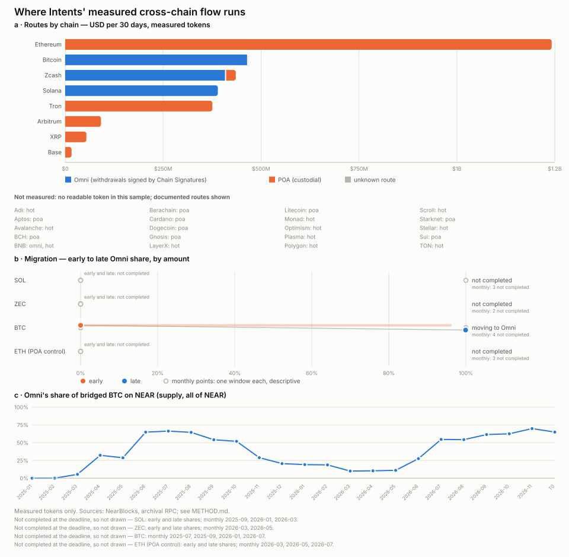
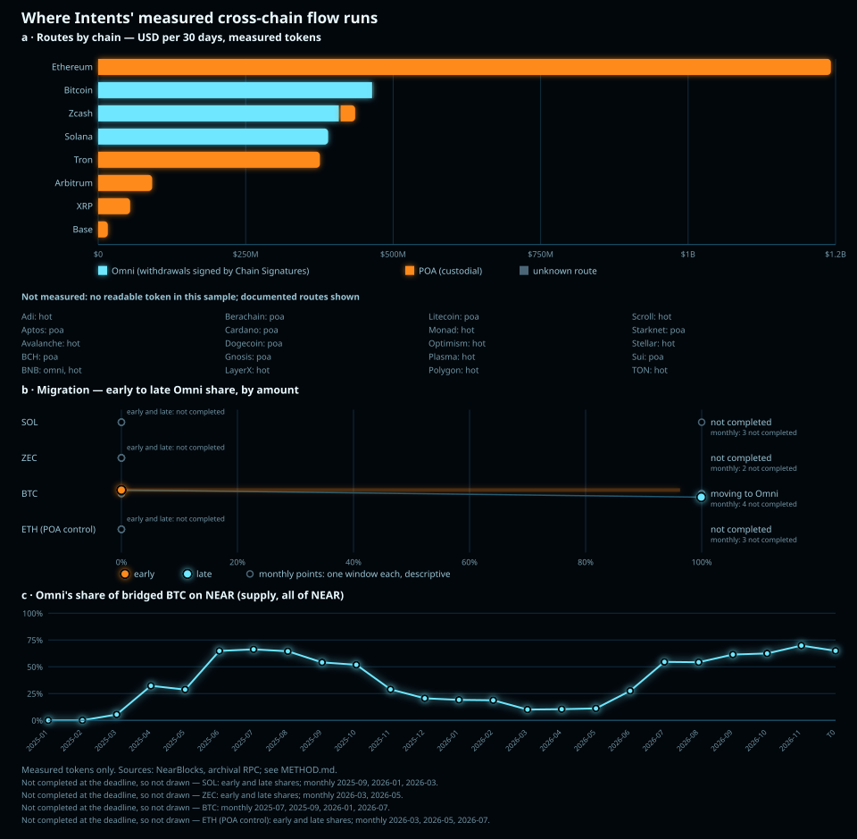
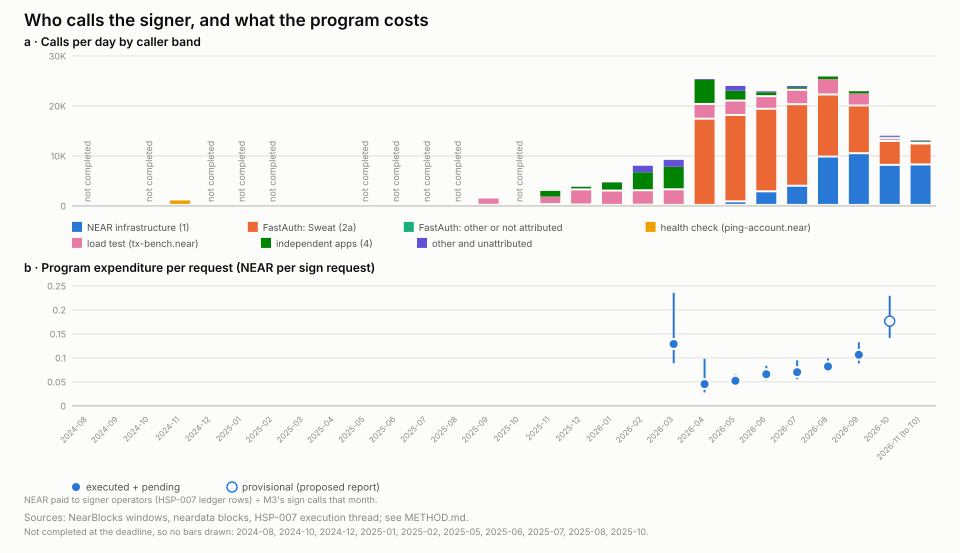
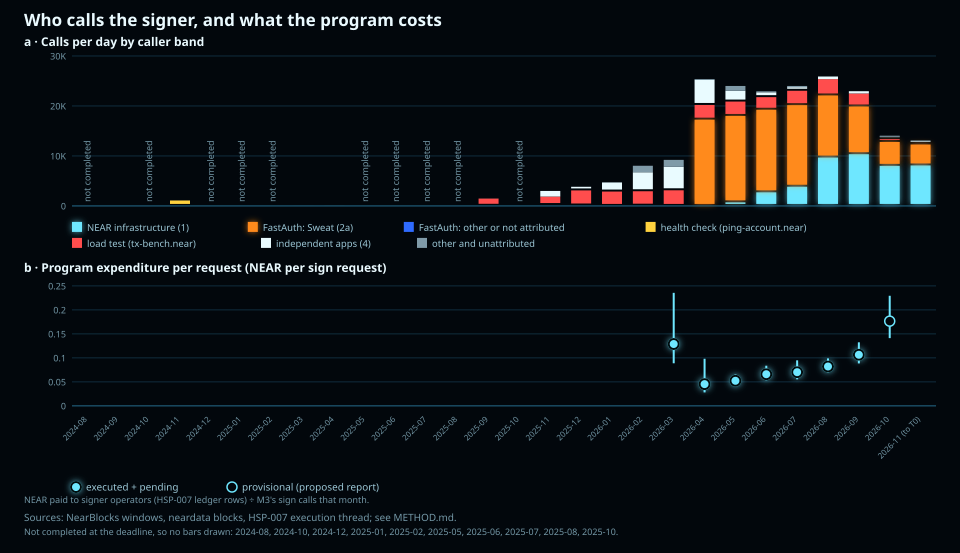

# After the first counted read

Status: the first counted read ran at 2026-11-13T11:00:30.160Z, through the gate (`publish/counted_read_gate.py`), on the supervisor's written go. All four steps ran and the gate logged DONE at 11:02:44.995Z. `THESIS.tmpl.md` is the stamped template again (the reviewer's ruling, route A2). The 11 sentences, the changes of presentation and the reviewer's round-1 fixes are in `THESIS.written.tmpl.md`, and `publish/written.py` fills `THESIS.md` from it; both are under review, and no reading changed. `POST-FREEZE.md` is stamped and is not edited again.
Last reconciled: 2026-11-14T20:00:21Z.
Known gaps:
- `out/published/tables.md` and the two charts are made by the stamped `publish/rule.py` and are not edited. The four notes the reviewer asked for beside them are in `TABLE-NOTES.md`: M8 is shown pooled (with the mainnet figures); October's M8 row; the "–" under main; the resolution audit's one transaction not read. The dashboard (`docs/index.html`) shows each note beside its table or chart.
- The three results files (`out/results.json`, `out/published/results.json`, `out/combined.json`) are not reproduced byte for byte: the order of one list, `M7/pairs`, changes from run to run (log, 12:42:30Z). Every reading in them is reproduced.
- The Explorer read (`THESIS.md` §4.8) cannot be repeated without a key: a reader can recompute every figure from the published sums (`explorer/data/blocks.jsonl`) and nothing before them. It covers one channel, sorts value by token and not by route, and places native BTC on the operator's label. The 1Click terms bar storing API data for more than 24 hours; only sums are kept, and whether sums count is not settled by the terms' text (`explorer/PLAN.md`, section 8).
- Counts that no placeholder carries are stated in words; `publish/check_thesis.py` derives each from the results, the HSP-007 ledger, the seed sweep, the saved audit lookups and the saved rows, and checks `THESIS.md` against them.
- The page's "Reproduce it" section says the re-pull (`verify.py check`) was not timed here: it has not been run since the counted read.
- `rederive/mc-seeds/` needs numpy; nothing else here does.
- Every receipt is now confirmed on Bitcoin (below). `POST-FREEZE.md`, stamped before that, still calls the deadline receipt pending; this file supersedes that line.
- METHOD §10 item 3 asks for outputs by 12:00Z Nov 13 (see `POST-FREEZE.md`). The outputs were done at 11:02:45Z, so there is no departure.

## Log

Every change after this record's stamp, with its time (UTC).

| UTC | What | Record |
|---|---|---|
| 2026-11-13T03:57:41Z | `postfreeze/MANIFEST-postfreeze.txt` written: 16 lines, the 14 files of the hash table in `POST-FREEZE.md`, that record itself and `deadline/MANIFEST-deadline.txt`; sha256 `36b8ad93de54032cb35ccc4626387ed7edeba716112c8b049d6505a82b784a62`. The template's byte copy, `postfreeze/THESIS.tmpl.md` (sha256 `758f3b997175449f1ce567c576ec808ec298e0349f38ca656341966dbdeaaee7`), written beside it | `postfreeze/` |
| 2026-11-13, 03:57:46Z to 03:57:51Z | The manifest submitted to OpenTimestamps (three calendars accepted it); its receipt, `postfreeze/MANIFEST-postfreeze.txt.ots`, sha256 `4fa5c89f14bcf1fced0b090ff268e4608bc8dff8fb62f0b90ba0ec8037d41f45`, written at 03:57:51Z. Pending Bitcoin confirmation | `postfreeze/` |
| 2026-11-13T03:58:22Z | The gate started, after the stamp, to act once at 11:00:30Z (gate sha256 `8edfb67b7bcd21d5d261f019c9c43c87393f4d04b8cff5a8d5fd4272c6e9873c`, as listed in the manifest) | The gate's log |
| 2026-11-13T03:59:46Z | The supervisor's written go: a file naming the manifest's sha256 and nothing else (the go file's sha256 `c9216b4214a32bcbab629b8bbe0f60104f8848c817fdb69856eeab128f609b9e`). Checked by the supervisor and by the thesis lead against the manifest: 128 files match | — |
| 2026-11-13T11:00:30.055Z | The gate checked the go: it names the manifest's sha256, and the 128 files of that manifest and the manifests it lists match disk | The gate's log |
| 2026-11-13T11:00:30.160Z | **The first counted read**: step 1, `publish/rule.py` on the counted rows | The gate's log |
| 2026-11-13T11:00:34.121Z | Step 1 done: 36 windows unfinished, 49 readings masked. Step 2: unfinished windows by family, index 2, migration 18, sign 16; no window has a completed line but fails the frozen gate, so the frozen gate's count equals the run's 36 | The gate's log; `out/` |
| 2026-11-13, 11:00:34Z to 11:02:41.625Z | Step 3, `publish/dest_audit.py`: 20 withdrawals picked by seed from the signature index's completed months (2026-02 and 2026-08 were not completed at the deadline), one keyless lookup each, 6 s apart. Bitcoin: 10 picked, 10 found, 10 confirmed, 10 spent from the signer's address. Zcash: the same, 10 of 10 each | `audit/dest-audit.md` (sha256 `de7c0b5aa1f85beec0566f3cd5baf0c713fa65ca7f3e0ba7956793d57db2f1c1`), `audit/dest-audit.json` (`138232b66a04a3272fd1fa3d920b2aeddaab9cd6cdf52d250e62b7ca8167a913`), `audit/raw/` (20 files) |
| 2026-11-13, 11:02:41.627Z to 11:02:44.995Z | Step 4, `rebuild.py --draft`: 64 placeholders filled, 11 sentences left to write; the extension did not run. Outputs: `out/combined.json` `f9477ebbb52fd0270cb500fd4e310469fa6a9ea84a0b226c68029af019dbcaec`; `out/published/results.json` `7611b84073b7a5034cf19c37fd600a8e7e5ba74fac7b1d6100ffdccf07e5debb`; `out/published/tables.md` `cd05cf5f0eec33295f6a5272e049d324ee715182cd9ee1e0d66ed44795afdd76`; the two published charts `0a5424c56b960983…37d9` and `12b606868d67ee19…b7ca`; the frozen command's own `out/results.json` `ee913cf034266afeaf0afea3fd4479f84efe8f0e95a851e15e7021f53505b6c7`; the draft `THESIS.md` `fd020a6fbee38d354c207dc3047dc0490e73eb1995871cf4e0ca05bb34f45d17`. The gate logged DONE | `out/`, `THESIS.md` |
| 2026-11-13T11:03Z | After the run, `postfreeze/MANIFEST-postfreeze.txt` still verifies: its 16 lines match disk | — |
| 2026-11-13, 11:07:47Z to 11:07:52Z | The two pending receipts are upgraded from their OpenTimestamps calendars, three Bitcoin branches each; the receipts as first written are kept beside them as `.ots.bak`. `deadline/MANIFEST-deadline.txt.ots`: `eeeb0891df407683142d1d26c517f9cf8111b95e9880e2b9bc9faf5f5dfaa8de` → `39853d9fc3e628462807b5c87ab9f85c167c6efa8db1c2ab9660872c839bb579`. `postfreeze/MANIFEST-postfreeze.txt.ots`: `4fa5c89f14bcf1fced0b090ff268e4608bc8dff8fb62f0b90ba0ec8037d41f45` → `a97f04885033bd7b11af9a035ae79af346a7e22431dce0e7e3e30f32a2b4cef4`. The two stage receipts were already confirmed and are not changed | `deadline/`, `postfreeze/` |
| 2026-11-13T11:08Z | Each receipt checked against Bitcoin's block headers (`collector/ots.py verify`; every merkle root matches). Earliest block: the deadline manifest, 975620 at 2026-11-13T02:26:51Z; the post-freeze manifest, 975631 at 2026-11-13T04:20:34Z, before the first counted read; stage 1 and stage 2, 975308 at 2026-11-10T14:41:27Z | — |
| 2026-11-13T11:27:41Z | `THESIS.md` first written from a working copy of the template kept outside the repo, before the ruling on where the sentences go; superseded at 11:41:41Z (below). It was: the 11 sentences between double angle brackets, and the text changes, filled from `out/combined.json` by `publish/fill.py`. Every number comes from a placeholder; the counts the page adds (tests met, windows read, chains by kind, audit clustering) are derived from `out/combined.json` by a script that first asserts each condition its wording rests on. No reading, threshold or stamped file changed. sha256 `b4bbce1f4e6d53800f0c62932bfd9fe1664b02db1b1e02930c2bdc9b0aabb564` (the draft it replaces: `fd020a6fbee38d354c207dc3047dc0490e73eb1995871cf4e0ca05bb34f45d17`) | `THESIS.md` |
| 2026-11-13T11:27:57Z | After the write, the 128 files of `postfreeze/MANIFEST-postfreeze.txt` and the manifests it lists still match disk, the template and its byte copy included | — |
| 2026-11-13T11:32:24Z | `preread/` added: byte copies of the supervisor session's pre-read folder, `HOLDER-READ.md` (`4574ab61bb7ae930db7c00673f013dbd282210112ed348def8ee60eff197e817`), `THESIS-b-SKETCH.copy.md` (`cf086a7b4a6c59c6cd835c57606436e5ddecdd6feee1da96a4978d3908ce0a37`), `MANIFEST-preread.txt` (`5e3bf62fa112a53a5395348f8b966652a8a915276e4dfe5e8e93a32b23e91cdd`) and its receipt `MANIFEST-preread.txt.ots` (`3e47d10790b38310943ba15f813408d355b7b567611a9101e9294da209f628a3`); `shasum -c` inside the folder passes. By the supervisor's record, the manifest was submitted to OpenTimestamps at 2026-11-13T05:46Z by the supervisor session, from a scratch copy of `collector/ots.py`, before the first counted read at 11:00:30.160Z. These files are outside the 128 files of the post-freeze manifest. The owner approved publishing them at 11:20Z on Nov 13 (relayed by the supervisor). None of the four is edited; `HOLDER-READ.md` keeps its stamped status line | `preread/` |
| 2026-11-13, 11:32:34Z to 11:32:36Z | `preread/MANIFEST-preread.txt.ots` upgraded from its three calendars: `3e47d10790b38310943ba15f813408d355b7b567611a9101e9294da209f628a3` → `f29feda5f6a77f90f50a5d2c7859b73fe24e72c1cccea0172c795243efe160e7`; the receipt as first written is kept beside it as `.ots.bak` | `preread/` |
| 2026-11-13T11:32:40Z | The pre-read receipt checked against Bitcoin's block headers (`collector/ots.py verify`; every merkle root matches): earliest block 975641 at 2026-11-13T07:25:27Z, before the first counted read; also 975643 at 07:38:00Z and 975645 at 07:56:01Z | — |
| 2026-11-13T11:37:55Z | `THESIS.tmpl.md` written, on the supervisor's ruling (option A): `758f3b997175449f1ce567c576ec808ec298e0349f38ca656341966dbdeaaee7` → `2bc4378c86679472b03e77efc32004efa190a0d3509ab8f28716394afa981765`. Superseded at 11:41:41Z: in the tests in `publish/`, which fill this template with synthetic results, it used the interval format on readings that carry lo and hi rather than L and U, and M7's share and delays, which the synthetic runs do not have | — |
| 2026-11-13T11:41:41Z | `THESIS.tmpl.md` restored from `postfreeze/THESIS.tmpl.md`, then written again: `758f3b997175449f1ce567c576ec808ec298e0349f38ca656341966dbdeaaee7` → `2f8d4577b0ef4eba524310ae357e8183d7f11943be017d9d93551ec88e56921c` (220 lines). The change is the planned writing of the 11 sentences plus the changes of presentation in the supervisor's brief, each listed under "THESIS.tmpl.md: what changed" below. `THESIS.md` filled from it by `publish/fill.py THESIS.tmpl.md out/combined.json THESIS.md --final`, the fill step of `rebuild.py`: `16dc413aa932afed6d00dd5a27103de2a1132288e732226e58ccc185e23aa629` (198 lines), the same page as the 11:37:55Z version | `THESIS.tmpl.md`, `THESIS.md` |
| 2026-11-13T11:41:41Z | `publish/check_thesis.py` added (`7495004080c26396193d9fe1d7b51d37aaf9d3a79c1bb05d77fa0aef2d471314`), outside every manifest. It derives the counts the page states in words from `out/combined.json`, asserts the conditions its wording rests on, and checks `THESIS.md`: 20 statements match | `publish/check_thesis.py` |
| 2026-11-13, 11:41:45Z to 11:43:26Z | `python3 -I -B -m unittest discover -s publish`: 59 tests, 3 fail. `test_the_rebuild_command_writes_the_same_page_offline` expects `rebuild.py` without `--draft` to stop while sentences remain to be written; `test_thesis_B_differs_from_A_only_where_the_rule_blanks_a_reading` expects the page of a masked synthetic run to differ from the unmasked one in exactly two lines; `test_a_flow_window_masks_the_route_counts_its_chain_and_the_mind_test` expects "Omni is the dominant route on" to be absent when the flow readings are masked, and the first screen and §2 now say it outside an "if completed" block | — |
| 2026-11-13T11:43Z | After the write: `postfreeze/MANIFEST-postfreeze.txt` verifies 15 of 16 lines, `THESIS.tmpl.md` the one that differs; the 112 lines of the deadline, stage-2 and stage-1 manifests all verify; `postfreeze/THESIS.tmpl.md` is unchanged. Superseded at 12:08:38Z (below) | — |
| 2026-11-13T11:59Z | `rederive/mc-seeds/` added: a byte copy of the re-deriving session's seed sweep (`sweep.py` `f60d95fc511e16057097f69de22d982324024a2f7e9b82c304ea57027a980b0c`, `sweep.json` `0b078f1a5fe3717b3bca80b8b4c22f58df32bfc2db5f7e933defa4056ea7b4e7`, seven modules under `vendor/`), checked file by file against the source folder. It is another session's independent code, not the frozen analysis code; it was run after the counted read, on 2026-11-13, by that session (the parent session of this work); it is not one of the 128 stamped files, and no test suite imports it. Run again here from the repo copy, 11:59:38Z to 11:59:50Z: the output is byte-identical to `sweep.json`. A three-line `README.md` was added beside it at 12:12Z | `rederive/mc-seeds/` |
| 2026-11-13T12:08:38Z | Route A2, the reviewer's ruling: `THESIS.tmpl.md` restored from `postfreeze/THESIS.tmpl.md` (`2f8d4577b0ef4eba524310ae357e8183d7f11943be017d9d93551ec88e56921c` → `758f3b997175449f1ce567c576ec808ec298e0349f38ca656341966dbdeaaee7`). The stamped template is not edited again | `THESIS.tmpl.md` |
| 2026-11-13T12:08:47Z | `THESIS.written.tmpl.md` written (`91e1046d787290f68c5fc07d3a457c528d051703960e2f59f9acb77b92ccd5a3`, 226 lines): the stamped template with the 11 sentences, the changes of presentation and the reviewer's round-1 fixes, each listed below. `publish/written.py` added (`451b358b0a7f6e6f9c0a4e6c4c895da5213f74299e7b9ceab6351da3b7195e0c`): it fills `THESIS.md` from the written template with the stamped `publish/fill.py` and `--final`, then runs `publish/check_thesis.py`. `THESIS.md`: `16dc413aa932afed6d00dd5a27103de2a1132288e732226e58ccc185e23aa629` → `86b18c7da0e8e4f17340d77ddf053fb90f3012c7f923778d0b416fc98ada7018` (204 lines). `out/` was not rebuilt and is unchanged | `THESIS.written.tmpl.md`, `publish/written.py`, `THESIS.md` |
| 2026-11-13T12:08:47Z | `publish/check_thesis.py` extended (`7495004080c26396193d9fe1d7b51d37aaf9d3a79c1bb05d77fa0aef2d471314` → `319385ee8fe56c1df695986cf027f0d50560c5ab8b511e2fce8cfae44f93482e`): it now takes the data folder, and also reads `out/results.json`, `inputs/hsp007-ledger.json`, `rederive/mc-seeds/sweep.json` and the saved rows through the frozen analysis code, which it imports and does not change. 28 statements match | `publish/check_thesis.py` |
| 2026-11-13T12:08:54Z | `postfreeze/MANIFEST-postfreeze.txt` verifies 16 of 16 lines, and the 112 lines of the deadline, stage-2 and stage-1 manifests all verify: 128 of 128 | — |
| 2026-11-13, 12:10:24Z to 12:12:00Z | `python3 -I -B -m unittest discover -s publish`: 59 tests, all pass | — |
| 2026-11-13T12:18:30Z | The reviewer's read of the page (nine notes) and the supervisor's Zcash sentence applied; each is listed below. `THESIS.written.tmpl.md`: `91e1046d787290f68c5fc07d3a457c528d051703960e2f59f9acb77b92ccd5a3` → `a071c7ed0a4a53cb7e31b338475cf64824242daa697cbd27757895ca1bd46cfb` (227 lines). `THESIS.md`: `86b18c7da0e8e4f17340d77ddf053fb90f3012c7f923778d0b416fc98ada7018` → `ffae1dd7ba6059e5498866099717db239350fd13cef5d37242f206fb3a6411e1` (205 lines). `publish/check_thesis.py`: `319385ee8fe56c1df695986cf027f0d50560c5ab8b511e2fce8cfae44f93482e` → `1eb85bf45ac9246b8706545f34576e6fad03241494775d9cc624e45e127a8767`; 25 statements match. `audit/zec-zero-rows-check.md` added (`c076018bfa4f537757b54b9faaab9ffc771bb660a4aa5409db78806207a4c278`), a byte copy of the note written at 11:07Z on the Zcash picks, as the source of the sentence on their inputs | `THESIS.written.tmpl.md`, `THESIS.md`, `audit/` |
| 2026-11-13T12:18:30Z | `publish/written.py` changed (`451b358b0a7f6e6f9c0a4e6c4c895da5213f74299e7b9ceab6351da3b7195e0c` → `cdef98f0aeb4ef47ab68b82d5d42faa569f74940145b18e7469490a26b26b78b`): it now replaces `THESIS.md` only after both checks pass, and otherwise exits non-zero and leaves the page as it was. The checks: no reading that a written line shows is masked, and `publish/check_thesis.py`. `publish/selftest_written.py` added (`deed83363459623e36130690fc8ba852d1380f0fb4f8e015ccea73a526313836`): it plants a wrong count and a masked reading (M9/p) and finds each caught, and it changes no file. Run at 12:18:30Z: 2 planted faults caught | `publish/` |
| 2026-11-13T12:18:30Z | How the counts stated in words are built (accepted by the supervisor): `check_thesis.py`'s `derive()` asserts each condition a sentence rests on before it gives the count; the page is checked after it is filled; a planted wrong count fails | `publish/check_thesis.py` |
| 2026-11-13T12:18:30Z | `postfreeze/MANIFEST-postfreeze.txt` verifies 16 of 16 after the write | — |
| 2026-11-13T12:25:57Z | The reviewer's review of `THESIS.md` `86b18c7d…` applied (round 3, items 1 to 5; each is listed below). `THESIS.written.tmpl.md`: `a071c7ed0a4a53cb7e31b338475cf64824242daa697cbd27757895ca1bd46cfb` → `b4c6d4a1d6c66192b216e0eb12e609a1c11b8f88f9d9cefef45d414f4c14cfbd` (227 lines). `THESIS.md`: `ffae1dd7ba6059e5498866099717db239350fd13cef5d37242f206fb3a6411e1` → `dafea9f578cd2f20789f012e83ce33ad611326028dd09cdb248dfa051f0f93fd` (205 lines). `THESIS.tmpl.md` is unchanged (`758f3b99…`), and so is `out/published/tables.md` (`cd05cf5f…`) | `THESIS.written.tmpl.md`, `THESIS.md` |
| 2026-11-13T12:25:57Z | `TABLE-NOTES.md` added at the repo root (`1cadd3685c88f6650e86209b508ce58b96fe43975361bf7c0751cc0c82e4d532`, 8 lines): four notes to read beside the tables and charts, which stamped code writes and which are therefore not edited. It is unstamped and outside `out/`, so a rebuild does not remove it. Its text is held in `publish/check_thesis.py` (`table_notes`), built from the results and the saved rows, and `publish/written.py` fails if the file differs from it. `THESIS.md` links it where `tables.md` is first cited (section 2) and in section 6 | `TABLE-NOTES.md` |
| 2026-11-13T12:25:57Z | `publish/check_thesis.py` changed (`1eb85bf45ac9246b8706545f34576e6fad03241494775d9cc624e45e127a8767` → `02d7ca540d3f15b4d64d999bb62fdbb684acc16ff14e675c665080a6874fea6a`): the reworded Zcash statement and the count of picks whose inputs all come from known addresses; the conditions under the two 3.5% intervals; mainnet June per request; the text and the check of `TABLE-NOTES.md`; `--notes` prints that text. 26 statements match. `publish/written.py`: its description names the new check (`cdef98f0aeb4ef47ab68b82d5d42faa569f74940145b18e7469490a26b26b78b` → `bfce89bcf3475091d41068b5c94939097ba3ecca7154da4878fd3e06b436b7de`); its code is unchanged | `publish/check_thesis.py`, `publish/written.py` |
| 2026-11-13T12:27:30Z | The stamp of the resolution-audit row below was an unfilled placeholder from 12:13:12Z until now (reviewer round 3, item 2); it now gives the time the row was first written. The same row said "the 20th" drew HTTP 429: the log's order does not show that (it is the sixth of the 20 rows in `nb/resolve.jsonl`), so the row now says "one" | — |
| 2026-11-13T12:33:11Z | `postfreeze/MANIFEST-postfreeze.txt` verifies 16 of 16 after the 12:25:57Z write | — |
| 2026-11-13, 12:31:24Z to 12:33:00Z | `python3 -I -B -m unittest discover -s publish`: 59 tests, all pass (a first run, 12:26:44Z to 12:28:18Z, exited 0 but its result line was not captured, so it was run again). `python3 -I -B -m unittest discover -s tests` was also run once, by mistake for the line above: 149 tests, 1 skipped, all pass, ended 12:26:27Z. `publish/selftest_written.py`: 2 planted faults caught | — |
| 2026-11-13T12:46:21Z | The judge-facing pieces (the supervisor's R4-h), all new and unstamped. `publish/dashboard.py` (`30d617e513242e776a836b5e3cc4005fa1e0f739a528b079017616f266123504`) writes `docs/index.html` (`afa5adfbfac4f24639ae2f3bcb72f9c25ccff104263c707ba62a8564ec515dd6`) and byte copies of the two published charts: the five tests and the answer lifted from `THESIS.md`, the 28 chains one by one from `M1`'s rows, each chart with its query and one sentence, and each note of `TABLE-NOTES.md` beside its chart. Every figure on it is read from `out/combined.json` with `publish/fill.py`'s formatter; a reading not completed stops the build. `publish/written.py` (`bfce89bcf3475091d41068b5c94939097ba3ecca7154da4878fd3e06b436b7de` → `118c4a8e2d6498f5be33bf92b6fae2101e2dabe738805f752154416648dfffb0`) now prepares the dashboard before it writes anything and writes `docs/` after `THESIS.md`; its last line is still the page's sha256, as the page says. `THESIS.md` is unchanged (`dafea9f578cd2f20789f012e83ce33ad611326028dd09cdb248dfa051f0f93fd`) | `publish/dashboard.py`, `publish/written.py`, `docs/` |
| 2026-11-13T12:46:21Z | `README.md` (draft: where the saved rows live, the licence, the note on AI and the sister entry are still to fill), `JUDGES.md` (`34924cda9b4437320d9922a6b84ee04251917a0444ed4c91430e42712d5d5d16`), `.gitignore` and `publish/same_out.py` (`8fee208a1887949895ab5f0965c5ecbf2e2f82d7b84356bfa54c7b2ecb0ce5d0`) added | `README.md`, `JUDGES.md`, `.gitignore`, `publish/same_out.py` |
| 2026-11-13, 12:42:26Z to 12:44:47Z | Fresh-copy proof, twice: every file here except caches was copied to an empty folder, `out/`, `docs/` and `THESIS.md` were deleted there, and the two commands were run, first on the whole data folder and then on only the files the commands open (`nb/pages`, `nb/txns`, `nb/RESOLVED`, `nb/resolve.jsonl`, `nb/windows.jsonl`, `nd/DONE`, `nd/blocks.jsonl`, `rpc/DONE`, `rpc/operators.jsonl`, `rpc/supply.jsonl`: 773 files, 15 MB). Both times `THESIS.md`, `docs/`, both `tables.md` and all four chart files came out the same bytes as here. A `git clone` proof waits for the first commit | — |
| 2026-11-13T12:42:30Z | Found in that proof: `out/results.json`, `out/published/results.json` and `out/combined.json` get a different sha256 on every run. The frozen `analysis/neardata.py` builds the list `M7/pairs` (252 rows) by looping over a set of strings, and Python orders such a set by a hash seeded anew for each process (`-I` ignores `PYTHONHASHSEED`). The rows are the same set; with that list sorted the files are equal; `M7`'s readings use only the median, the maximum and counts, which do not depend on the order. So the sha256 values logged above for these three files at 11:02:44.995Z identify that run's files and will not be reproduced; `tables.md`, the charts, `THESIS.md` and `docs/` are reproduced byte for byte. `publish/same_out.py` compares two `out/` folders on that basis. The frozen file is not changed | `publish/same_out.py` |
| 2026-11-13T13:01:14Z | The NearBlocks terms read (one request, the terms page only): `GET https://nearblocks.io/terms-and-conditions` returned HTTP 403 with a Cloudflare challenge. It was not retried and nothing was done to get past it. No clause was read, so whether the saved NearBlocks pages may ship in this repo is not settled; it is with the owner | — |
| 2026-11-13T13:06:19Z | A cold read of `docs/index.html`, `JUDGES.md`, `README.md` and `TABLE-NOTES.md` by a separate reviewer (220 numerals on the dashboard traced to the results, none untraced) and the fixes taken from it: "128 files" corrected to 128 manifest lines for 92 distinct files (the stage-2 manifest lists the stage-1 files again, and three lines are manifests); the claim's sentence is said to be stamped after the sample was collected and before it was first read, not "before the data"; two query descriptions on the dashboard now follow `METHOD.md` M10 and the sampler's paging; note 3 of `TABLE-NOTES.md` says what the dash means without calling the reading sound. Now: `docs/index.html` `30646f7493cd1adf560d7fbdbedbc9a643b73839dd614256c037212821f2d8b9`, `publish/dashboard.py` `82af6f1a5f4002ca88387a25857304915b68319cf8645bd4976abd089b488f5f`, `publish/check_thesis.py` `85792fd533a1fa85e325a55a5566f4abae43d5dae72e9fef4d5abfcdab381eb0`, `TABLE-NOTES.md` `3dc82e0ecf63dffe94f0645da4d01a600ab3923a4202564273ee0311553f9499`, `JUDGES.md` `d19bd1d0b202cf975ba7906fc763365b176c588c1d41d44d35c7372ac6e1c12e`. `THESIS.md` is unchanged (`dafea9f578cd2f20789f012e83ce33ad611326028dd09cdb248dfa051f0f93fd`) | `docs/`, `JUDGES.md`, `README.md`, `TABLE-NOTES.md`, `publish/dashboard.py`, `publish/check_thesis.py` |
| 2026-11-13, 13:03:17Z to 13:05:12Z | The fresh-copy proof again, without the three `deadline/` copies that `POST-FREEZE.md` holds back, following the README's own steps on only the files the commands open: `THESIS.md`, `docs/`, the tables and the charts byte-equal; `publish/same_out.py` ok; `postfreeze/MANIFEST-postfreeze.txt` 16 of 16; `tests/` 149 pass (1 skipped). `publish/` 58 of 59: the stamped `test_gate.py` `test_the_real_chain_verifies` checks `deadline/MANIFEST-deadline.txt` against disk and reports the three held-back files missing. With them present it is 59 of 59 (12:33:00Z). `README.md` and `JUDGES.md` say so. Whether the three copies are published is with the owner; `.gitignore` lists them until then | `README.md`, `JUDGES.md`, `.gitignore` |
| 2026-11-11T20:40:54Z (logged 2026-11-13T12:13:12Z) | The resolution audit (reviewer round 1, finding 3): 20 transactions were drawn; 19 were read whole and 0 differ; one drew HTTP 429 on 2026-11-11 and was not requested again. It is `6gXczJpg5zbZCDnVa7yPCQ1ruivARq5QQsMoAdXqBNy6`, in window `40b3222ed992` (`nb/resolve.jsonl` in the data folder). `out/published/tables.md` says "19 transactions read whole, 0 differ" and does not say a 20th was drawn | — |
| 2026-11-13T13:24:26Z | When the two Nov 10 manifests were submitted, recorded here because the page now states it (cold read, M1). The receipts as first written keep their file times on this machine: the stage-1 receipt, `frozen/MANIFEST-stage1.txt.ots.bak`, was written at 2026-11-10T11:51:41Z, and the stage-2 one, `frozen/MANIFEST-stage2.txt.ots.bak`, at 2026-11-10T13:04:50Z; the lead's hand-over note of that day records 11:51:41Z, 13:04:51Z and the start of the counted run at 11:52:19Z. A clone does not keep file times, so these two times are this entry's own record. What anyone can verify is the Bitcoin block that holds both hashes, 975308 at 14:41:27Z that day (above), which is after collection began at 11:52Z | — |
| 2026-11-13T13:46:31Z | A term corrected. The rows above of 11:00:30.055Z and 11:27:57Z say "the 128 files" of the manifests, and the row of 13:06:19Z says "92 distinct files". The four manifests have 128 lines for 95 distinct paths: 92 files, and 3 manifests that another manifest lists. The earlier rows are left as written | — |
| 2026-11-13, to 13:29:40Z (logged 2026-11-13T13:46:31Z) | A cold read of `THESIS.md` by a separate reader given the page and nothing else, and the reviewer's triage of it: 7 items that must change and 10 that should (listed below under "what changed"). Every one is a sentence in `THESIS.written.tmpl.md`; no reading, threshold or stamped file changed. `publish/check_thesis.py` now also derives and checks each count the new sentences state (the three found values of tests 1 to 3; the 3.4-point gap and its two ends; the two supply shares; the early Bitcoin sample; the ratio of calls leaving out tests and Sweat; the split 1 + 2 + 5 of the 8 chains; October's calls; the 150 blocks a month): 35 statements match. After the write: `THESIS.md` `2a64d1bd08c2da24dfa399872352957afd3d7bfb12bf9308b9677d21234a06de`, the template `2731287519c2875897205c4950d9488b8b0676d206eea2a78e6635913c9960c3`; `python3 -I -B -m unittest discover -s publish` ran 59 tests, all passing, 13:26:42Z to 13:28:15Z; `postfreeze/MANIFEST-postfreeze.txt` 16 of 16; `selftest_written.py` caught both planted faults | — |
| 2026-11-13 (logged 2026-11-13T13:46:31Z) | Two statements of fact corrected while writing the timeline. (1) Earlier versions of the page said the Nov 10 hashes were timestamped on Bitcoin before the first counted call. The Bitcoin block that holds them is of 14:41:27Z, after collection began at 11:52Z; what came before collection is the submission of the first hash to the calendars at 11:51Z, which is this entry's own record (row of 13:24:26Z). The page now says exactly that on its first screen, under "Pre-registered" and under "What would change my mind". (2) The page said Intents listed 39 chains on Nov 9; `METHOD.md` (M1) has that count from NearStats' summary feed, and the page now attributes it so | — |
| 2026-11-13 (logged 2026-11-13T13:46:31Z) | `publish/written.py`: `masked_in_written_lines` now treats a placeholder whose path runs on below a masked reading as masked. The new sentences use such paths (`M9/p/reading_L/boot/0`), and with the self-test's planted mask the stamped `fill.resolve` raised an error on them instead of reporting the mask, so `selftest_written.py` stopped. It runs again and catches both planted faults. No stamped file changed | — |
| 2026-11-13 (logged 2026-11-13T13:46:31Z) | `TABLE-NOTES.md`, note 5 (May and July 2026 show the same calls figure), written on the reviewer's ruling with the count it asked for. Of the 198 `sign` windows, 182 have saved pages (16 were not started): 253 pages. In no page are the rows out of time order, and in none of the 71 steps from one page of a window to the next is the next page's newest row newer than the page before's oldest. Each of the two months has six 60-second windows holding 100 calls in all, and every window's last page reaches past the window's start. `check_thesis.py` recounts all of this from the saved pages. `TABLE-NOTES.md` `a560bd6ed713f389ca0e78a2930497f347c91ba45150b40a7b0e1ef952eea21a` | — |
| 2026-11-13 (logged 2026-11-13T13:46:31Z) | The dashboard, `README.md` and `JUDGES.md` follow the page's new first screen. `publish/dashboard.py` lifts "What was fixed, and when" and the five tests in their two groups from `THESIS.md`, and places note 5 beside the panel it concerns. The page was rendered in headless Chrome and looked at, at 1200 px and 500 px wide, in the dark palette (this machine's setting) and, in a copy with the dark block switched off, in the light one. `README.md` is rewritten: the answer and the dated timeline as the page has them; what the track's prompt asks for and how each item is met or done differently; the six files that are the same bytes on every run, with their sha256; what the `deadline/` manifest check prints in a clone; who and what made the entry (the author's own wording is still to come). `JUDGES.md` gains the rows for `same_out.py` and the two manifest checks and the paragraph on the three results files | — |
| 2026-11-13, 13:35:14Z to 13:37:13Z | The fresh-copy proof on this version, in a copy without the three `deadline/` files that are held back, rebuilt from the 773 saved files the two commands open: `THESIS.md` (`2a64d1bd…`), `docs/`, the tables and the charts byte-equal; `same_out.py` ok; manifests 16 of 16, 75 of 75, 33 of 33 and 2 of 2; `tests/` 149 pass (1 skipped); `publish/` 58 of 59, the one failure being `test_the_real_chain_verifies` on the three files held back | — |
| 2026-11-13T13:25Z (logged 2026-11-13T13:46:31Z) | The saved rows. The author read NearBlocks' terms page in his own browser (13:20Z) and ruled at 13:25Z, as the reviewer recorded it: the saved rows are published with the entry, as the sample behind its numbers. This settles the row of 13:01:14Z | — |
| 2026-11-13, 13:40Z to 13:43Z (logged 2026-11-13T13:46:31Z) | `data/` added: the 773 files the two commands open (746 NearBlocks pages in 491 window folders, 19 transactions read whole, the collector's ledger, 3,951 neardata blocks, the RPC answers), copied byte for byte from the collection folder; `data/README.md` (what each file is, the credit to NearBlocks, the line on removal at its request); `data/MANIFEST-data.txt` (773 sha256 lines; written now, not timestamped). The 773 files were searched for a local path, the user's name, an e-mail address and key-like words: none. "Reproduce it" in the page, the dashboard, `README.md` and `JUDGES.md` now name `data` where they said `<data_dir>`, so the commands run as typed in a clone. After the write: `THESIS.md` `0f4b9e5d453eb428dbea485b32d7d948b63e1636e6e538ecf67fa1c1d4fc44f0`, the template `a3d3040081553c0b11c09a5eefaafce1f9df2b593ade4309ae2f89328dc9674c`, `docs/index.html` `893975ac2c05002baefc8587ac25354b96841f69123271a3ea23905e1864dc88`; the three changed lines of the page are the comment under the title, the first sentence of "Reproduce it" and its three commands | `data/` |
| 2026-11-13 (logged 2026-11-13T13:46:31Z) | What the first commit leaves out, and why (`.gitignore`): Python caches; the five `.ots.bak` files, which are the receipts as first returned by the calendars and which no manifest lists (the `.ots` files beside them carry the Bitcoin blocks); and, until the author rules, the three `deadline/` files of the row of 13:03:17Z. `extension/` stays in: the stamped `publish/test_publish.py` imports its merge step, and a copy without that folder runs 31 of the 59 tests (seen at 13:44Z, in a copy built from a list that left it out) | — |
| 2026-11-13, 13:45:40Z to 13:47:57Z (logged 2026-11-13T13:48:31Z) | The README's steps, as typed, in a copy holding exactly the files proposed for the first commit (942 files: the 773 saved rows, their README and sha256 list, and 167 others; without the three `deadline/` files held back). `rebuild.py data --draft` and `publish/written.py data` exit 0; `THESIS.md` (`0f4b9e5d…`), `docs/`, `TABLE-NOTES.md`, the tables and the charts are the same bytes as here; `same_out.py` ok; manifests 16 of 16, 75 of 75, 33 of 33, 2 of 2 and, for the rows, 773 of 773; `selftest_written.py` catches both planted faults; `tests/` 149 pass (1 skipped); `publish/` 58 of 59, the one failure being `test_the_real_chain_verifies` on the three files held back. The copy was made before the rows of 2026-11-13T13:48Z and 13:46:31Z were added to this file; no command reads them | — |
| 2026-11-13T14:13:33Z | A ruling reversed. `POST-FREEZE.md` (stamped) says the three copies under `deadline/` (`POST-FREEZE.md`, `deadline_stop.py`, `test_deadline_stop.py`) are held back, because they carry a local path, a process id and a first name. The author has now ruled to publish them, in his words: "go with recommendation" (his answer, at about 13:32Z on Nov 13, to the senior reviewer, who had recommended publishing them; that reviewer passed the answer on at 14:08Z). With them in the repo `deadline/MANIFEST-deadline.txt` checks 4 of 4 and the stamped `test_the_real_chain_verifies` passes, so `publish/` runs 59 of 59 in a clone. The three files are published as stamped; `README.md`, `JUDGES.md` and one sentence of "Reproduce it" say so | `deadline/` |
| 2026-11-13T14:14:01Z | The author's answers of about 13:32Z, passed on by the senior reviewer at 14:08Z, placed in `README.md`. The licence, in his words "yes, carry my name": MIT, with the copyright line in his name (`LICENSE`, new). Whether the paragraph on AI assistance names a second tool, "no": it names Claude Code and denies nothing. The other entry's name, "for now, go with Boomerang": named once, with its link. Hosting the dashboard, "yes but we'll deal with that later": nothing is hosted yet. The three placeholders in `README.md` are gone | `README.md`, `LICENSE` |
| 2026-11-13T14:18:19Z | A second cold read by a reader who had only the page (the senior reviewer's, on the page of 13:49Z, ten points C1 to C10, each checked by that reviewer against `METHOD.md` and `DEVIATIONS.md`). All ten taken, C2 in part. C1: how Bitcoin's interval is built, by the frozen rule (METHOD, sections 4 and 7), and its coverage in the frozen replays (`DEVIATIONS.md`: 30 of 40), said where the interval first appears and under "Evidence against". C2: what "narrow" rests on, and that on value the sample cannot tell; the first sentence is unchanged. C3: what the pilot had already shown, and that all five tests are one-sided. C4: the repository's address and what it needs. C5: "not a rounding error" dropped. C6: the effective windows behind the POA chains' upper ends (between one and three, checked by the writer from each upper end) beside the windows read. C7: tests 1 to 4 are far from their thresholds and test 5 is not. C8: with Solana and Zcash counted as dominant the count is still under the 5 needed. C9: the "Needed" lines are the tests in short. C10: FastAuth, NEAR's own infrastructure and HOT defined. Also: the fall of the BTC supply share in March 2026 and the gap against NearStats' volume are listed under "Evidence against"; the stamp times stay on the first screen and three later places point there. No reading changed | `THESIS.written.tmpl.md`, `THESIS.md`, `docs/` |
| 2026-11-13T14:18:19Z | "Before any result was read" now reads "before any counted result was read", on the page, in `README.md` and in `JUDGES.md` (the senior reviewer's point: the page also says the claim and tests were written after an uncounted pilot) | `THESIS.written.tmpl.md`, `README.md`, `JUDGES.md` |
| 2026-11-13T14:18:19Z | A correction of fact. The first screen said the signer's operators are paid "from emissions (newly issued NEAR)". HSP-007 says the funding is "sourced from protocol emissions held in `treasury.near`", and the protocol's reward rate to the treasury is zero today (RPC `EXPERIMENTAL_protocol_config`, `protocol_reward_rate` [0, 1], read Nov 13), so the payouts are NEAR already minted and add nothing to total supply. The first screen now says so. The holder's read, stamped before the first read, says "a cost that holders carry through dilution"; it is quoted as stamped and the page corrects that word beside it. Found by an independent re-derivation; no reading or test changes | `THESIS.written.tmpl.md`, `THESIS.md` |
| 2026-11-13T14:18:19Z | `JUDGES.md`, the row on originality: it now leads with what is measured that public dashboards do not show. A check of the other entries and of public dashboards on Nov 13 found fixing tests in advance to be common, and found no measure of route share, of the apps behind the signer's calls, or of cost per signature | `JUDGES.md` |
| 2026-11-13T14:34:03Z | The senior reviewer's two notes on the page of 14:18Z, both taken. (a) The correction on how the signer's operators are funded now also says that holders were diluted when that NEAR was emitted to the treasury, by HSP-007's own description ("protocol emissions held in `treasury.near`"), and that the programme adds no further supply; without it "not new issuance" could be read as "no cost to holders". (b) Where Bitcoin's interval is called the weakest by coverage, the page now says the printed 90-day interval rests on twelve windows of the Omni token (six in the claim window, six outside; `frozen/instants.json`, checked by the writer) and that the replays were run at six only. No reading changed | `THESIS.written.tmpl.md`, `THESIS.md`, `docs/` |
| 2026-11-13T14:34:03Z | `README.md`, the row on `deadline/`: it now says in plain words that the timer and its test read the author's own folders by absolute path and are a record, not something to run from a copy (the senior reviewer's point; checked: neither test command, nor a bare `python3 -m unittest discover` from the root, finds that test) | `README.md` |
| 2026-11-13T14:34:03Z | `registry/BRIEF-callers.md`, a worker's brief for the caller lookups, is left out of the published files (`.gitignore`): no manifest lists it, nothing reads it and no number traces to it. The three source files it produced stay | `.gitignore` |
| 2026-11-13T14:41:45Z | The author's answers to the open decisions of the ground-up audit, typed to the lead at about 14:40Z, in his words: "go with recommendations"; "decision 4: don't worry about nearblocks at all"; "decision 7, we'll figure that out later". As acted on: the entry stays on its question; the first screen is rebuilt around the holder's read; a labelled layer written after the read is added and stamped before it is published (a line of scale, three dated next reads, the Intents SDK's list of tokens it sends through Omni); a captioned video and a draft post are made for him to approve. Decision 4 is read as: no further call to NearBlocks, so the drafted extension pass is not run, SOL and ZEC stay "not completed", and the re-pull stays untimed. The disclosure paragraph is untouched | — |
| 2026-11-13T14:41:45Z | A wording error found by the independent re-derivation: the page said "10 to 20 windows were read on each of these tokens". The 10 to 20 is per reading, not per token (Arbitrum's reading joins two tokens of 10 windows each; each of these tokens has 10 or 12). Now "each of these readings rests on 10 to 20 windows". No reading changed | `THESIS.written.tmpl.md`, `THESIS.md`, `docs/` |
| 2026-11-13T14:41:45Z | `README.md`, step 7: the re-pull is said to be optional and not run since the collection ended | `README.md` |
| 2026-11-13T14:53:11Z | The first screen of the write-up is rebuilt around what a NEAR holder reads (the author's ruling of about 14:40Z, above). Its lead is now "Narrow today, and the next reads are dated.", followed by five points: Bitcoin, beyond Bitcoin, the call count, the cost, and what a holder watches next. As `preread/HOLDER-READ.md` requires, the first sentence still says the claim held on breadth, and the first screen still names the five tests, gives their count and keeps the line on windows read. The paragraph that began "For a NEAR holder, the read written before" is no longer on the first screen; its content stays in "For a NEAR holder". No reading changed. | `THESIS.written.tmpl.md`, `THESIS.md`, `docs/` |
| 2026-11-13T14:53:11Z | An "after the read" layer is added (same ruling): `afterread/NEXT-READS.md` holds the scale of the cost, three dated next reads with the threshold each has to clear and this entry's expectation, and a source found after the read; `inputs/chain-params.json` holds the supply and inflation figures behind the scale line, as FastNEAR's public RPC returned them at 14:00:15Z. Both are listed in `afterread/MANIFEST-afterread.txt`, which was submitted to three OpenTimestamps calendars at 14:51:54Z; its receipt is pending until Bitcoin confirms it. The stamp supports no result. It shows the expectations were written before the readings they are about exist. The thresholds are the frozen ones (tests 3 and 4, and the method's rule for a dominant route); the expectations are judgement. The file was written by a script kept outside this repo, and the writer of the page requires each figure the page repeats to appear in it. | `afterread/`, `inputs/chain-params.json` |
| 2026-11-13T14:53:11Z | The scale line: on the first screen, the cost point now says that at October's proposed payout the programme runs at 922,374.24 NEAR a year, equal to 2.8% of the most NEAR the protocol can issue in a year. It is worded as a comparison of scale, not a share of issuance, because HSP-007 pays from NEAR already emitted. The line is marked "written after the read". | `THESIS.written.tmpl.md`, `THESIS.md`, `docs/` |
| 2026-11-13T14:53:11Z | A source found after the read is named in three places (the first screen, "What holds for NEAR's side" and "Evidence against this reading"): the Intents team's SDK lists 17 tokens it treats as Omni, 12 of them on Solana, with Zcash's, and no EVM, Tron or XRP token (github.com/defuse-protocol/sdk-monorepo at `930d2816`). It is described as a list in code, not a measurement of flow. No frozen test result changes and nothing was re-run. A check made after the read, outside this repo, found the list could not have changed a route label: labels come from the counterparties of Intents' own legs, not from token names. | `THESIS.written.tmpl.md`, `THESIS.md`, `afterread/NEXT-READS.md` |
| 2026-11-13T14:53:11Z | "For a NEAR holder" gains "What to watch, and when": the three next reads in one line each, with the sentence on what they add up to. The dashboard shows the same three under the five tests. | `THESIS.written.tmpl.md`, `THESIS.md`, `docs/`, `publish/dashboard.py` |
| 2026-11-13T14:53:11Z | Repetition cut: the 3.4-point gap, the two interval ends and the two supply figures were each stated in more places than needed. "Evidence against this reading" now points to section 4 for them. The checker's expected counts follow: the gap with its two ends 3 to 2, "a 3.4-point gap between two intervals" 2 to 1, the two supply figures 2 to 1. Each is still required on the page. | `THESIS.written.tmpl.md`, `THESIS.md`, `publish/check_thesis.py` |
| 2026-11-13T14:53:11Z | A second correction to the same sentence of section 2, again from the independent re-derivation: "each of these readings rests on 10 to 20 windows" did not say what a reading is, and a reader counting by chain gets 32 for Ethereum. The five chains have six readings, one for each chain's dollar tokens or its own coin; Ethereum has both (12 windows for ETH, 20 for its dollar tokens). The sentence now says so, and the writer requires six readings on five chains. The upper ends, 73.1% to 94.0%, and the 10 to 20 are unchanged. | `THESIS.written.tmpl.md`, `THESIS.md` |
| 2026-11-13T14:53:11Z | A wrong licence corrected. The page and `README.md` said "NearStats figures are CC BY 4.0". Read at nearstats.org on Nov 13, that licence covers NearStats' integrators feed, which this entry does not use; the summary feed it does use is described there as free, with attribution appreciated. The sources sentence and the credit line now say "free to use with attribution (nearstats.org)". The Disclosure paragraph above the credit line is unchanged, byte for byte. | `THESIS.written.tmpl.md`, `THESIS.md`, `README.md` |
| 2026-11-13T14:53:11Z | `publish/dashboard.py` now lifts the lead's five points and the three next reads from `THESIS.md`. The first build after the rewrite stopped, as it should: the builder looked for the old lead's exact opening and did not find it. It was changed to find the lead as it now stands and to require the five points and the three reads. | `publish/dashboard.py`, `docs/` |
| 2026-11-13T14:53:11Z | `README.md` and `JUDGES.md`: a line on the dated next reads, a check of `afterread/MANIFEST-afterread.txt`, an `afterread/` row, and a paragraph on what that stamp does and does not show. | `README.md`, `JUDGES.md` |
| 2026-11-13T15:01:33Z | The senior reviewer's read of the rebuilt first screen, five wording changes, all taken. (a) The lead now says in so many words that the claim held on breadth, because `preread/HOLDER-READ.md` promised the first sentence would say so if tests 1 and 2 were both not met: "Narrow today: the claim held on breadth. The next reads are dated." (b) The paragraph under the five points gives the count the same file promised: "none was met and none is undecided". (c) "On Bitcoin the signer carries the flow" became "On Bitcoin the flow runs on the signer's bridge": the signer signs withdrawals only (section 3). (d) The scale line says on the page itself that it is a comparison of size, not a share of issuance. (e) "no lower than in July" became "by the frozen test it did not fall from July": the monthly intervals overlap, so a rise is not established (section 5). No reading changed. | `THESIS.written.tmpl.md`, `THESIS.md`, `docs/` |
| 2026-11-13T17:12:37Z | The author's ruling, in his words: "don't put not completed on them" (SOL and ZEC). Asked what he meant, with the note that the timestamped rule prints those words in the tables, both charts and the table of section 4, he chose to have the lead's own sentences reworded and the stamped tables and charts left as they are. So four sentences of the write-up, one of the dashboard and one of `JUDGES.md` no longer call SOL and ZEC "not completed": they say the before-and-after comparison could not be made, because windows it rests on did not finish before the deadline. The frozen reading is unchanged: `M10`'s verdict for SOL, ZEC and the ETH control is still the frozen code's word, "not completed", and it still stands in `out/published/tables.md`, in both charts and in the table of section 4, whose cells the timestamped fill step prints. No call to NearBlocks was made and no window was re-read. | `THESIS.written.tmpl.md`, `THESIS.md`, `docs/`, `publish/dashboard.py`, `JUDGES.md` |
| 2026-11-13T17:16:00Z | The receipt for `afterread/MANIFEST-afterread.txt` was upgraded: one calendar's branch now ends in Bitcoin block 975691 (time 2026-11-13T15:06:32Z), and `collector/ots.py verify` prints `"merkle_root_matches": true` for it. The other two calendars had not answered yet. The receipt before the upgrade is kept beside it as `.ots.bak`, outside the published list. `README.md` now gives the block. | `afterread/MANIFEST-afterread.txt.ots`, `README.md` |
| 2026-11-13T17:28:06Z | The second implementation is placed in `rederive/`, on the author's ruling, in his words: "i think we should go with option 2, just we need to document and explain properly and in a good flow so that it goes with everything while also not looking out of place, but rather boosting our thesis and giving us points, etc, so ideate towards that on how we can do that properly" (option 2 was to ship the whole re-derivation: its code and a one-command comparison). It was written and run after the first counted read by other AI sessions, which were given `METHOD.md`, `DEVIATIONS.md` and the saved rows and told not to read the analysis code or any result; `rederive/README.md` says what rests on those instructions and what a reader can verify. 59 files were added (a sha256 list of them was checked 59 of 59 before and after the copy); `rederive/mc-seeds/`, already here, is byte for byte unchanged. From a clone it compares 570 numbers: 553 agree, 9 need a source file this repository does not ship, 6 are not recomputed and 2 differ, both explained (the census counted outside the windows' segments). Its tolerance for bootstrap ends was set after the first comparison, and its README says so. It changes no reading and no test. The page gains one paragraph after the dated list ("Checked again after the read"), one command in "Reproduce it", and the words "the second implementation" where it said "the optional study"; `README.md` and `JUDGES.md` gain its command and description; `.gitignore` leaves out the working files its command rebuilds. | `rederive/`, `THESIS.written.tmpl.md`, `THESIS.md`, `README.md`, `JUDGES.md`, `.gitignore` |
| 2026-11-13T17:41:10Z | `README.md`: the address of the author's other entry is now https://github.com/bchowdar00/boomerang. The repository was renamed on GitHub (seen there at 17:08:11Z; the old address redirects to it), and the author's word on the name is "Keep boomerang". | `README.md` |
| 2026-11-13T21:55:55Z | `README.md` step 5 and `JUDGES.md`: the stated result of the `tests/` suite was wrong for a clone. Both said `Ran 149 tests`, `OK (skipped=1)`, which is what the author's machine prints. Run with an empty home folder, as a clone is, the suite ends `FAILED (errors=2, skipped=2)`: two frozen tests (`tests/test_collector.py` lines 307 and 408) read a draft pilot file from a data folder under the home folder, which `DEVIATIONS.md` ("Stale text in stage-1 files") already records. Found while listing where local paths appear in the published files; every earlier fresh-copy proof ran with the author's home folder, so none could catch it. Both files now give a command that puts the shipped copy of that file (`tests/fixtures/stage1-local/rates-plan-draft.json`, same sha256) in a temporary home folder and state the result with it, `OK (skipped=2)`, and the result without it. Checked in a copy of the repository with an empty home folder: the other steps (`rebuild.py`, `publish/written.py`, `publish/selftest_written.py`, the `publish/` tests, `rederive/run.py`) print what the two files say. No frozen file, test or result changed. | `README.md`, `JUDGES.md` |
| 2026-11-13T22:30:18Z | `THESIS.md` is in a new order, on the author's word ("lets go depth B", given to the reviewing session at about 22:14Z and passed on by it), after he asked for the page to be set out as published research is. What changed: an author line; a Summary with one table of the five tests (T1 to T5, in the order they were stamped) in place of the two lists; "How to read this page"; numbered sections (1 the question, 2 background with a table of the three routes, 3 data and method, 4 results, 5 evidence against, 6 what it means for a NEAR holder, 7 what would change my mind, 8 limitations, 9 reproduce it); the results in the order of the tests, each opening with its verdict; numbered captions on the five tables and two figures; the dates and the pilot told once, in sections 3.4 and 3.5; a reference list. No reading, threshold or test result changed, and no timestamped file changed. Each timestamped promise about the page was checked against the new page: the first sentence still says the claim held on breadth, the first screen still names the five tests and gives the count, the claim's sentence is word for word, the line on price and valuation now sits in the holder's section beside the read, and "What would change my mind" still holds the five thresholds in full. The section at the end of this file lists every sentence added, reworded or cut. `publish/check_thesis.py` and `publish/dashboard.py` now read the table of tests where they read the two lists (still 35 statements; each test's result is checked in three places); `TABLE-NOTES.md`, `README.md` and `JUDGES.md` name the new sections. | `THESIS.written.tmpl.md`, `THESIS.md`, `docs/`, `publish/check_thesis.py`, `publish/dashboard.py`, `TABLE-NOTES.md`, `README.md`, `JUDGES.md` |
| 2026-11-13T22:30:18Z | A wrong result on the page itself, found by the reviewing session at about 22:04Z and removed with the new order: "Reproduce it" gave the plain `tests/` command and said it "ends with `OK`"; on a clone it ends `FAILED (errors=2, skipped=2)` (the row of 21:55:55Z has the cause). The page now keeps the two rebuild commands, the manifest check and the receipt check, and points to `README.md` for the rest, where the tests' command and both results are given. The same passage called the three `deadline/` copies "held-back"; they have been published since the ruling logged at 14:13:33Z. | `THESIS.written.tmpl.md`, `THESIS.md` |
| 2026-11-13T22:30:18Z | A correction to this record. The list under "THESIS.written.tmpl.md: what changed" says the first screen keeps the line "490 of 526 windows read in full", "which `preread/HOLDER-READ.md` committed the first screen to". That file makes no such commitment, and no timestamped file does. The line is still on the first screen, by choice; `publish/check_thesis.py` requires it on the page once. The earlier sentence is left as written. | this file |
| 2026-11-13T22:40:07Z | Two checks of the page in its new order, and what each changed. (1) A read-only check of the new page against the old one, the writer's log and the timestamped promises found no number changed, and one promise broken in wording: the new section 7.2 had dropped the sentence that names the dates of the next reads ("January 2027 for broad adoption (the first full month after 2026-12-30), and each month's HSP-007 report for falling spend per request"), which `preread/HOLDER-READ.md` commits the page to. It is back, word for word. The size of the programme against issuance, which the Summary points to section 7.2 for, is now stated there with its figures. (2) The reviewing session listed statements told more than twice (`DUPLICATES-B.md`, in its own folder, not published) and proposed ten cuts. Six were made as proposed, one of them with a rejoin. Of the other four: in section 4.6 one of the three sentences went, since the other two say what the post claims and the paragraph cannot be read without them; in section 6 the sentence that retold when the read was stamped now only names the file and points to section 3.4; in section 4.4 the repeated opening went, and so did the whole sentence that applies the earlier read to the result, which is more than was proposed; in exchange the paragraph on cost in section 6 keeps both of the sentences proposed for cutting there, because the read for a holder belongs in that section and its argument starts from them. Pointers by position ("above", "below", "under the design") were replaced by what they point to where the sentence is the page's own; two in section 4.3 stay because the line they point to is the one before. No number, interval or test result changed; `publish/check_thesis.py` still matches 35 statements, and the second implementation still finds every sentence it quotes. Each sentence is listed, old and new, in the last section of this file. | `THESIS.written.tmpl.md`, `THESIS.md`, `docs/index.html`, `rederive/RESULTS.md`, `rederive/out/` |
| 2026-11-13T22:46:05Z | A second read-only check, of the page after those cuts against the page as it stood before the new order, found no number changed and every timestamped promise kept, and four faults, each fixed. (1) This record did not list the ten section references that were renumbered when the results changed order, nor the label of Table 4; both are now in its last section, with a note that its steps ran in order. (2) One of the cuts in the row above (in section 4.6) had removed the only statement that Bitcoin's interval in the claim window is given to one decimal, and the sentence the next one points back to; that cut is undone, and the paragraph now opens section 4.6, before its table. (3) Another (in section 5) had removed the only statement that the replays' misses were far smaller than the gap the migration test rests on; that half of the sentence is back, and only the repeated caveat is gone. (4) Two details of the commands that moved from the page to `README.md` were not in it, the spacing of the audit's lookups and how long `--all` takes; they are now. So of the ten cuts proposed, five were made as proposed, two in part (sections 5 and 6), one went further than proposed (section 4.4), and two were not made (the paragraph in section 4.6, and the two sentences of the cost paragraph in section 6). `publish/check_thesis.py` matches 35 statements on the result. | `THESIS.written.tmpl.md`, `THESIS.md`, `docs/index.html`, `README.md`, this file |
| 2026-11-13T22:54:45Z | The second implementation after the new order. `rederive/README.md` now cites the page's sections by their new numbers (nine citations changed, nothing else). Its comparison script is unchanged: it holds no section names and reads each row's section from the heading above the sentence it quotes, each time it runs. Both runs were made again on the page as it now stands, and every sentence the script quotes was found: from a clone, 49 rows agree, 7 need a source file not shipped, 6 are not recomputed and 1 differs (553, 9, 6 and 2 numbers), as the page states; with the saved sources, 53 agree, 5 are checked against a source file, 4 are not recomputed and 1 differs. | `rederive/README.md`, `rederive/RESULTS.md`, `rederive/RESULTS-with-sources.md`, `rederive/out/` |
| 2026-11-13T23:02:16Z | The reviewing session read the whole page in its new order with three read-only checkers and sent 17 findings; none changes a number or a result. What changed on them. Two lines of section 7.2 now match the timestamped `afterread/NEXT-READS.md`: the cost threshold has its clause "each interval wholly below the one before", which the page had left out since those lines were first written, and the first read says it is readable from February 2027. Section 5 now says, in that file's words, that no Ethereum, Arbitrum, Base, Tron or XRP token is on the SDK's list; the Summary cited section 5 for it and it was not there. Section 1 no longer says the public dashboards do not show its three measurements: that comparison was new on the page and was not bounded. Section 2 says a swap "can move" an asset over two routes, as section 4.1 does, and its table says "no single custodian" of Bitcoin and Zcash withdrawals only. The table of tests and "How to read this page" say "would have gone against this page's reading" where they said "would have proved the claim wrong". Section 4.5 says for ZEC what it said for SOL: its share over the 90 days is complete, and 3 of its 8 early-2025 windows did not finish (counted from the saved window records as the SOL count is; `publish/check_thesis.py` now checks both, 36 statements in all). The sentence of the stamped read quoted in section 6 is marked as its words. Tables and figures are cited by number in the text; the tests are called T1 to T5 in running text; six paragraphs of more than about 140 words are split, with no word changed; the reference list gains Relay's documentation and revenue.near.org; `README.md` says what the destination audit writes. Not changed, with the reason given to the reviewer: the rows of Table 5 keep their names without T-labels (the page check anchors on them; Table 1 pairs each name with its label); the lines that open sections 4.4 and 4.6 still state what the paragraph under them sources (one of the two sentences is quoted by the second implementation); "What to watch, and when" keeps its label (the dashboard reads it); the note under Table 3 keeps "above" (it is written by `publish/rule.py` when the page is built). | `THESIS.written.tmpl.md`, `THESIS.md`, `docs/index.html`, `publish/check_thesis.py`, `README.md`, `rederive/RESULTS*.md`, `rederive/out/`, this file |
| 2026-11-13T23:15:22Z | The reviewing session was moved to other work before it could check the page as changed in the row above, so a read-only checker compared that page with the one the reviewer had verified: 33 changed spans, each tied to one of the 17 findings; no new quantity; the checker and `README.md` changed only as stated; all 999 listed files re-hashed. It found five small things. Changed on them: the table of routes now says "no single custodian" in the words section 4.4 uses (withdrawals to chains without smart contracts, Bitcoin and Zcash among them); the new ZEC sentence gives the lower end section 4.2 gives ("its interval reaches down to 16.8%") and no longer an interval that section does not print; the third next read carries its condition from `afterread/NEXT-READS.md` ("in which every SOL and ZEC window is completed"). And the row above is corrected here: it left out six of its own changes (the addition to section 3.5's list, the T5 cell of Table 1, the label of section 3.1, Figure 1's caption, the cut in section 7.1 and the NearStats reference; all are in the last section of this file); it said the tests are called T1 to T5 in running text, which holds except in section 3.3 and under Table 5, where "the first two" and "the first three … the last two" stay; and its "six paragraphs" were split by ten breaks. Not changed: the three next reads do not repeat the stamped file's "Against the expectation" lines; the page names that file. From this row on, no other session reviews the page unless the author names one. | `THESIS.written.tmpl.md`, `THESIS.md`, `docs/index.html`, `rederive/RESULTS*.md`, `rederive/out/`, this file |
| 2026-11-13T23:46:58Z | The author, to the lead on Nov 13, on the Intents Explorer API: "use the api key". A key for that API had been issued to him that day, after the counted read and after the page was written; the track names the API as a source, and until now the page listed it as out of reach (it needs a sign-up). Acted on as one descriptive read added after the read. It changes no test, threshold, interval or word of the claim. The plan, `explorer/PLAN.md`, and the collector, `explorer/pull.py`, were hashed in `explorer/MANIFEST-explorer-stage1.txt` (sha256 `42d793e24cf0f0dce3c22849f0fbc13d3cde5f4c787d8e588b9474c49247cc64`) and submitted to OpenTimestamps (three calendars accepted it; receipt sha256 `08c230676a736b48f50f1f8936421f371e0b5c695af7067c7e58e27039765c3c`, clock read 23:35:20Z right after), before any request for a time inside the 90 days. The requests made before that, all on one 10-minute window of Nov 12 outside the 90 days, are listed in the plan's section 9. The counted pull began at 2026-11-13T23:35:26Z. The collector writes no transaction row to disk, only sums by asset pair and 24-hour block; the plan's section 8 names the terms of the API and grades this grey. The key is not in this repository. | `explorer/PLAN.md`, `explorer/pull.py`, `explorer/MANIFEST-explorer-stage1.txt` and its `.ots` |
| 2026-11-13T23:46:58Z | Stage 2 of the Explorer read, fixed while the pull ran and before any cell was read: the rules that put a token ID in a bridge family, with the source of each (`explorer/STAGE2.md`), the analysis (`explorer/analyse.py`), the second reading of three blocks (`explorer/recheck.py`), their tests on made-up cells (`explorer/test_explorer.py`) and the chain of each token from 1Click's public token list (`explorer/data/assets.json`). Hashed in `explorer/MANIFEST-explorer-stage2.txt` (sha256 `afae26e567a2150ca9346f12ba196c9d6ac0e5f1ae2703e0f5435259121269be`) and submitted to OpenTimestamps (three calendars; receipt sha256 `bff7faa756fc87a9100a3169c760b9026b0214e263f36daa8f8edc3fab8807ab`, clock read 23:41:01Z right after). By then the pull's log had shown the number of pages and rows of the first two blocks; no cell had been read. The sentences the page will carry were also written before the pull finished (`explorer/sentences.py`): which branch of a sentence is used depends only on the results. | `explorer/STAGE2.md`, `explorer/analyse.py`, `explorer/recheck.py`, `explorer/test_explorer.py`, `explorer/sentences.py`, `explorer/data/assets.json`, `explorer/MANIFEST-explorer-stage2.txt` and its `.ots` |
| 2026-11-13T23:59:57Z | An independent read-only audit of the Explorer read's code (an AI session that had not written it; it was barred from the pulled sums and ran the code on a made-up API and made-up cells) passed the collector and the analysis on every sum it worked by hand, and found three faults in the sentences written for the page, none in a timestamped figure. (1) The shares are shares of bridged value, and the plan's wording could be read as shares of all withdrawal value, tokens delivered on NEAR included: the page now gives both, and the expectation is judged on both. (2) If only part of the 90 days is read, one sentence would have blamed the unclassified value for the width of an interval: it now gives the range and says what it is made of. (3) "Each share below carries a 95% interval" was untrue of the SDK-listed, unclassified and per-chain shares: reworded. The count of chains in one sentence now leaves out chains with no value and names the token list does not carry. `explorer/sentences.py` was revised for these and timestamped again (`explorer/MANIFEST-explorer-stage3.txt`, sha256 `eccd59d01ab3c9d626b1fbc1c0184b85479880cd578de814387d7922603be402`; receipt sha256 `6007aebe04954e56ebf1cdc69790fd2f8c0866a7160387b643220a81e1b93e07`, clock read 23:59:33Z right after), with the pull at 10 blocks of 90 and no cell read. Its first version (sha256 `2be9b1bb15680b5f32eda047d31ff5c94a2a111b856c56c0b30e0c28695cb625`) had been stamped at 23:47:15Z; that manifest and receipt are kept outside this repository. Left as timestamped, with the audit's note: the bootstrap takes its lower end one draw lower than its upper end is high (of 10,000 draws; it bears only if fewer than 90 blocks are read); the collector would stop after seven refusals in a row, which the plan does not say (it has had none); and it has no guard against 1,000 swaps with no deposit address in one millisecond. | `explorer/sentences.py`, `explorer/MANIFEST-explorer-stage3.txt` and its `.ots` |
| 2026-11-14T02:57:44Z | The Explorer pull finished at 2026-11-14T02:46:08Z: all 90 blocks, 1,934,126 completed swaps in 1,979 pages; 0 rows outside their block, 0 seen twice, 0 without a USD figure. Two requests were refused (429) and retried after 30 seconds, never two in a row, so the stop after seven refusals never bore (`explorer/data/blocks.jsonl`, sha256 `bfad04c7c53ad421c1422417c09c6f6117627d1d3724b4d2f8368fa2040d4e58`). All 90 were read, so the figures are a count and carry no interval. The three blocks of the plan were then read again (2026-11-14T02:46:32Z to 2026-11-14T02:54:48Z): the same rows, the same page hashes and the same sums, cell for cell (`explorer/data/recheck.json`). `explorer/analyse.py` wrote `explorer/RESULTS.md` and `explorer/results.json` (sha256 `e68b857b638137fa510a0c1901915cc9b5e2abcad01f9c7d2b11156a3ab1c3db`). Omni's side of the bridged withdrawal value is 30.7% with the SDK-listed tokens and 31.9% with the unclassified value too; POA-form tokens not on the SDK's list carry 62.4% and HOT's 5.7%. The expectation written in the plan held on all three counts. A second AI session then recomputed the figures from the plan, the rules, the token list, the SDK's list and the sums; it was told not to read the analysis code, the sentences, the results or the page. Its code and output are published (`rederive/explorer/`), and `rederive/explorer/compare.py` sets the two side by side: 155 values, sums and counts equal to the digit, shares to 1e-25, none differs. It reported one finding: the rule that places native BTC with Omni on the operator's label (`explorer/STAGE2.md`, rule 5) carries 99.73% of the Omni-form withdrawal value. | `explorer/data/blocks.jsonl`, `explorer/data/recheck.json`, `explorer/RESULTS.md`, `explorer/results.json`, `rederive/explorer/`, `rederive/README.md`, `README.md` |
| 2026-11-14T02:57:44Z | `THESIS.md` now carries the Explorer read, written by the same writer as before (sha256 `7e256464e303cd8ff4e98d883006f1f659f9651ca3205b90541bddc11e0605c3`, 8,982 words; `publish/check_thesis.py` now finds 49 statements where it found 36, the 13 more being the Explorer's, each built by `explorer/sentences.py` from `explorer/results.json`). What changed: one sentence in the Summary; section 4.8, whole; three references; and six rewordings where the page had said that no source needs a key or that the Explorer API was not covered (§3.1 twice, §3.5, §5, §8, §9). Two sentences in section 4.8 are not from the timestamped `explorer/sentences.py` and carry no figure. One says native BTC is the one token placed by the operator's label and is nearly all of the Omni-form value, so counting it any other way would lower Omni's side: the second implementation's finding, in the row above. The other points the 30-day total at NearStats' 30-day figure in §4.1, because the plan (`explorer/PLAN.md`, section 6, item 4) set the two side by side. Every sentence added or reworded is listed in the last section of this file, which the same step rewrote. No test, reading or result of the five tests changed; `rebuild.py` and `publish/written.py` give the same outputs as before apart from this page. The known gap on `README.md` waiting for the author is closed and replaced above: the three `deadline/` files are published, the licence is MIT, the paragraph on who made the entry is his, and the other entry is named. | `THESIS.md`, `AFTER-READ.md`, `README.md` |
| 2026-11-14T03:04:12Z | The three Explorer receipts were upgraded from the calendars between 02:58:44Z and 02:58:48Z (file times): one calendar's branch for each now ends in Bitcoin block 975729 (time 2026-11-14T00:54:22Z), and `collector/ots.py verify` prints `"merkle_root_matches": true` for each. `explorer/MANIFEST-explorer-stage1.txt.ots`: `08c230676a736b48f50f1f8936421f371e0b5c695af7067c7e58e27039765c3c` → `9d02d8a3fe5bb1326ed63b932c187fbf6049ab485ab9ee74770684ef629e6e0e`; `explorer/MANIFEST-explorer-stage2.txt.ots`: `bff7faa756fc87a9100a3169c760b9026b0214e263f36daa8f8edc3fab8807ab` → `3ef21fd76d96ccc29b1d8018ce9fda71d25470210fb7c7ab1be183e0a9ae13cd`; `explorer/MANIFEST-explorer-stage3.txt.ots`: `6007aebe04954e56ebf1cdc69790fd2f8c0866a7160387b643220a81e1b93e07` → `abec62aa9af6bda25ed247af0bf629459c5e352e55a4b876aaac8b0ee103b133`. The receipts as first written are kept beside them as `.ots.bak`, outside the published list. An independent read-only audit of the page as changed in the two rows above (an AI session that had not written it) recomputed every figure of the Summary line and of section 4.8 from `explorer/results.json`, three sums from `explorer/data/blocks.jsonl`, and the commands of the two READMEs: all agreed, and the page's changes were only the ones listed. It found five faults of wording and record, all taken up. (1) All three hashes are in the same Bitcoin block, which is later than the pull's first request (23:35:26Z): the receipts cannot show that the plan came before that request, nor the order of the three; that rests on this file. The page said "timestamped before the first request" and `README.md` said the stamps "show the order"; both now say hashed and submitted, say that the times and their order are this entry's own record, and give the block. The page and `README.md` also said "before any figure was read", when the collector's progress log had shown counts of pages and rows (as `explorer/STAGE2.md` and the row of 23:46:58Z say): they now say "before any pulled sum was read". The same sentence of the page lacked a verb. (2) The plan set the 30-day total beside NearStats' figure, and the page only pointed to it: section 4.8 now gives V beside the Explorer's 30-day total and says that V is the smaller and that the gap is not explained here. (3) The row above counted two sentences of section 4.8 that are not from the timestamped `explorer/sentences.py`. As the page now stands there are eight, none with a figure of the Explorer read: two on native BTC; two on NearStats' V (V through its own placeholder); and four on the stamps, which replace one sentence of that file's fixed text. `explorer/sentences.py` itself is unchanged, and all 13 of its checked statements are on the page word for word. (4) The upgrade of the receipts had not been logged: it is, here. (5) "Counting it any other way would lower Omni's side", of native BTC, was untrue of the upper figure, which stays as it is if native BTC is counted as unclassified: the page now says no other way of counting it would raise Omni's side. `THESIS.md` is now sha256 `cf6dcfffea7e937c76a53ace355cbefd4a0901b90e017b72e9d4cca066260667`, 9,064 words, 49 statements. `JUDGES.md` gained one sentence on what the Explorer read covers and found. | `THESIS.md`, `README.md`, `JUDGES.md`, the three `explorer/MANIFEST-explorer-stage*.txt.ots` |
| 2026-11-14T03:08:53Z | The same auditor read the corrections of the row above against the records: the page's changes were only the four passages intended, every time in them matches the records, and no placement of native BTC raises Omni's side (it recomputed five). It found one fault left and three of wording, all taken up. (1) `README.md` still said, in its table of the track's asks, "a plan timestamped before the first counted request": the row above was wrong to say `README.md` had been corrected throughout. It now says hashed and submitted. (2) "The sentences that carry this section's figures" overreached, since NearStats' V is a figure in the section and its sentence was written after the read: the page now says "this read's figures" and names `explorer/sentences.py`; `README.md` likewise. (3) "By the same record" could be read as the receipts, and the receipts hold the block's number, not its time: the page now gives the number, 975729, says the block is dated Nov 14, 00:54Z, and says the pull's end is by this entry's record. (4) `JUDGES.md` said the read covers every completed 1Click swap of the 90 days: it covers every one the API returned. One sentence was added to section 4.8 on a point from the second implementation's session: section 4.2 counts 20 chains the sample cannot read and section 4.8 counts 29. All 20 are among the 29 (the writer now stops if they are not); the other 9 are chains the partner's page does not name, and the page says how the two counts relate. That makes ten sentences of section 4.8 that are not from `explorer/sentences.py`: five on the stamps where the row above counted four, two on native BTC, two on NearStats' V and this one. `THESIS.md` is now sha256 `5ec580c7074f48cdc5cf02efc6ac92cd38d117c208e74f407d20ae8e49109daa`, 9,089 words, 49 statements. | `THESIS.md`, `README.md`, `JUDGES.md` |
| 2026-11-14T03:10:10Z | Found on the lead's last read of the page: two sentences (§3.1 and §8), `README.md` and `JUDGES.md` said the Explorer API was "read once". The 90 days were read in one pull; before it came the test calls on a window outside the 90 days (`explorer/PLAN.md`, section 9), and after it three blocks were read again as the plan's repeat check (section 4.8). All four now say "in one pull". `THESIS.md` is now sha256 `fc8842e9928cc9c09535f55bf63206756c1ee32ac7cb08fb63155f0f1e9a9cc5`, 9,093 words, 49 statements. | `THESIS.md`, `README.md`, `JUDGES.md` |
| 2026-11-14T19:01:21Z | The first commit was made on the author's word at 2026-11-14T18:07:53Z (`32d333302ab016511ec1cd08f8679b30cf2856a3`, the 1,022 files of the list checked in the rows above, every file's sha256 compared with that list after the commit) and pushed to the private repository. Two changes since, for a second commit. `.gitattributes` is new: it tells git to treat every file as bytes, so that a clone on a system that rewrites line ends still holds the bytes the manifests list (no file here has Windows line ends, and the first commit was made with that rewriting switched off). `rederive/README.md` gained one sentence the second implementation's session asked for: its reading that unlisted `bnb-…` IDs take the token list's code `bsc` was set after its first run on the sums; it makes the count of other chains 29, not 30, and moves no sum. | `.gitattributes`, `rederive/README.md` |
| 2026-11-14T19:44:49Z | The look, and what a survey of the track's other write-ups led to; all after the read, none changes a reading. **The look** (the author's instruction of Nov 14: one strict dark look for the charts and the pages). `publish/dashboard.py` now sets the dashboard in one dark look and no longer follows the reader's light or dark setting; writes a recoloured copy of each chart beside the byte copy (`docs/chart1-routes-grid.svg` `ebda9cac…`, `docs/chart2-callers-cost-grid.svg` `e53d126d…`), in which the chart's one style block is replaced and nothing else, and it stops the build if anything else differs; writes `docs/thesis.html` (`0c48114b…`), `THESIS.md` set as a page, and stops the build unless the page carries the words of `THESIS.md` in the same order; and writes `docs/banner-grid.svg`, the title as an image, which carries no figure. The byte copies of the timestamped charts are unchanged (`0a5424c5…`, `12b60686…`, equal to `out/published/`). The chart colours were run through a palette checker on the dark ground: neighbouring series separate for the three common kinds of colour blindness (worst pair 20.7 where 8 is the target) and every colour clears 3:1 against the ground; two series, the white and the steel, are neutrals by design, and the bright colours sit outside the checker's lightness band, which is the look. No typeface, image or script is loaded from elsewhere. **The page**, through the writer (four changes, `THESIS.written.tmpl.md`): the two images now point at the recoloured copies; "How to read this page" gains one line saying so and naming the charts as written; and section 6, where it lists what the page does not give, now ends "Nothing on this page is investment advice." `THESIS.md` is now sha256 `a5e9b139fd722228553f077eac6239d23c86b018cb1885f73338c96832e2714b`; `docs/index.html` `ab4d0437…`. Both comparisons with the second implementation were run again on it and read as before (49 and 53 rows agree, 1 differs), and their four output files carry the new hash. **The survey.** Twelve other write-ups in the track were read for structure by two research workers, and the lead checked four of their theses' headings and three SQL files at the source. Eleven of the twelve give one command for the whole check; eleven link a hosted dashboard; five ship SQL against the BigQuery public dataset, each with its saved results, and seven use no BigQuery; eight say in words that they are not investment or financial advice. What changed here for it: `check.sh` is new, one command that runs steps 1 to 6 of `README.md` in order and ends `ALL OK`; `README.md` and `JUDGES.md` name it, show the banner, link the page form of the write-up, say the entry is not investment advice, and `JUDGES.md` no longer says the dashboard follows the reader's light or dark setting. Nothing was taken from any other entry, and none is named on the page. Still not done: a hosted dashboard (the repository is private), and SQL against BigQuery (`README.md` says what is used instead). |
| 2026-11-14T19:50:10Z | An independent auditor (a separate AI session, read-only) checked ten points of the row above against the files. It confirmed that each recoloured chart differs from the timestamped one in the style block only; that `docs/thesis.html` carries the words of `THESIS.md` in order (9,746 of 9,746, re-derived without this entry's code); that the pages and images load nothing from elsewhere; that the page's diff is the four changes named and no timestamped file changed; that no local path or private detail was added; and that the hashes quoted match. It found one fault and two points of wording, all taken up. (1) `README.md` said `check.sh` runs the Explorer read's offline checks, and the script left out the comparison with the second implementation (`rederive/explorer/compare.py`); it now runs it. (2) The row above says five write-ups ship SQL "against the BigQuery public dataset". Four are seen to name that dataset in their SQL; the fifth sets its dataset in a setting the survey did not open. (3) The pages' font list named two typefaces that are not system fonts; they are removed. That changes `docs/index.html` (now `ad8dd1f7…`) and `docs/thesis.html` (now `7ae34b2c…`), not the two hashes the row above gives for them, and nothing a reader sees. Before those three fixes the fresh-copy proof ran on the version of the row above, from 2026-11-14T19:44:59Z to 2026-11-14T19:49:27Z, on 1,028 files: both commands; the same bytes for `THESIS.md`, `docs/`, the tables and the charts; 59, 149 and 10 tests; every manifest; and `sh check.sh`, which ended `ALL OK`. |
| 2026-11-14T19:54:32Z | The fresh-copy proof was run again on the files as fixed in the row above, from 2026-11-14T19:50:10Z to 2026-11-14T19:54:17Z, on 1,028 files: both commands; the same bytes for `THESIS.md`, `docs/`, the tables and the charts; 59, 149 and 10 tests; every manifest; and `sh check.sh`, with the comparison it had left out, ended `ALL OK`. This row was written after that run and is the only change since it. |
| 2026-11-14T20:00:21Z | The parent session re-checked the list for the second commit and the `bnb-…` clause of `rederive/README.md`. With that reading switched off, every category sum, share and total is the same and only the per-chain lines differ (the Omni-form value sits on `bnb` instead of `bsc`), so "moves no sum" was loose for the per-chain lines. The clause now reads "moves no category sum, share or total: only the chain line that value sits on". One sentence in one file, which nothing rebuilds and no manifest lists; it and this row are the only changes since the proof of the row above. |

## THESIS.written.tmpl.md: what changed

Against the stamped template, `THESIS.tmpl.md` (the same bytes as `postfreeze/THESIS.tmpl.md`), by line of that template. Written at 12:08:47Z (above); the first two groups were first written at 11:41:41Z.

**The planned sentences: the 11 slots between double angle brackets** (planned in `POST-FREEZE.md`, written after the first counted read)
- Line 11: the answer in brief, written as the first screen.
- Line 48: BTC and Solana.
- Line 60: the per-chain picture.
- Line 73: "all the network's cross-chain volume".
- Line 88: direction.
- Line 108: what the calls are for, and Relay.
- Line 118: spend per request over time.
- Line 122: completion (M7).
- Line 128: evidence against this reading.
- Line 134: the table of the five tests.
- Line 138: for a NEAR holder. It uses the reads of `preread/HOLDER-READ.md` and cites it, and replaces "No valuation and no fee-capture model: that is a different question" with that file's one-sentence limit.

**Changes of presentation** (the supervisor's brief)
- Line 1: the title becomes "Signed by NEAR?", with a one-line subtitle.
- Line 3: "recomputed from public chain data" named only chain data, but NearStats' swap volume and the HSP-007 payout thread are not chain data; the line now names all three.
- Lines 5 to 7: the comment under the title is one line: the page is generated from the written template by the named command and is not edited by hand (the reviewer's read, note 7).
- Line 29: "so totals are unbiased" is true of a total only where every window of its stratum is read, and not of a share; the line now says so.
- Lines 38 and 62: the headings of sections 1 and 3 named a person's title; each now quotes the sentence it tests.
- Line 55: one sentence mixed the 8 chains this sample can read with the 28 the partner names; it now says which count is of which.
- Line 67: the coverage against twice NearStats' volume reads at its cap; the bullet now says so and gives the measured value against V, with the denominator explained in section 3.
- Line 124: the audit bullet adds two facts from the audit rows: the Bitcoin picks were confirmed at few distinct times, so they are fewer independent checks than their number; and on some Zcash withdrawals no value went to another transparent address, stated as a payout not visible, not as nothing paid.
- Lines 149 to 152 (route A2): the page is rebuilt by two commands, `rebuild.py <data_dir> --draft` and then `publish/written.py <data_dir>`; the text says why, and line 3 now says "two offline commands".

**The reviewer's round-1 fixes** (from an independent re-derivation; no reading, threshold or stamped file changed)
- Finding 1, M8 mainnet and testnet apart (METHOD M8). The test's reading stays as frozen, pooled. Lines 113 and 115 add the testnet rows of the ledger totals; line 118 leads with mainnet and then gives the pooled figures; line 134, the table, adds the mainnet figures.
  - Testnet rows: executed 2,560.66 (June) + 6,219.94 (July) + 1,536.40 (August) = 10,317.00 NEAR; pending 1,536.40 (August).
  - July, mainnet: 46,000.00 ÷ 744,016.67 calls = 0.0618 NEAR per request (pooled: 52,219.94 ÷ 744,016.67 = 0.0702).
  - August, mainnet: (58,167.74 executed + 4,600.00 pending) = 62,767.74 ÷ 802,700.39 = 0.0782 (pooled: 65,840.54 ÷ 802,700.39 = 0.0820).
  - September: 73,293.34 ÷ 688,515.94 = 0.1065; it has no testnet rows, so mainnet and pooled are the same.
  - The frozen results give each month's mainnet and testnet executed amounts and its calls. How August's pending amount splits between the two networks is not in the results: it is read from `inputs/hsp007-ledger.json` with the frozen loader, and `publish/check_thesis.py` first checks that the ledger's sums equal the results' fields.
  - No mainnet interval is printed. The frozen code divides a fixed spend by the bootstrap draws of the month's calls, so mainnet's interval is the pooled one times mainnet spend ÷ pooled spend: July [0.0487, 0.0835], August [0.0666, 0.0943], September [0.0884, 0.1324]. Consecutive months overlap, as they do pooled, so "the rise is not established" holds either way.
  - Line 118 also says that the tables and chart 2 show the pooled figures, because those files cannot be edited (known gaps).
- Finding 3, the resolution audit: logged above; the tables cannot be edited.
- Finding 4, M7 (line 122): the three censored requests are each the second of two identical requests, and a node's later respond for the same payload failed with the contract's message. Checked on the saved blocks with the frozen pairing code: two of the three are in the same block as the first request (run blocks 566 and 1568, counting from 1), and the third (599) is five blocks after its first (594), so the page says that and does not say all three share a block. The failed responds came five blocks after each censored request.
- Finding 5, the custody path (lines 86 and 88): Omni's share of bridged BTC on NEAR did not climb steadily. The line now gives the points for July 2025, March 2026 and Nov 1, 2026, each a month start, and the paragraph names the fall to March 2026. Its cause is not known here and the page says so.
- Finding 6, Monte Carlo error (after line 31): no digit changes. One sentence says bootstrap ends carry Monte Carlo error and gives two measured spreads, from `rederive/mc-seeds/sweep.json`: the non-Omni lower end over 40 seeds, 1,112,937,736 to 1,168,454,864 USD, and Bitcoin's 90-day lower end over 60 seeds, 0.996821 to 0.997690. "No test's result is near its threshold" was checked before printing: test 1's lower end is the exact window bound and the non-Omni upper end stayed at 1.49 times 2V or more against a threshold of 0.10; test 5 rests on Bitcoin's 90-day lower end less the early upper end (an exact bound, 0.962841), which stays above 0.0339 at every seed; tests 2, 3 and 4 are far from their thresholds. `publish/check_thesis.py` asserts each of these.
- Finding 7, wording.
  - Line 55: the other 20 chains "cannot have their flow measured"; four of them appear in the census of Intents' own legs.
  - After line 84: SOL's 90-day share is complete and is in the tables; the comparison also needs the early-2025 windows, and 2 of SOL's 8 did not finish (6 of 8, ZEC 5 of 8, ETH 7 of 8 completed, counted with the frozen completion rule).
  - Lines 113, 115 and 138: a `sign` call must attach at least 1 yoctoNEAR, and the signer "charges" no fee. Over the saved rows of all 198 `sign` windows, 4,013 of 4,058 calls attach exactly 1 yoctoNEAR and the other 45 attach more.
- Quotes. Line 17: "mitigated" is not in the partner's report in this use; its risk table has a "Mitigant" column, where "28-chain moat" comes first for "Competition". Line 18: the Oct 23 post has two authors, Near One's CTO and a NEAR writer, and the line now says so; lines 11, 29 and 48 say "the post" where they said "the CTO".

**The reviewer's read of the page** (nine notes, 12:18:30Z; no reading changed)
- Notes 1 and 2, the first screen (line 11): the answer comes first, then the claim, then the five results that would have proved it wrong, each as what the test needed against what was found, then the timestamp sentence. The counts "0 met, 5 not met, 0 undecided" leave the first screen; "None occurred" says it, and the frozen names with "met" and "not met" stay in the table lower down. The reviewer's first line said Chain Signatures "signs nearly all of Intents' Bitcoin flow"; the signer signs Omni's withdrawals only, so the line says the flow runs on Omni, the bridge whose withdrawals Chain Signatures signs. "Four by showing a broad moat" became "four by showing breadth or scale", because the spend test is about scale.
- Note 3: "consistent at the 90% threshold" is said once in plain words on the first screen: the sentence was tested as a threshold of at least 90%, and it passes.
- Note 4, "Reproduce it" (lines 149 to 168): each command now says what the reader sees when it worked. The sha256 printed there for `out/published/tables.md` is computed by `publish/check_thesis.py` from the file. The durations are measured: the rebuild took 3.4 s at the gate (11:02:41.627Z to 11:02:44.995Z), the audit 127 s (11:00:34Z to 11:02:41.625Z), the tests in `publish/` 92 s.
- Note 5: Relay "appears to use" NEAR's signer "(reported; §5)", where the page said it "chose" it.
- Note 6: "the post's Bitcoin sentence" (done with the quote fixes above).
- Note 8, line 145: the sentence on no price target and no valuation moves from the holder section to "What this does not cover", with its reason.
- Note 9, line 95: one sentence says which of the two trends speaks to adoption, and that its interval lies above 1 (1.65 to 3.70; the headline trend, 0.75 to 1.06, is inconclusive).
- The supervisor's Zcash sentence, line 124: in 4 of the 10 Zcash picks most of the input value came from addresses outside the five signer addresses the audit knows; in one the known address supplied 392,500 of 739,392,500 zatoshi. Recomputed by `publish/check_thesis.py` from `audit/raw/`; source note `audit/zec-zero-rows-check.md`.

**The reviewer's review of `THESIS.md` `86b18c7d…`** (round 3, 2026-11-13T12:25:57Z; no reading changed)
- Item 1, line 124: the Zcash input sentence now follows the Zcash counts, and says what "from that address" means for the 4 picks where most of the input value came from other addresses: the signer's address was among the inputs, not that it supplied most of the value. The reviewer's draft said "not that it funded the withdrawal"; the rows give a narrower statement, because in one of the four the known address supplied 22,510,000 of 48,210,000 zatoshi, nearly half. One sentence is added from the same rows: in the other 6 every input came from a known signer address. Both counts are recomputed by `publish/check_thesis.py` from `audit/raw/`. This supersedes the sentence listed above under "The supervisor's Zcash sentence".
- Item 2: the unfilled stamp in this file's log (see the log).
- Item 3, line 108: one clause says why the same 3.5% carries two intervals. From `analysis/measures.py` (`m4_m5`, `_share_with_bound`; DEVIATIONS 9): "main without Sweat" is the directly calling classes (4 and 4x) plus other named apps signing in through FastAuth (2b), and its interval is widened to the block-level bound on the share of FastAuth's calls that could be theirs; the class of apps calling directly (4) has a bootstrap interval only. In October every FastAuth signer the neardata sample read was Sweat's relayer, so the two points are equal. `check_thesis.py` asserts each of these.
- Item 4, line 108: "A rival intents network choosing NEAR's signer" becomes "that appears to use NEAR's signer (reported)". The sentence before it in the same paragraph said Relay "is among the users"; it now says "appears to be among the users … (reported)", so the paragraph does not state as fact what its last sentence reports. The other place the reviewer named was already changed at 12:18:30Z (note 5 above).
- Item 5, lines 48 and 118: both link `TABLE-NOTES.md`. In note 4 of that file the reviewer's "20th transaction" is written as "one": see the log.
- Item 6 (May and July 2026 show the same calls figure): no window was cut short; each month had 100 calls in its six windows. The line for `TABLE-NOTES.md` is held for the reviewer's ruling, because 11 of the 12 windows end on a full page with no further request (each such page reaches past the window's start, which is the collector's rule for stopping).

**The cold read's triage** (the reviewer's items M1 to M7 and S1 to S10; written by 2026-11-13T13:46:31Z)
- M1, the first screen and "What would change my mind": "What was fixed, and when" in three dated lines. Nov 10: the two submissions (11:51Z and 13:04Z) and the Bitcoin block that holds both hashes (14:41Z), with which of these anyone can verify. Nov 10 to Nov 13, 00:00Z: collection. Nov 13: the claim's sentence and the holder's read, submitted at 05:46Z, in a block at 07:25Z, before the first read of any result at 11:00:30Z. One paragraph says the claim and the tests were written after an uncounted pilot their author had seen, and what the pilot showed (`METHOD.md`, sections 4 and 7).
- M2, the first screen and "What would change my mind": the five tests in two groups, each as what it needed against what was found. Tests 1 to 3 would have shown a broad moat; tests 4 and 5 would have changed the read on cost and on direction. The table keeps the frozen names and "met / not met".
- M3, wherever the page says Bitcoin's flow moved to Omni: the same sentence gives the gap between the two intervals (3.4 points, 96.3% against 99.7%) and Omni's share of all bridged BTC by supply (66.3% in July 2025, 64.9% at T0). Section 4 prints the early sample: 45 BTC transfers in 6 of the 16 early windows, none on Omni, an effective 1.1 windows. "For a NEAR holder" names this as the read's weak point.
- M4, "Evidence against this reading": a new item, that calls leaving out tests and Sweat grew, 2.37 [1.65, 3.70] times the three months before. Where the page said the calls did not grow it says total calls did not grow (0.89 [0.75, 1.06]).
- M5, "For a NEAR holder": the signer signs the withdrawal side of Bitcoin's flow on Omni; the [100.0%, 100.0%] is deposits and withdrawals together.
- M6: links and dates for the partner's report, the blog post and the HSP-007 thread; NearStats named as the source of the 39 chains and of the headline total; NearStats and the two explorers added to "Sources".
- M7, the first screen: one line of terms (Chain Signatures, POA, Sweat, [a, b], window, claim window, reported). "Without Sweat" reads "leaving Sweat out"; "a key" reads "an API key".
- S1, section 3: why the share's interval and the dollar ranges are built differently (the window-level bound against a bootstrap of totals); why the two scenarios equal the interval's ends, with the by-chain scenario (88.3%, 88.2%, 14.0%) beside them; V is said not to be a ceiling.
- S2: "1 of 8" is spelled out: dominant on 1; not shown on 7, of which 2 (Solana and Zcash) have intervals too wide and 5 have no Omni value in the sample.
- S3: statements about what "never" happens are scoped to the sample.
- S4, "For a NEAR holder": the sentences of the pre-read are quoted as that read (`preread/HOLDER-READ.md`), and what is measured is said beside them.
- S5: the clause "and even the upper end is below it" is gone; the test-1 line names the lower end, and "Pre-registered" says which end each test reads.
- S6: the two low ends are said to be over the 90 days.
- S7, section 5: October's calls, 435,432 [335,044, 544,604], against September's 688,516.
- S8, section 5: why 12 calls had their arguments read (150 random blocks a month; October's held 12 `sign` calls).
- S9: the sketch is named (`preread/THESIS-b-SKETCH.copy.md`); the heading is "What would change my mind"; the 1 yoctoNEAR minimum is sourced to the signer contract's source (`SIGN_DEPOSIT_YOCTONEAR = 1`, github.com/near/mpc at `cfa4b83`), with the caveat that the deployed contract was not compared.
- S10, "Reproduce it": which commands use the network, what each prints when it worked and about how long it takes, and the commands that check the manifests and a receipt.
- Not asked for, added in the same pass: the subtitle says "five tests, fixed before any result was read"; the first screen keeps the line "490 of 526 windows read in full", which `preread/HOLDER-READ.md` committed the first screen to.
- The saved rows (13:25Z): "Reproduce it" names `data/`.

## THESIS.md in a new order (Nov 13): every sentence added, reworded or cut

Written by the step that reorders the page (`review` tooling, not in this repository), from its own record. Whole lines moved are not listed one by one: every line of the page as it stood is either in the new page word for word, or is in one of the four tables below (paragraph breaks are listed after them). The steps ran in order, so a sentence shown as "Before" in a later row may already carry an earlier row's change, most often a section number: the table of renumbered references gives the number each had on the page as it stood. No reading changed; the page check and the second implementation, which quote the page's sentences and numbers, pass on the new page.

**Where each part went.**

| Before | Now |
|---|---|
| The answer in brief: the lead, the five points, the claim | Summary |
| The answer in brief: the two lists of tests ("Needed", "Found") | Table 1, in the Summary |
| The answer in brief: the paragraph on the one sign of widening; the line on windows read in full | Summary, under Table 1 (the windows line now follows a new sentence in the same paragraph) |
| The answer in brief: Terms | Section 2 (eight terms) and "How to read this page" (two) |
| The answer in brief: What was fixed, and when | Section 3.4 |
| The answer in brief: the second implementation; the pilot | Section 3.5 |
| The answer in brief: What holds for NEAR's side | Section 4.6, as its opening paragraph |
| The question | Section 1 |
| What was measured, and how | Section 3: sources in 3.1; the design in 3.2; its "Pre-registered" and "After the freeze" points in 3.4 |
| Results 1 | Section 4.6 |
| Results 2 | Section 4.2 |
| Results 3 | Section 4.1 |
| Results 4 | Section 4.5 |
| Results 5 | Section 4.3 |
| Results 6 | Section 4.4 |
| Results 7 | Section 4.7 |
| Evidence against this reading | Section 5 |
| For a NEAR holder: where the moat sits, narrow and widening, what it costs, the other 20 chains | Section 6 |
| For a NEAR holder: What to watch, and when; Reading it again | Section 7.2 |
| What would change my mind | Section 7.1 |
| What this does not cover | Section 8; its line on price and valuation is in section 6 |
| Reproduce it | Section 9 |
| Disclosure | Disclosure, unchanged |

**Cut (18).**

| Text | Why |
|---|---|
| An evidence-first thesis on Chain Signatures, NEAR's MPC signer (`v1.signer`): how broad its reach is, whether it is widening, and what NEAR pays for it. | the one-line description under the subtitle; the summary says the same |
| **Three results would have shown a broad moat. None occurred:** | replaced by the sentence under Table 1 |
| **Two more would have changed the read on cost and on direction. Neither occurred:** | replaced by the sentence under Table 1 |
| Bitcoin moved, by the frozen test: {{M10/BTC/readings/amount/early::iv1}} of Intents' bridged BTC on Omni in early 2025, {{M10/BTC/readings/amount/late::iv1}} in the 90 days to T0. For SOL and ZEC the before-and-after comparison could not be made: windows it rests on did not finish before the deadline. | Table 1 carries the short form; the two Bitcoin intervals and the reason for SOL and ZEC are stated in §4.5 |
| Each "Needed" line above is the test in short; the table under "What would change my mind" gives it in full. | the caption of Table 1 says it |
| Five tests were fixed before any counted result was read: none was met and none is undecided. | the subtitle and the count sentence under Table 1 say it |
| **Terms.** | the label of the terms paragraph; its ten terms are now list items, eight in section 2 (HOT now listed before FastAuth) and two in "How to read this page", each word for word |
| **The design** (METHOD.md): | the label becomes the sentence "The design is fixed in `METHOD.md`." |
| **What was fixed, and when** (2026, UTC). | the label is now the heading of 3.4 and the line "All times are 2026, UTC." |
| A `sign` call must attach at least 1 yoctoNEAR (4,013 of 4,058 sampled calls attached exactly that), a spam guard, so the signer charges no fee for a signature, and its operators | the deposit and the count behind it are stated once, in §4.4, with the source |
| - The share of calls from apps beyond NEAR's infrastructure after Sweat's exit on Dec 30: at least 25% in each month, with a lower end of at least 15%, would meet broad adoption. | the same threshold is in the three dated reads just above it |
| - NEAR per request as the operator set grows: falling month on month, each interval wholly below the one before, while calls grow, would show scale. | the same threshold is in the three dated reads just above it |
| ```bash<br>python3 -I publish/dest_audit.py out audit<br>```<br>repeats the destination audit over the network: one keyless lookup per pick on mempool.space or Blockchair, 6 s apart, about two minutes in all. When it worked, `audit/dest-audit.md` lists the same picks with the same counts as section 7, unless an explorer's record changed.<br><br>```bash<br>python3 -I verify.py check frozen/instants.json data<br>```<br>re-pulls, over the network, a seeded sample of 20 windows from NearBlocks' public API, keyless, and checks them against the published rows and their hashes; its last line is `PASS` when every window matches, and it was not timed here (`--all` re-pulls every window: three days or more, because NearBlocks accepted fewer calls than its documented limit; see `POST-FREEZE.md`).<br><br>```bash<br>python3 -I rederive/run.py data<br>```<br>runs the second implementation (`rederive/README.md`) and compares it with the published results, offline, in about 15 seconds. It needs numpy. From a clone its last line is `49 rows agree, recomputed by code; 0 checked against a source file; 7 need a source file not shipped; 6 not recomputed; 1 differ`.<br><br>```bash<br>python3 -I -m unittest discover -s tests<br>python3 -I -m unittest discover -s publish<br>```<br>run the offline tests: the frozen suite, including an end-to-end run on synthetic data, and the tests of the rule for readings not completed. The first takes about 20 seconds and ends with `OK`. The second takes about a minute and a half and ends with `OK` where the three held-back `deadline/` files are present; without them one test, `test_the_real_chain_verifies`, reports them missing (`README.md`). | four command blocks (the destination audit, the keyless re-pull, the second implementation, the tests): README.md has each with what it prints; the tests block said the first suite ends with `OK`, which a clone does not print |
| The second view is flat: Omni's share of all bridged BTC on NEAR, by token supply, was {{M10b/6/omni_share::pct1}} in July 2025 and {{M10b/-1/omni_share::pct1}} at T0, with a fall to {{M10b/14/omni_share::pct1}} in March 2026 between them that is not explained here. | told twice (senior review, DUPLICATES-B.md): the paragraph two above it gives the same supply shares; that the fall is not explained stays in section 5 |
| As the coverage line above says, V is not a ceiling on bridge transfers, and why the measured value is larger is not established here. | told twice (senior review, DUPLICATES-B.md): the coverage point of the same section says it |
| A rival intents network that appears to use NEAR's signer (reported) is reach of its own, but a small share of calls. | told twice (senior review, DUPLICATES-B.md): the same paragraph names Relay and its share, and section 5 draws the point |
| On the read written before any counted result was read, falling cost per request while calls grow would show scale, and anything else means the subsidy grows with the operator set: here the cost did not fall and total calls did not grow, though calls leaving out tests and Sweat did (§4.3). | told twice (senior review, DUPLICATES-B.md): section 6 gives the same read and the same result in its paragraph on cost, where the read for a holder belongs |
| The gap between the two intervals is narrow, and Omni's share of all bridged BTC on NEAR is flat since July 2025 (§4.5). | told twice (senior review, DUPLICATES-B.md): sections 4.5 and 6 and the Summary give this caveat; the point of section 5 is the evidence against |

**Reworded (58).**

| Before | Now | Why |
|---|---|---|
| (`afterread/NEXT-READS.md`) | (§5) | point 2: the SDK list is set out in Evidence against |
| not a share of issuance; `afterread/NEXT-READS.md`) | not a share of issuance; §7.2) | point 4: the comparison is in the next reads |
| ("What to watch, and when", below) | (§7.2) | point 5 |
| - Value mostly on Omni. Needed: the lower end of Omni's share of the measured value at 90% or more. Found: {{mind/value_mostly_on_omni/p_L::pct1}}; the share is {{M9/p/point_unknown_not_omni::pct1}} {{M9/p::iv1}} over the 90 days. | row T1 of Table 1 (below) | the line becomes a table row; "Needed" is the "Met if" cell and "Found" the "Found" cell (not on the page in these words: a later row changes this text again, or it is one cell of a table row listed whole) |
| - Omni dominant widely. Needed: Omni the dominant route on at least 5 of the 8 chains this sample can read. Found: {{mind/omni_dominant_widely/dominant_yes::int}} of {{mind/omni_dominant_widely/of_measured::int}}, Bitcoin. On the other 7 it is not shown: on 2 (Solana and Zcash) the intervals are too wide, and on 5 (Arbitrum, Base, Ethereum, Tron and XRP) the sample holds no Omni value. Counting Solana and Zcash as dominant too would make 3 of {{mind/omni_dominant_widely/of_measured::int}}, still under the 5 needed. | row T2 of Table 1 (below) | the line becomes a table row; "Needed" is the "Met if" cell and "Found" the "Found" cell (not on the page in these words: a later row changes this text again, or it is one cell of a table row listed whole) |
| - Broad adoption. Needed: apps beyond NEAR's own infrastructure, leaving Sweat out, making at least 25% of `sign` calls in each of August, September and October. Found: {{by_month/M4/2026-10/main_without_sweat/point::pct1}} [{{by_month/M4/2026-10/main_without_sweat/lo::pct1}}, {{by_month/M4/2026-10/main_without_sweat/hi::pct1}}] in October, and less before. | row T3 of Table 1 (below) | the line becomes a table row; "Needed" is the "Met if" cell and "Found" the "Found" cell (not on the page in these words: a later row changes this text again, or it is one cell of a table row listed whole) |
| - Falling spend per request. Needed: what NEAR pays per request falling from July to September while calls grow. Found: it did not fall, and total calls did not grow. In September NEAR paid {{by_month/M8/2026-09/per_request_executed_plus_pending/point::f4}} NEAR [{{by_month/M8/2026-09/per_request_executed_plus_pending/lo::f4}}, {{by_month/M8/2026-09/per_request_executed_plus_pending/hi::f4}}] per request, from emissions held in NEAR's treasury (NEAR emitted earlier, which diluted holders then; the programme adds no new supply); the signer charges no fee. | row T4 of Table 1 (below) | the line becomes a table row; "Needed" is the "Met if" cell and "Found" the "Found" cell (not on the page in these words: a later row changes this text again, or it is one cell of a table row listed whole) |
| - No migration. Needed: no move to Omni for SOL, ZEC or BTC. Found: Bitcoin moved, by the frozen test: {{M10/BTC/readings/amount/early::iv1}} of Intents' bridged BTC on Omni in early 2025, {{M10/BTC/readings/amount/late::iv1}} in the 90 days to T0. For SOL and ZEC the before-and-after comparison could not be made: windows it rests on did not finish before the deadline. | row T5 of Table 1 (below) | the line becomes a table row; "Needed" is the "Met if" cell and "Found" the "Found" cell (not on the page in these words: a later row changes this text again, or it is one cell of a table row listed whole) |
| lists what that rules out (below) | lists what that rules out (§8) | sources: pointer |
| with the five tests below in it | with the five tests in it | what was fixed: "below" no longer true |
| The method, the window list and the collector were hashed and submitted to OpenTimestamps before the first counted call, and the analysis code was hashed and submitted again before any counted row was read. The first screen gives the times and their order. Every reading below, and each threshold, | Every reading in §4, and each threshold, | pre-registered bullet: its first two sentences repeated the three lines above |
| so the second and third tests below could hardly have been met | so the second and third tests could hardly have been met | pilot: "below" no longer true (not on the page in these words: a later row changes this text again, or it is one cell of a table row listed whole) |
| (the first screen gives the times) | (§3.4 gives the times) | holder reads: pointer (not on the page in these words: a later row changes this text again, or it is one cell of a table row listed whole) |
| - A price target or a valuation of NEAR: | **What this page does not give.** No price target and no valuation of NEAR: | the bullet of "What this does not cover" is now a paragraph of section 6, beside the read; the rest of the sentence is unchanged |
| the first screen gives the times and what each proves | §3.4 gives the times and what each proves | 7.1: pointer |
| is listed under "Reading it again", below. | is listed in §7.2. | 7.1: pointer |
|  What would move each reading: |  Beyond those three reads, what would move a reading: | reading it again: two of its five bullets are the first two reads above |
|  The first two commands, the tests and the manifest check run offline; the destination audit, the re-pull and the receipt check need the network, and say so. |  The two commands below and the manifest check run offline; the receipt check needs the network. | reproduce: which commands are on this page |
| These reads were written and stamped after collection ended and before the first read of any counted result (§3.4 gives the times): `preread/HOLDER-READ.md`, checked by `preread/MANIFEST-preread.txt` and its receipt. | The read quoted in this section is `preread/HOLDER-READ.md`, checked by `preread/MANIFEST-preread.txt` and its receipt; §3.4 gives when it was stamped. | told twice (senior review, DUPLICATES-B.md): when the read was stamped is told once, in section 3.4 |
| as measured use on a few; on the measured EVM, Tron and XRP tokens no sampled transfer moved on the signer's bridge. | as measured use on a few. | told twice (senior review, DUPLICATES-B.md): the same paragraph says it three sentences earlier |
| Spend per request did not fall. On mainnet rows alone | On mainnet rows alone | told twice (senior review, DUPLICATES-B.md): the line that opens section 4.4 says it |
| The replays' misses were far smaller than the gap the migration test rests on, but that gap is itself narrow. | The replays' misses were far smaller than the gap the migration test rests on. | told twice (senior review, DUPLICATES-B.md): that the gap is narrow is said in sections 4.5 and 6 and in the Summary; the comparison itself is said only here and stays |
| Threshold: NEAR per request falling month on month while calls grow. | Threshold: NEAR per request falling month on month, each interval wholly below the one before, while calls grow. | senior review, round 12: the threshold as `afterread/NEXT-READS.md` states it |
| - **January 2027, the first full month without Sweat.** Threshold: | - **January 2027, the first full month without Sweat.** Readable from February 2027. Threshold: | senior review, round 12: when the read can be made, as `afterread/NEXT-READS.md` states it |
| 12 of them on Solana and one of them Zcash's. | 12 of them on Solana and one of them Zcash's; no Ethereum, Arbitrum, Base, Tron or XRP token is on it. | senior review, round 12: the Summary cites this section for it; the words are those of `afterread/NEXT-READS.md` |
| Falling cost per request while calls grow would show scale; anything else means the subsidy grows with the operator set. From July | The same read: "Falling cost per request while calls grow would show scale; anything else means the subsidy grows with the operator set." From July | senior review, round 12: the sentence is the stamped read's and is now marked as its words |
| at a cutoff after Dec 30. Threshold: the lower end of Omni's share above 50% | at a cutoff after Dec 30, in which every SOL and ZEC window is completed. Threshold: the lower end of Omni's share above 50% | senior review, round 12: the condition of the third read, as `afterread/NEXT-READS.md` states it |
| Tests 1 to 4 are far from their thresholds: test 1 reads | T1 to T4 are far from their thresholds: T1 reads | senior review, round 12: the tests are named T1 to T5 throughout |
| Test 5 is not: it rests | T5 is not: it rests | senior review, round 12: the tests are named T1 to T5 throughout |
| so the second and third tests could hardly have been met | so T2 and T3 could hardly have been met | senior review, round 12: the tests are named T1 to T5 throughout |
| the first two tests not met with a series moving to Omni | T1 and T2 not met with a series moving to Omni | senior review, round 12: the tests are named T1 to T5 throughout |
| What would change the reading from here, test by test, is listed in | What would change the reading from here is listed in | senior review, round 12: the next reads cover three of the five tests, not each |
| **Sources, all keyless.** NearBlocks | All sources are keyless: NearBlocks | senior review, round 12: the run-in label repeated the heading above it |
| shown to be the dominant route, with {{M1/chains/8/amount_share_by_unit/BTC::iv1}} | shown to be the dominant route (Figure 1), with {{M1/chains/8/amount_share_by_unit/BTC::iv1}} | senior review, round 12: the figure is cited by its number |
| The tables and chart 2, made by the frozen command, | The tables and Figure 2, made by the frozen command, | senior review, round 12: the figure is cited by its number |
| The test reads "moving" because | The test reads "moving" (Table 3) because | senior review, round 12: the table is cited by its number |
| it passes: Omni carried | it passes (Table 4): Omni carried | senior review, round 12: the table is cited by its number |
| Each is shown with whether it was met. | Table 5 shows each with whether it was met. | senior review, round 12: the table is cited by its number |
| and 2 of SOL's 8 did not finish. | and 2 of SOL's 8 did not finish. ZEC is the same: its share over the 90 days is complete (its interval reaches down to {{M1/chains/27/amount_share_by_unit/ZEC/L::pct1}}, §4.2), and 3 of its 8 early-2025 windows did not finish. | senior review, round 12: section 4.2 gives a 90-day interval for ZEC while Table 3 shows none; this says why, as the sentence before it does for SOL |
| and its interval is built as below. | and its interval is built as the next two points describe. | a pointer by position replaced with what it points to |
| The share's interval above is built differently | The share's interval is built differently | a pointer by position replaced with what it points to |
| for the reason given under the design: | for the reason given in §3.2: | a pointer by position replaced with what it points to |
| in March 2026 and recovered, and the measured value is | in March 2026 and recovered (§4.5), and the measured value is | the section that shows the fall is named |
| ![Who calls the signer, and what the program costs] | ![Who calls the signer, and what the programme costs] | the image's alternative text spelled as the rest of the page spells it (the chart's own drawn title is unchanged) |
| All sources are keyless: NearBlocks | All sources of the five tests are keyless: NearBlocks | the Explorer read, added after the read on the author's word (Nov 13): one source now needs a key, and it is not a source of the tests |
| both need a sign-up, so this entry uses sources anyone can query with no account, and lists what that rules out (§8). | both need a sign-up, so the five tests use sources anyone can query with no account, and §8 lists what that rules out. The Explorer API was read in one pull, after the counted read, with a key issued on Nov 13 (§4.8). | the Explorer read, added after the read on the author's word (Nov 13): section 3.1 said this entry uses no source that needs an account |
| - Daily active accounts and contract usage across NEAR (BigQuery), and Intents' own swap volume (Explorer API): both need a sign-up. | - Daily active accounts and contract usage across NEAR (BigQuery), which needs a sign-up. Intents' own swap records (Explorer API) need one too: they were read in one pull, after the counted read, for one channel (§4.8). | the Explorer read, added after the read on the author's word (Nov 13): section 8 listed the Explorer API as not covered |
| - **What this sample cannot see** could move every share: HOT's flow, the 20 chains without a readable token here, and flows outside Intents. | - **What this sample cannot see** could move every share: HOT's flow, the 20 chains without a readable token here, and flows outside Intents. The Explorer read covers HOT and those chains for one channel, by token and not by route (§4.8). | the Explorer read, added after the read on the author's word (Nov 13): section 5 names what the sample cannot see; one sentence points to the read that sees part of it |
| the correction to one word of the stamped read (§6), and the second implementation above. | the correction to one word of the stamped read (§6), the second implementation above, and the Explorer read (§4.8), whose plan was hashed and submitted to OpenTimestamps before its first counted request. | the Explorer read, added after the read on the author's word (Nov 13): section 3.5 lists the additions made after the read |
| which need the network; the second implementation; and the tests. | which need the network; the second implementation; the tests; and the Explorer read, whose pull needs a key and whose arithmetic does not. | the Explorer read, added after the read on the author's word (Nov 13): section 9 points to the README for the other commands |
| which is how the tests label a route. The USD figures are the API's. | which is how the tests label a route. The USD figures are the API's. Native BTC is the one token placed by a label and not by its ID: the operator's own token list calls it `BTC(OMNI)` (`explorer/STAGE2.md`). It is nearly all of the Omni-form value below, and no other way of counting it would raise Omni's side. | the Explorer read, added after the read on the author's word (Nov 13): the independent re-derivation found that one rule, the label on native BTC, carries nearly all of the Omni-form value; the page says so where it explains the measure (placing it with POA, with the unclassified value or with tokens on NEAR lowers Omni's side or leaves its upper figure as it is) |
| The plan was timestamped before the first request inside the 90 days, and the rules that sort tokens into bridges before any figure was read (`explorer/PLAN.md`, `explorer/STAGE2.md`). | The plan was hashed and submitted to OpenTimestamps before the first request inside the 90 days. The rules that sort tokens into bridges, and the sentences that carry this read's figures, were submitted while the pull ran and before any pulled sum was read (`explorer/PLAN.md`, `explorer/STAGE2.md`, `explorer/sentences.py`). Those times, and their order, are this entry's own record (`AFTER-READ.md`). What the receipts show is that Bitcoin holds all three hashes in one block, number 975729, which is dated Nov 14, 00:54Z. By this entry's record the pull ended at 02:46Z. | the Explorer read, added after the read on the author's word (Nov 13): the receipts were upgraded after the pull: the Bitcoin block that holds the three hashes is later than the first request, so the page keeps the submission and the block apart, as section 3.4 does for Nov 10, says which of the two rests on this entry's own record, and says 'sum' where it said 'figure' (the collector's progress log shows counts of pages and rows) |
| Each chain has its own line in `explorer/RESULTS.md`. | Each chain has its own line in `explorer/RESULTS.md`. The chains it could not read are the other 20 of §4.2 and chains the partner's page does not name. | the Explorer read, added after the read on the author's word (Nov 13): section 4.2 counts 20 chains the sample cannot read and this section counts more; one sentence says how the two counts relate (the writer stops unless all 20 are among them) |
| Over the 30 days to T0 the completed swaps come to $1,054.7M. | Over the 30 days to T0 the completed swaps come to $1,054.7M. NearStats' figure for Intents' 30-day swap volume, V (§4.1), is {{M9/V_usd::usdm}}, from its summary feed of Nov 9. That is less than this one channel's figure, and this entry does not explain the gap. | the Explorer read, added after the read on the author's word (Nov 13): the plan sets the 30-day total beside NearStats' figure, which the page already uses; the two are given side by side, V through its own placeholder (the writer stops if V is not the smaller) |
|  |  | the look (Nov 14, the author's instruction): the page shows the recoloured copy of chart 1 that publish/dashboard.py writes; that step stops unless the copy differs from the timestamped chart in its style block only |
|  |  | the look (Nov 14, the author's instruction): the same for chart 2 |
| - *Reported*: stated by a source and not confirmed here. | - *Reported*: stated by a source and not confirmed here.<br>- *Charts*: drawn by the timestamped code and shown in this entry's colours. Only the style block differs from the files that code wrote, `out/published/chart1-routes.svg` and `out/published/chart2-callers-cost.svg`. | the look (Nov 14, the author's instruction): a reader is told once that the charts on the page are recoloured copies, and where the charts as written are |
| so any value reaches the token through Intents' fees and gas, which this sample does not measure. | so any value reaches the token through Intents' fees and gas, which this sample does not measure. Nothing on this page is investment advice. | the other write-ups in the track say in so many words that they are not investment advice; this page did not, and now says so where it lists what it does not give (structure survey of Nov 14) |

**Added (95): headings, captions, the lines that open each result, connecting sentences, references.** Placeholders in double braces are filled from the results when the page is built.

| Text | What it is |
|---|---|
| Bhargav Chowdary · version 1 · Data cutoff (T0): {{T0_utc::str}} · code, data and timestamps: https://github.com/bchowdar00/signed-by-near | author line (the cutoff keeps its words) |
| ## Summary | heading (was "The answer in brief") |
| Bitcoin moved, by the frozen test; for SOL and ZEC the comparison could not be made | Table 1, T5 cell (short form of the line it replaces) |
| **Table 1. The five tests and how each came out.** Each test is a result that would have gone against this page's reading on one point. "Met if" gives the test in short; §7.1 gives it in full. | Table 1 caption |
| \| \| Test \| Met if (in short) \| Found \| Result \| | Table 1, header |
| \| T1 \| Value mostly on Omni \| the lower end of Omni's share of the measured value at 90% or more \| {{mind/value_mostly_on_omni/p_L::pct1}}; the share is {{M9/p/point_unknown_not_omni::pct1}} {{M9/p::iv1}} over the 90 days \| not met \| | Table 1, row T1: the cells are cut from the line it replaces; the label T1 and the result are added (the page check requires the result to match the results file) |
| \| T2 \| Omni dominant widely \| Omni the dominant route on at least 5 of the 8 chains this sample can read \| {{mind/omni_dominant_widely/dominant_yes::int}} of {{mind/omni_dominant_widely/of_measured::int}}, Bitcoin \| not met \| | Table 1, row T2: the cells are cut from the line it replaces; the label T2 and the result are added (the page check requires the result to match the results file) |
| \| T3 \| Broad adoption \| apps beyond NEAR's own infrastructure, leaving Sweat out, making at least 25% of `sign` calls in each of August, September and October \| {{by_month/M4/2026-10/main_without_sweat/point::pct1}} [{{by_month/M4/2026-10/main_without_sweat/lo::pct1}}, {{by_month/M4/2026-10/main_without_sweat/hi::pct1}}] in October, and less before \| not met \| | Table 1, row T3: the cells are cut from the line it replaces; the label T3 and the result are added (the page check requires the result to match the results file) |
| \| T4 \| Falling spend per request \| what NEAR pays per request falling from July to September while calls grow \| it did not fall, and total calls did not grow \| not met \| | Table 1, row T4: the cells are cut from the line it replaces; the label T4 and the result are added (the page check requires the result to match the results file) |
| \| T5 \| No migration \| no move to Omni for SOL, ZEC or BTC \| Bitcoin moved, by the frozen test; for SOL and ZEC the comparison could not be made \| not met \| | Table 1, row T5: the cells are cut from the line it replaces; the label T5 and the result are added (the page check requires the result to match the results file) |
| T1 to T3 would have shown a broad moat; T4 and T5 would have changed the read on cost and on direction.  | sentence under Table 1 |
| The tests were written after an uncounted pilot that their author had seen (§3.5), and their hash was in a Bitcoin block before any counted result was read (§3.4).  | pointer to the pilot and the stamps |
| **Added after the read.** Intents' own records of 1Click swaps, read with a key after the counted read, put Omni's side of the bridged withdrawal value at 30.7% with the tokens the SDK lists as moved to Omni, and at 31.9% if the unclassified value is counted as Omni too (§4.8). | the Explorer read, added after the read on the author's word (Nov 13): its one sentence in the Summary (explorer/sentences.py writes the figures) |
| ## How to read this page | heading |
| - *Met, not met, undecided*: a test is met when the result that would have gone against this page's reading on that point occurred, not met when it did not, and undecided when a reading it needs was not completed. | how to read: the three results, in the stamped words |
| ## 1. The question | heading numbered |
| **What this adds.** Three measurements: | section 1: what this adds (the three items are those JUDGES.md lists under originality) |
| - the share of Intents' flow by bridge route, with intervals; | what this adds, 1 |
| - which apps are behind the signer's calls, with the login service's calls attributed to the app behind each; | what this adds, 2 |
| - what NEAR pays per signature. | what this adds, 3 |
| ## 2. Background | heading |
| A swap on NEAR Intents can move an asset in over one bridge route and out over another. Three routes appear on this page (Table 2). | background, opening |
| **Table 2.** The three bridge routes on this page. | caption, the route table |
| \| Route \| Who holds the keys \| Uses NEAR's signer \| Readable in this sample \| | route table (new exhibit; every cell restates a sentence of the page) |
| \| Omni, NEAR's own bridge \| the signer's MPC network; for withdrawals to chains without smart contracts, Bitcoin and Zcash among them, with no single custodian \| yes: it signs each withdrawal; deposits are verified by light clients or Wormhole \| yes \| | route table, Omni |
| \| POA, the Intents team's custodial bridge \| the bridge itself \| no \| yes \| | route table, POA |
| \| HOT, a separate bridge \| its own MPC network \| no \| no \| | route table, HOT |
| ## 3. Data and method | heading (was "What was measured, and how") |
| ### 3.1 Sources | heading |
| ### 3.2 Sampling and intervals | heading |
| The design is fixed in `METHOD.md`. | sampling: lead-in (was the label "The design (METHOD.md):") |
| ### 3.3 The five tests | heading |
| The five tests, T1 to T5, are given in short in Table 1 and in full in §7.1, in the order in which they were stamped. The stamped read rests the page's first sentence, on breadth, on T1 and T2; T3, T4 and T5 qualify that reading and do not reverse it (`preread/HOLDER-READ.md`). T3 would also have shown breadth, of use by apps, which is why the Summary groups it with the first two. | the tests, stated once in full elsewhere |
| ### 3.4 What was fixed, and when | heading |
| All times are 2026, UTC. | 3.4: the label "What was fixed, and when (2026, UTC)" is now the heading and this line |
| ### 3.5 What was seen first, and what was added after the read | heading |
| Everything written or added after the counted results were read is listed in `AFTER-READ.md`. The additions that bear on a reading are marked where they appear: the Intents team's SDK list (§5), the size of the programme against issuance and the three dated next reads (§7.2, from `afterread/NEXT-READS.md`, timestamped before publication), the correction to one word of the stamped read (§6), and the second implementation above. | the after-the-read additions, in one place |
| ## 4. Results | heading numbered |
| **T1, not met.** The lower end of Omni's share of the measured value is {{mind/value_mostly_on_omni/p_L::pct1}}; the test needed 90% or more. | verdict line, T1 |
| **T2, not met.** Omni is shown dominant on  | verdict line, T2 (the rest is the line moved from the first screen) |
| **T3, not met.** Apps beyond NEAR's own infrastructure, leaving Sweat out, made  | verdict line, T3 |
|  of `sign` calls in October, and less before; the test needed at least 25% in each of August, September and October. | verdict line, T3, end |
| **T4, not met.** What NEAR pays per request did not fall from July to September, and total calls did not grow.  | verdict line, T4 (the rest is the line moved from the first screen) |
| **T5, not met.** The test needed no move to Omni for SOL, ZEC or BTC. Bitcoin moved; for SOL and ZEC the comparison could not be made. | verdict line, T5 |
| ### 4.6 NEAR's own sentence on Bitcoin and Solana | result heading: "1. BTC and Solana ("virtually all")" -> 4.6 |
| ### 4.2 T2. On how many chains is Omni the main route? | result heading: "2. Where the measured flow runs (the partner's "28-chain moat")" -> 4.2 |
| ### 4.1 T1. Is most of the measured value on Omni? | result heading: "3. How much of Intents' measured cross-chain value is on Omni ("all the network's cross-chain volume")" -> 4.1 |
| ### 4.5 T5. Is the route widening? | result heading: "4. Is the route widening?" -> 4.5 |
| ### 4.3 T3. Who uses the signer? | result heading: "5. Who uses the signer" -> 4.3 |
| ### 4.4 T4. What does NEAR pay, and is it falling? | result heading: "6. What NEAR pays" -> 4.4 |
| ### 4.7 Does the signer work? | result heading: "7. Does it work?" -> 4.7 |
| **Figure 1.** Where Intents' measured cross-chain flow runs, in three panels: measured value by chain and route; Omni's share early and late for four series; Omni's share of bridged BTC on NEAR, by token supply, by month. Drawn by the timestamped code; the files and the dashboard call it chart 1. | caption, chart 1 |
| **Figure 2.** Who calls the signer, and what the programme costs, in two panels: `sign` calls per day by caller class, by month; NEAR paid per `sign` request, by month. Drawn by the timestamped code; the files and the dashboard call it chart 2. | caption, chart 2 |
| **Table 3.** Omni's share of Intents' bridged amount for four series, early 2025 against the 90 days to T0, with 95% intervals. The reading is the frozen test's word. | caption, the series table |
| **Table 4.** | the caption label of the claim-window table; its lead sentence, unchanged, is the caption |
| ### 4.8 The same question on Intents' own records (added after the read) | the Explorer read, added after the read on the author's word (Nov 13): section 4.8, written whole by explorer/sentences.py from explorer/results.json |
| **Added after the read; it changes no test.** The five tests could not use the Intents Explorer API, which needs a key (§3.1). A key was issued to the author on Nov 13, after the counted read. With it, all 90 of the 24-hour blocks were read: 1,934,126 completed swaps, worth $3,850.7M by the API's own USD figures, a count and not a sample. The plan was timestamped before the first request inside the 90 days, and the rules that sort tokens into bridges before any figure was read (`explorer/PLAN.md`, `explorer/STAGE2.md`). | the Explorer read, added after the read on the author's word (Nov 13): section 4.8, written whole by explorer/sentences.py from explorer/results.json |
| This is a different measure from the tests'. It covers one channel, 1Click swaps. It sorts value by whose token was delivered, since a token's ID names its bridge, and not by the leg a transfer was seen to take on chain, which is how the tests label a route. The USD figures are the API's. | the Explorer read, added after the read on the author's word (Nov 13): section 4.8, written whole by explorer/sentences.py from explorer/results.json |
| **Withdrawals.** These are the legs Chain Signatures signs when the token is Omni's. Of the $3,513.4M that left through a bridge, Omni-form tokens carried 14.0%, POA-form tokens that the SDK lists as moved to Omni 16.8%, other POA-form tokens 62.4%, HOT's tokens 5.7%, and 1.2% is unclassified. Omni's side of the withdrawals is 14.0% on Omni-form tokens alone, 30.7% with the SDK-listed tokens, and 31.9% if the unclassified value is counted as Omni too. A further $105.9M was delivered as tokens on NEAR, which cross no bridge. With that value in the denominator Omni's side is 29.8%, or 31.0% with the unclassified value, and POA-form tokens not on the SDK's list are 60.5%. | the Explorer read, added after the read on the author's word (Nov 13): section 4.8, written whole by explorer/sentences.py from explorer/results.json |
| **Deposits.** Of the $3,263.3M that came in through a bridge, Omni-form tokens carried 14.6%, POA-form tokens that the SDK lists as moved to Omni 16.6%, other POA-form tokens 61.2%, HOT's tokens 7.4%, and 0.2% is unclassified. | the Explorer read, added after the read on the author's word (Nov 13): section 4.8, written whole by explorer/sentences.py from explorer/results.json |
| **The chains the keyless sample could not read.** On the 29 chains here that the keyless sample could not read, $272.5M left through a bridge: Omni-form tokens 0.3%, SDK-listed 0.3%, other POA-form 16.3%, HOT's 73.7%, unclassified 9.4%. On the 8 here that it could read, $3,240.9M left through a bridge: Omni-form tokens 15.1%, SDK-listed 18.1%, other POA-form 66.2%, HOT's 0.0%, unclassified 0.5%. Each chain has its own line in `explorer/RESULTS.md`. | the Explorer read, added after the read on the author's word (Nov 13): section 4.8, written whole by explorer/sentences.py from explorer/results.json |
| **Against T1 and against the expectation.** On this channel Omni's side of the bridged withdrawals lies between 30.7% and 31.9%, counting the unclassified value against it and for it: under half, and so under T1's 90%. The expectation written before the pull (POA-form tokens over half of withdrawal value, Omni's side under half, HOT under 10%) held on all three counts, whether or not the tokens delivered on NEAR are in the denominator. Over the 30 days to T0 the completed swaps come to $1,054.7M. Of 3 blocks read a second time after the pull, 3 gave the same sums cell for cell. 0 of the swaps had no USD figure on the way out and count for nothing in these sums. | the Explorer read, added after the read on the author's word (Nov 13): section 4.8, written whole by explorer/sentences.py from explorer/results.json |
| What this read cannot show: flows that do not pass through 1Click, and the route a given transfer took. A reader without a key cannot repeat the pull; the sums it rests on are published, and `python3 -I explorer/analyse.py explorer/data/blocks.jsonl explorer/data/assets.json explorer --check` recomputes every figure in this section from them. | the Explorer read, added after the read on the author's word (Nov 13): section 4.8, written whole by explorer/sentences.py from explorer/results.json |
| ## 5. Evidence against this reading | heading numbered |
| ## 6. What this means for a NEAR holder | heading (was "For a NEAR holder") |
| The signer charges no fee for a signature (§4.4), and its operators | what it costs: the deposit sentence is given once, in the cost result |
| **What this page does not give.** No price target and no valuation of NEAR:  | the valuation limit, beside the read (was a bullet of "What this does not cover") |
| ## 7. What would change my mind | heading numbered |
| ### 7.1 The five tests in full | heading |
| **Table 5.** The five tests as frozen, the reading each rests on, and the result. V is NearStats' 30-day swap volume (§4.1). | caption, the tests in full |
| ### 7.2 The next reads | heading |
| The same stamped file sets the cost against issuance: at October's proposed payout the programme runs at  | 7.2: the size comparison, stated in the body (its figures are those of the summary line) |
| . It is a comparison of size, not a share of issuance (`afterread/NEXT-READS.md`). | 7.2: the size comparison, end |
| ## 8. Limitations | heading (was "What this does not cover") |
| Each limit is stated beside the result it limits, and §5 gathers those that cut against this reading. By kind: what the sample cannot see (the list below); how the intervals can mislead (the bootstrap over few windows and the seed-to-seed movement, §3.2 and §4.2; the gap the migration test rests on, §4.5); and what the design could not rule out (the pilot seen before the tests were written, §3.5; coverage against swap volume, §4.1). | limitations: a short index |
| This page does not cover: | lead-in to the list |
| ## 9. Reproduce it | heading numbered |
| `README.md` gives the other commands with what each prints or writes: the destination audit and the keyless re-pull of the sample, which need the network; the second implementation; and the tests. | reproduce: pointer to the README |
| ## References | heading |
| Each source is named where it is used; this list gathers them, with the date it was read where the page gives one. | references, lead-in |
| - SVRN Research, "NEAR Protocol: The Bottom-Up Investment Case", March 2026. https://svrn.net/research/near-protocol (read Nov 9, 2026). | reference |
| - NEAR blog, Oct 23, 2026. https://www.near.org/blog/chain-signatures-tee (read Nov 9, 2026). | reference |
| - HSP-007 execution thread, gov.near.org. https://gov.near.org/t/42147 (saved Nov 9, 2026). | reference |
| - NearStats, summary feed of Nov 9, 2026. nearstats.org. | reference |
| - revenue.near.org's 30-day series, as carried in NearStats' summary feed of Nov 9, 2026 (reported). | reference |
| - Relay's documentation and its contracts on Aurora, as recorded in `registry/callers.json` (reported). | reference |
| - The signer contract's source. github.com/near/mpc at commit `cfa4b83` (read Nov 8, 2026). | reference |
| - The Intents SDK's list of tokens moved to Omni. github.com/defuse-protocol/sdk-monorepo; the file and commit are in `afterread/NEXT-READS.md` (found after the read). | reference |
| - NEAR's Omni overview and the Intents bridging overview, as listed in `METHOD.md`. | reference |
| - NearBlocks' public API, neardata.xyz and FastNEAR's archival RPC: the counted sample, collected Nov 10 to Nov 13, 2026 (`data/README.md`). | reference |
| - mempool.space and Blockchair: the destination audit's lookups (`audit/dest-audit.md`). | reference |
| - OpenTimestamps: the receipts (`.ots` files) and the Bitcoin blocks they name. | reference |
| - The NEAR Intents Explorer API, its specification. https://explorer.near-intents.org/api/v0/openapi.yaml (read Nov 13, 2026). | reference (the Explorer read, added after the read on the author's word (Nov 13): its source) |
| - 1Click's public token list, https://1click.chaindefuser.com/v0/tokens, and its terms of service, docs.near-intents.org (read Nov 13, 2026). | reference (the Explorer read, added after the read on the author's word (Nov 13): the chain of each token, and the terms) |
| - The Omni Bridge repository's README, github.com/Near-One/omni-bridge, and HOT's documentation, docs.hotdao.ai/omni-tokens (read Nov 13, 2026): the sources of the family rules in `explorer/STAGE2.md`. | reference (the Explorer read, added after the read on the author's word (Nov 13): the family rules) |

**Paragraph breaks added (10).** No word changed; a paragraph of more than about 140 words now breaks before the sentence that starts:

- "A bootstrap over few windows holds the truth less often…" (section 4.2)
- "On Solana and Zcash Omni carried most of the measured flow…" (section 4.2)
- "Omni is seen in use on Bitcoin, Solana and Zcash among the measured chains…" (section 4.2)
- "October's three largest callers were…" (section 4.3)
- "Apps calling directly, the class Relay is in…" (section 4.3)
- "Over the same months total calls fell…" (section 4.4)
- "So "moving" holds for Intents' flow…" (section 4.5)
- "In 4 of the 10 Zcash picks…" (section 4.7, inside the audit's list item)
- "The Bitcoin picks are separate transactions…" (section 4.7, inside the audit's list item)
- "What is measured:…" (section 6)

**Section references renumbered (10).** The results changed order, so a reference to one of them by its old number now carries the new one.

| Before | Now | Where (the words around it, as they stood) |
|---|---|---|
| section 4 | §4.5 | …needed. Test 5 is not: it rests on the gap between two interval ends (section 4), though … |
| section 6 | §4.4 | …purpose/11/sign_calls_in_sample::int}} `sign` calls. (The deposits in section 6 come from… |
| section 5 | §4.3 | …tal calls did not grow, though calls leaving out tests and Sweat did (section 5). What th… |
| §4 | §4.5 | … Omni** by the frozen test, on the one series this sample can decide (§4). The gap… |
| section 4 | §4.5 | … and Omni's share of all bridged BTC on NEAR is flat since July 2025 (section 4). A narro… |
| §5 | §4.3 | …es their rate of the three months before, an interval wholly above 1 (§5). Total c… |
| §5 | §4.3 | …etwork, appears to use NEAR's signer** for its withdrawals (reported; §5). That is… |
| section 2 | §4.2 | …s the weakest here by coverage.** It is a bootstrap over few windows (section 2), which h… |
| section 3 | §4.1 | …d value is {{M9/c_against_V/point::f2}} times NearStats' swap volume (section 3). Either … |
| section 5 | §4.3 | …total calls did not grow; calls leaving out tests and Sweat did grow (section 5). |
