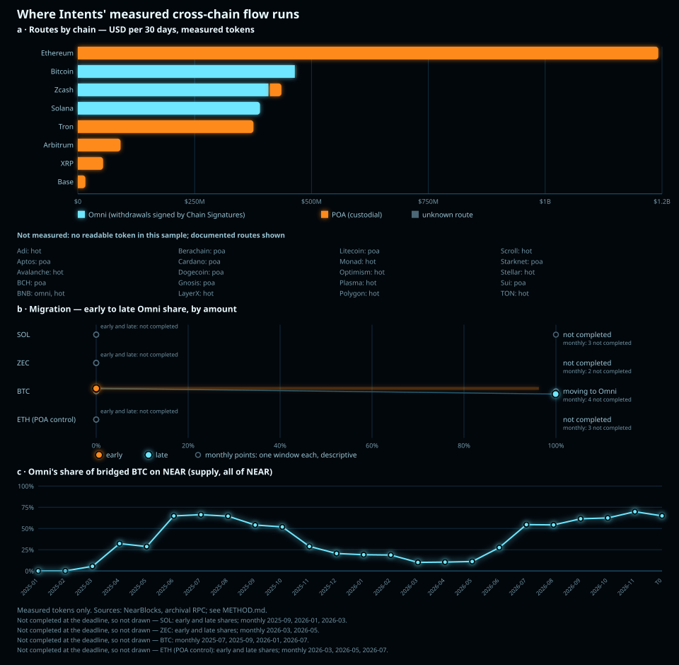

# Signed by NEAR?


**On Bitcoin, the flow runs on the bridge that NEAR's signer signs for. On the other seven chains this sample can read, that is not shown.** An evidence-first investment thesis on Chain Signatures, NEAR's MPC signer (`v1.signer`), for the Investment Thesis track of NEAR Hackathon 2026. It is research, not investment advice.

- **Dashboard, live:** https://bchowdar00.github.io/signed-by-near/ (in this repository: [`docs/index.html`](docs/index.html))
- **The write-up:** [`THESIS.md`](THESIS.md), and the same words as a page: https://bchowdar00.github.io/signed-by-near/thesis.html
- **For judges and screening agents:** [`JUDGES.md`](JUDGES.md)

## The finding

**Narrow today.** Five tests were fixed before any counted result was read, each naming a result that would have gone against this reading on one point. None of the five was shown.

- **Bitcoin runs on the signer's bridge.** Omni, the NEAR bridge whose withdrawals Chain Signatures signs, carried [99.7%, 100.0%] of the bitcoin that moved through NEAR Intents over the 90 days measured. NEAR's own sentence about Bitcoin holds on chain.
- **Beyond Bitcoin it is not shown.** This sample can read 8 chains, and Omni is shown to be the main route on 1 of them. On Arbitrum, Base, Ethereum, Tron and XRP every sampled dollar moved on a custodial bridge that does not use the signer.
- **The call count overstates adoption.** The signer took 14,046 calls a day in October. 34.0% of them came from one app, Sweat Wallet, and that app ends in its present form on Dec 30, 2026. Apps beyond NEAR's own infrastructure, leaving Sweat out, made 3.5% [1.7%, 17.4%].
- **It is a cost, and it is not falling.** The signer charges no fee. NEAR paid its operators 0.1065 NEAR per request in September, and by the frozen test that did not fall from July.



**What a NEAR holder watches next** is dated: January 2027, the first full month without Sweat; October's payout, when it is executed; and the next complete reading of Solana and Zcash. Each has the threshold it has to clear and what this entry expects, written after the read and timestamped before publication ([`afterread/NEXT-READS.md`](afterread/NEXT-READS.md)).

## Reproduce it

```bash
sh check.sh
```

Python 3, standard library only. No key, no install, no network. It recomputes every number, table and chart from the saved rows in `data/` (773 files, 15 MB; [`data/README.md`](data/README.md) says what each is and credits its sources), checks that the write-up and the pages come out as the committed bytes, runs the tests and checks the manifests. It runs steps 1 to 6 below in order (all but the one command in step 6 marked "with network"), with the Explorer read's offline checks from step 7, takes about three minutes, stops at the first step that fails, and ends with a line that starts `ALL OK`.

<details>
<summary>The steps, one by one, with what each prints</summary>

1. **Keep the committed outputs to compare with.**
   Do: `cp -R out out-committed`
2. **Recompute every number, table and chart from the saved rows.**
   Do: `python3 -I rebuild.py data --draft`
   See: it ends by printing the sha256 of each file it publishes. `out/published/tables.md` reads `cd05cf5f0eec33295f6a5272e049d324ee715182cd9ee1e0d66ed44795afdd76`.
   (`--draft` because the timestamped template still has its sentences to write; the next step writes them.)
3. **Fill the write-up and the dashboard, and check them.**
   Do: `python3 -I publish/written.py data`
   See: a last line that starts with `ok:` and gives the sha256 of `THESIS.md`. In a clone, `git status` shows `THESIS.md`, `docs/`, the tables and the charts unchanged: the same bytes as committed.
4. **Compare the rest of the outputs.**
   Do: `python3 -I publish/same_out.py out-committed out`
   See: `ok: 6 files are the same bytes, and 3 results files are equal up to the order of M7/pairs`.
   The six files, which are the same bytes on every run:

   | File | sha256 |
   |---|---|
   | `out/tables.md` | `f0d6ad8bd58c4ad38a4f25d56226fb16a74770d8d12ac73ba4325c3a8112ebce` |
   | `out/chart1-routes.svg` | `e6b66c845b4ce076628b879d77e920c4699c57dcd7cdb8cba573c0f38309ea81` |
   | `out/chart2-callers-cost.svg` | `06a8a63363f2d5b31db84bd280bf7d4e9e8ab6b3b660b59cd73250b726d1279b` |
   | `out/published/tables.md` | `cd05cf5f0eec33295f6a5272e049d324ee715182cd9ee1e0d66ed44795afdd76` |
   | `out/published/chart1-routes.svg` | `0a5424c56b960983c6e4310253f6945706eed9dcc1a4648149ef1128fd0337d9` |
   | `out/published/chart2-callers-cost.svg` | `12b606868d67ee1967b2e0bd9d6783c44f330adcfa8dc5c7b8a78c369240b7ca` |

   The three results files (`out/results.json`, `out/published/results.json`, `out/combined.json`) get a new sha256 on every run, because the frozen code loops over a set when it builds one list (`M7/pairs`). Every reading in them is the same; this command sorts that list and requires equality. So hashing `results.json` twice gives two hashes, and that is expected.
5. **Run the tests.**
   Do: `python3 -I -m unittest discover -s publish`
   See: `Ran 59 tests` and `OK` (about a minute and a half).
   Do: `H=$(mktemp -d) && mkdir -p "$H/Data/hackathons/near-2026/b-collect/pilot" && cp tests/fixtures/stage1-local/rates-plan-draft.json "$H/Data/hackathons/near-2026/b-collect/pilot/" && HOME="$H" python3 -I -m unittest discover -s tests`
   See: `Ran 149 tests` and `OK (skipped=2)` (about 20 seconds). Two frozen tests read a draft pilot file from a data folder under the home folder, so this command gives them the shipped copy of that file (same sha256) in a temporary home folder. Run without it on a clone, the suite ends `FAILED (errors=2, skipped=2)`, because those two tests cannot find the file (`DEVIATIONS.md`, "Stale text in stage-1 files"). The two skipped tests need the OpenTimestamps reference example and a saved source file named by an environment variable.
6. **Check that the frozen files are the ones that were timestamped.**
   Do: `shasum -a 256 -c postfreeze/MANIFEST-postfreeze.txt`
   See: 16 lines, each `OK`.
   Do: `shasum -a 256 -c frozen/MANIFEST-stage2.txt` and `shasum -a 256 -c frozen/MANIFEST-stage1.txt`
   See: 75 lines and 33 lines, each `OK`.
   Do: `(cd preread && shasum -a 256 -c MANIFEST-preread.txt)`
   See: 2 lines, each `OK`: the claim's sentence and the holder's read.
   Do: `shasum -a 256 -c deadline/MANIFEST-deadline.txt`
   See: 4 lines, each `OK`.
   Together the four manifests of frozen files have 128 lines for 95 distinct paths: 92 files, and 3 manifests that another manifest lists.
   Do: `shasum -a 256 -c afterread/MANIFEST-afterread.txt`
   See: 2 lines, each `OK`: the next reads and the chain parameters behind the scale line. This manifest was stamped after the read, so it fixes no test; it shows only that the expectations were written before anyone could check them.
   Do: `shasum -a 256 -c data/MANIFEST-data.txt`
   See: 773 lines, each `OK`: the saved rows are the ones published. This list was written after the read and is not timestamped.
   With network: `python3 -I collector/ots.py verify frozen/MANIFEST-stage1.txt.ots frozen/MANIFEST-stage1.txt` looks up each Bitcoin block the receipt names and prints its height, its time and `"merkle_root_matches": true`. Every `.ots` file here checks the same way against the file it is named after.
7. **Optional.**
   Offline, with numpy: `python3 -I rederive/run.py data` runs the second implementation and compares it with the published results, in about 15 seconds. From a clone its last line is `49 rows agree, recomputed by code; 0 checked against a source file; 7 need a source file not shipped; 6 not recomputed; 1 differ` ([`rederive/README.md`](rederive/README.md) says what each count means and why one row differs).
   Offline: `python3 -I explorer/analyse.py explorer/data/blocks.jsonl explorer/data/assets.json explorer --check` recomputes every figure of the Explorer read (`THESIS.md` §4.8) from its published sums; its last line is `explorer results match`. `python3 -I -m unittest discover -s explorer` runs that code's tests on made-up cells (`Ran 10 tests`, `OK`). `python3 -I rederive/explorer/compare.py explorer/results.json rederive/explorer/out/rederived.json` sets those results beside a second implementation's, written from the plan and the rules without the analysis code or its results; its last line is `155 values compared; 0 differ` ([`rederive/README.md`](rederive/README.md), "The Explorer read"). The pull itself cannot be repeated without an Explorer API key; with one, `EXPLORER_HDR=<a file holding the Authorization header> python3 -I explorer/pull.py run <a new file>` reads the same 90 blocks in the same order, one request every 5.3 seconds.
   Do: `shasum -a 256 -c explorer/MANIFEST-explorer-stage1.txt`, then the same for `stage2` and `stage3`.
   See: 2 lines, 5 lines and 1 line, each `OK`: the Explorer read's plan and collector, its family rules and analysis, and the sentences the page carries.
   The next two use the network, with no key.
   `python3 -I publish/dest_audit.py out audit` repeats the destination audit (20 lookups on public explorers, 6 s apart, about two minutes). When it has run, `audit/dest-audit.md` lists the same picks with the same counts as `THESIS.md` §4.7, unless an explorer's record has changed.
   `python3 -I verify.py check frozen/instants.json data` re-pulls a seeded sample of 20 windows from NearBlocks' public API and checks them against the published rows; its last line is `PASS` when every window matches. It is optional and has not been run since the collection ended, so it is not timed here. With `--all` it re-pulls every window, which takes three days or more, because NearBlocks accepted fewer calls than its documented limit (`POST-FREEZE.md`).

</details>

## Why it can be trusted

- **Fixed in advance.** The five tests were in a Bitcoin block on Nov 10, while collection ran; the claim's sentence was in one on Nov 13, before the first read of any counted result. Three of the five would have shown a broad moat; two would have changed the read on cost and on direction.
- **Weak points stated.** The claim and the tests were written after an uncounted pilot that their author had seen, and `THESIS.md` says what it showed. The one sign of widening, Bitcoin's move to Omni, rests on a gap of 3.4 points between two intervals. `THESIS.md`, "5. Evidence against this reading", gathers what cuts against the finding.
- **Recomputed twice.** A second implementation, written from the method and the saved rows alone, recomputes the write-up's numbers and reports where it agrees (`rederive/`).

<details>
<summary>What was fixed when, in 2026 and UTC</summary>

- Nov 10: the method, the list of windows and the collector were hashed and submitted to OpenTimestamps at 11:51Z, a minute before collection began; the analysis code, with the five tests in it, at 13:04Z, while collection ran and before any analysis read a collected row. Bitcoin holds both hashes in a block of 14:41Z that day. The block time is what anyone can verify; the two earlier times are this entry's own record.
- Nov 10 to Nov 13, 00:00Z: collection.
- Nov 13: the claim's sentence and the read for a NEAR holder were stamped (in a Bitcoin block at 07:25Z), after collection ended and before the first read of any counted result at 11:00:30Z.

</details>

## What the track asks for, and where it is

The track's own prompt lists five things to build and one rule.

| The prompt asks for | Here | How |
|---|---|---|
| "One command that rebuilds every chart from raw data." | Met | `python3 -I rebuild.py data --draft` recomputes every number, table and chart from the saved rows (step 2 below). `sh check.sh` runs it, then fills the write-up and runs every offline check, and ends `ALL OK`. |
| "A static dashboard page: each chart, the query behind it, and one plain sentence on what it shows." | Met | `docs/index.html`, written by `python3 -I publish/written.py data` (step 3). No script is needed to read it, and it loads nothing from elsewhere. |
| "THESIS.md with the claim, the evidence for it, the evidence against it, and what result would change my mind." | Met | `THESIS.md`: "Summary" (the claim and Table 1), "4. Results", "5. Evidence against this reading", "7. What would change my mind". |
| "SQL queries against the NEAR BigQuery public dataset" | Done differently | BigQuery needs a cloud account. The five tests use sources anyone can query with no account or key (NearBlocks' public API, neardata.xyz, FastNEAR's archival RPC, the HSP-007 thread, NearStats). `THESIS.md`, "8. Limitations", lists what that rules out: daily active accounts and contract usage across NEAR. |
| "A pull from the NEAR Intents Explorer API for swap volume" | Done after the read | That API needs a key from the partner dashboard, so the five tests do not use it: in them Intents' swap volume is NearStats' published figure, as reported, used only as a reference. A key was issued to the author on Nov 13, after the counted read. With it the 90 days to T0 were read in one pull, to a plan hashed and submitted to OpenTimestamps before the first counted request (`explorer/PLAN.md`); the result is `THESIS.md` §4.8 and changes no test. |
| "Never invent numbers. If a metric can't be computed from these sources, write that in THESIS.md." | Met | Every number is filled from the results by `publish/fill.py`, or is a count that `publish/check_thesis.py` re-derives and checks. Readings that rest on a window that did not finish are printed "not completed". |

## What is where

<details>
<summary>Every folder and file, and what it is</summary>

| Path | What it is |
|---|---|
| `THESIS.md` | The write-up. Generated; not edited by hand. |
| `docs/` | The dashboard page; the write-up as a page (`thesis.html`: the words of `THESIS.md` in the same order, which the build checks); the title banner above; and the two charts, as byte copies and as recoloured copies. Generated. |
| `METHOD.md` | The method, hashed before collection began. |
| `data/` | The saved rows every number is computed from: NearBlocks' pages, neardata blocks and RPC answers, with a sha256 list. `data/README.md` says what each file is. |
| `frozen/`, `postfreeze/`, `preread/` | The manifests of the timestamped files and their OpenTimestamps receipts (`.ots`). |
| `afterread/` | Written after the counted read and timestamped before publication: three dated next reads, each with its threshold and this entry's expectation; the scale of the cost; and a source found after the read. With its manifest and receipt. |
| `deadline/` | The record of how the collection was stopped at its deadline: the timer that stopped it, its test and the note written then, with their manifest and its receipt. They are here to be checked by hash. The timer and its test read the author's own folders by absolute path, so they are a record of what ran, not something to run from a copy; no step above runs them, and no test command here finds that test. |
| `collector/`, `analysis/` | The sampler and the timestamp tool; the frozen analysis code. |
| `publish/` | The rule for readings not completed, the fill step, the checks and the dashboard. |
| `out/` | The outputs of the frozen command; `out/published/` after the rule for readings not completed. |
| `extension/` | A second pass over the windows not completed: drafted, never approved and never run (`POST-FREEZE.md`, "The extension pass"). It is here as drafted because the record names it and the tests in `publish/` use its merge step. Not timestamped. |
| `audit/` | The destination audit: 20 sampled withdrawals looked up on Bitcoin and Zcash explorers. |
| `explorer/` | The Explorer read, added after the counted read: its plan, the collector, the rules that sort tokens into bridges, the analysis, the sums it published (`data/blocks.jsonl`, by asset pair and 24-hour block; no transaction row is kept) and the results. Its pull needs a key; its arithmetic does not. |
| `registry/` | Who each caller of the signer is, with a source for every account. |
| `inputs/` | The HSP-007 payout rows and the reference figures, each with its link; and `chain-params.json`, the supply and inflation figures behind the scale line, as one public RPC returned them. |
| `rederive/` | A second implementation of the analysis, written after the read by AI sessions that were given the method and the saved rows and told not to read the analysis code or any result. One command compares its numbers with the published ones; `rederive/README.md` says how it was kept apart and what it does not show. Also the seed sweeps behind two interval ends. Needs numpy. |
| `DEVIATIONS.md`, `POST-FREEZE.md`, `AFTER-READ.md` | Every departure from the method, in order: before the freeze, after it, and after the counted read. |
| `TABLE-NOTES.md` | Notes to read beside the tables and charts. |
| `tests/`, `rebuild.py`, `verify.py`, `run.sh`, `stage1_manifest.py`, `stage2_manifest.py` | The tests of the frozen code; the rebuild and re-pull commands; the scripts that ran the collection and wrote the two Nov 10 manifests. |
| `check.sh` | One command for steps 1 to 6 of "Reproduce it". Written after the read. |

</details>

## What is timestamped, and what is not

<details>
<summary>What was stamped before the read, what after, and what a receipt shows</summary>

Timestamped before the first read of any counted result: the method, the sampling plan, the collectors, the analysis code, the five tests, the rule for readings not completed, the write-up's template with its numbers as placeholders, the claim's sentence and the holder's read. The first section above says which of these were in a Bitcoin block before collection ended and which after. These files are published byte for byte, which is why a few of them carry a local path or a working note. `POST-FREEZE.md` says three copies under `deadline/` are held back for that reason. They were held back at first, because they carry a local path, a process id and a first name, and are now published on the author's ruling, so that the `deadline/` manifest checks 4 of 4 and all 59 tests pass in a clone (`AFTER-READ.md`).

Timestamped after the read and before publication: `afterread/NEXT-READS.md` and `inputs/chain-params.json`, submitted to OpenTimestamps on Nov 13 at 14:51Z and held in a Bitcoin block of 15:06Z that day (height 975691). That stamp supports no result here. It shows that the three expectations, and the dates on which each can be checked, were written down before the readings they are about exist.

Also hashed and submitted to OpenTimestamps after the read, on Nov 13: the Explorer read's plan and collector at 23:35Z, before its first request for a time inside the 90 days; its family rules and analysis at 23:41Z, while the pull ran and before any pulled sum was read (the collector's progress log had shown counts of pages and rows); and the sentences that carry its figures on the page (`explorer/sentences.py`) at 23:47Z, revised after a code audit and submitted again at 23:59Z, before the pull finished and before any pulled sum was read (`explorer/MANIFEST-explorer-stage1.txt`, `-stage2.txt`, `-stage3.txt`, each with its receipt). Those times and their order are this entry's own record (`AFTER-READ.md`). What the receipts show is less: Bitcoin holds all three hashes in one block, 975729, of 2026-11-14T00:54:22Z, which by the same record is before the pull ended at 02:46Z. These stamps fix no test either.

Written after the read, and listed in `AFTER-READ.md`: the sentences of the write-up (`THESIS.written.tmpl.md`), the checks, `TABLE-NOTES.md`, the dashboard, `JUDGES.md`, the second implementation in `rederive/` and this file. None of them changes a reading.

The look was added on Nov 14, also after the read: one dark look for the two pages, the banner and the charts shown on them and in `THESIS.md`. The charts as the timestamped code wrote them are unchanged in `out/published/` and are copied byte for byte into `docs/`. Each recoloured copy (`docs/chart1-routes-grid.svg`, `docs/chart2-callers-cost-grid.svg`) differs from its chart in the style block only, and `publish/dashboard.py` stops the build if it differs anywhere else. No typeface, image or script is loaded from elsewhere.

The saved rows in `data/` are in no manifest either: the manifests fix how the sample was to be drawn and read, not what came back. What ties the rows to the plan is the list of windows in `frozen/instants.json`, each page's own record of the request it answers, and the re-pull in step 7.

</details>

## Who and what made this

This entry is one person's. It was built with AI coding sessions in Claude Code, which wrote the code and drafted the text under the author's direction. In `POST-FREEZE.md` and `AFTER-READ.md`, "supervisor", "lead", "reviewer", "senior reviewer", "worker" and "session" are the names of those sessions, not of other people. Every ruling those records attribute to the author was his decision.

The same author has one other entry in this hackathon, Boomerang (https://github.com/bchowdar00/boomerang). The two are independent: different code, data and claims.

## Sources and credits

Data: "Powered by Nearblocks.io APIs". The pages under `data/nb/` are NearBlocks' answers, published as the sample behind these numbers and removed on NearBlocks' request (`data/README.md`). NearStats' figures are free to use with attribution (nearstats.org). Blocks from neardata.xyz, token supplies from FastNEAR's archival RPC, payouts from the HSP-007 thread on gov.near.org, explorer lookups from mempool.space and Blockchair.

Code: Python 3 standard library; numpy for `rederive/` only. Licence: MIT (`LICENSE`).
