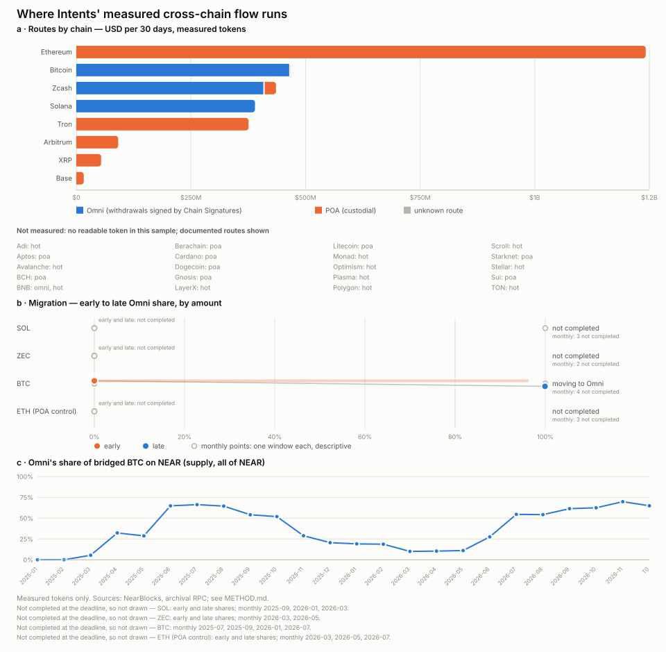
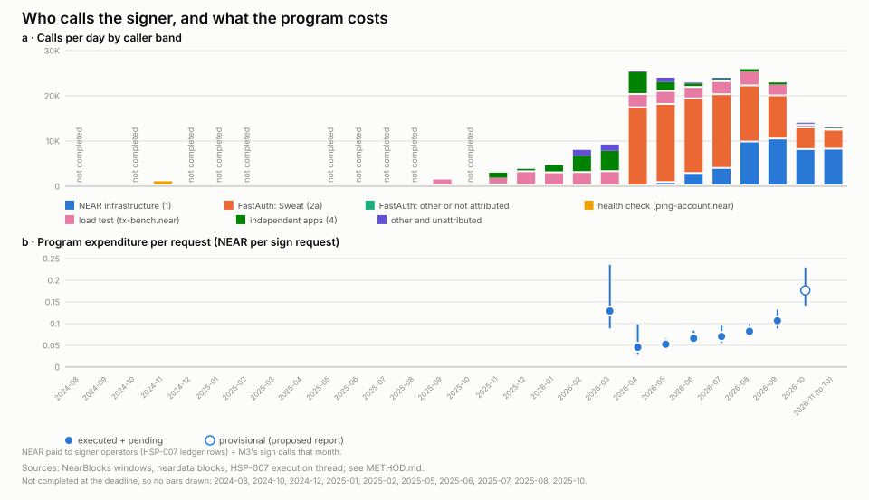

# Where NEAR's cross-chain moat sits

*An evidence-first thesis on Chain Signatures, NEAR's MPC signer (`v1.signer`): how broad its reach is, whether it is widening, and what NEAR pays for it. Every number here is recomputed from public chain data by one offline command, and the sample can be re-pulled without a key. Data cutoff (T0): {{T0_utc::str}}.*

<!-- Template. publish/fill.py fills every placeholder (a path and a format, between double braces) from out/combined.json, using the frozen
     analysis/thesis_fill.py formats; the sentences between double angle brackets are written once the frozen readings are in, and none may
     remain in THESIS.md. An "if completed" block keeps its first text unless a reading it lists is not completed. -->

## The answer in brief

⟪Four or five sentences, written from the readings below: where the measured flow runs, the BTC verdict and the Solana estimates, whether the route is widening, who uses the signer beyond NEAR's own bridge, and what NEAR pays per request.⟫

## The question

Part of NEAR's long-term case rests on one claim about its cross-chain stack: that Chain Signatures is a broad moat.

- **The partner.** SVRN's March 2026 report rates "Competition" a MEDIUM risk, "mitigated" by a "28-chain moat", and says solvers fulfil intents "across 28 blockchains via NEAR's chain signature architecture".
- **Near One's CTO** (Oct 23, 2026) says Chain Signatures "powers all the network's cross-chain volume", and that "virtually all BTC and Solana cross-chain flow now moves through the NEAR MPC-powered Omnibridge".

Breadth is one input to two judgements a NEAR holder makes: how much of the partner's "Competition: MEDIUM" rests on the signer, and what the emissions that pay its operators buy. It does not settle either. A narrow moat can still be valuable, and emissions buy security as well as reach.

This entry tests those sentences against the chain. It does not re-check NEAR's headline totals (volume, users, fees); it asks which route carries the cross-chain flow behind them.

## What was measured, and how

**Sources, all keyless.** NearBlocks' public API (FT events, `sign` receipts, the signature index), neardata.xyz blocks (call arguments and transaction signers), FastNEAR's archival RPC (token supplies and the signer's operator set), and the HSP-007 execution thread on gov.near.org (payouts to operators). The track suggests BigQuery and the Intents Explorer API; both need a sign-up, so this entry uses sources anyone can query with no account, and lists what that rules out (below).

**The design** (METHOD.md):
- Time windows are placed at random within strata (calendar months for the signer; for each of 15 Intents tokens on 8 chains, the 28-day window around the CTO's post and the rest of the 90 days to T0). Each window is read completely, page by page, and weighted by the inverse of its inclusion probability, so totals are unbiased.
- A transfer's route comes from the counterparties of Intents' own legs: **Omni** (NEAR's bridge, whose withdrawals Chain Signatures signs), **POA** (the Intents team's custodial bridge) or **unknown**. Every share is computed twice, with unknowns counted against Omni and for it, and the interval read spans both.
- Intervals count windows, not transfers: transfers inside one window are not independent, so a stratum's bound uses Kish's effective number of windows. Three all-Omni windows give a lower bound of 29%, not 99%.
- **Pre-registered.** The method, the window list and the collector were hashed and timestamped on Bitcoin (OpenTimestamps) before the first counted call; the analysis code was hashed and timestamped again before any counted row was read. Every reading below, and each threshold, was fixed before the data, or is listed in `POST-FREEZE.md`, each fixed before any counted row was read. `DEVIATIONS.md` lists every point the method left open and how the code settles it; it is hash-frozen with the analysis code, so it cannot be appended, and every change after the freeze is in `POST-FREEZE.md`, each with its own timestamp.
- **After the freeze.** The counted run stopped at its deadline, 2026-11-13T00:00Z, with {{rule/unfinished_windows::int}} of its {{rule/windows_total::int}} windows not completed. By the method, a reading that rests on a window not completed is "not completed" and is never estimated from the part done; the frozen code still computes a number for it, so a short script applies the method's rule to everything shown here, and the frozen output is published beside it unchanged (`POST-FREEZE.md`).
- Every verdict was checked, before the draw, to be reachable both ways. Where it was not, the claim gets estimates and no verdict. That is why Solana has none: at this sample size the Solana half could not be confirmed even by an all-Omni sample, so the absence of a verdict is not evidence against the claim.

## Results

### 1. BTC and Solana (the CTO's second sentence)

Omni's share of Intents' bridged amount in the claim window (Oct 9 to Nov 6, 2026), deposits and withdrawals together:

| | Omni's share [interval] | reading |
|---|---|---|
| BTC (`nbtc.bridge.near` and `btc.omft.near`, in BTC) | {{C2b/BTC/primary::iv1}} | **{{C2b/BTC/verdict::str}}** at the 90% threshold |
| SOL (in SOL) | {{C2b/SOL/primary::iv1}} | estimate only |
| Solana USDC and USDT (in USD) | {{C2b/Solana stablecoins (USD)/primary::iv1}} | estimate only |

⟪One paragraph: what this says about "virtually all BTC and Solana cross-chain flow". Sensitivities (τ 80% and 95%, counts, each direction, the 90 days) are in `out/published/tables.md`.⟫

### 2. Where the measured flow runs (the partner's "28-chain moat")



<!-- if completed: M1/counts/dominant, M1/counts/observed -->
Of the 28 chains the partner names, this sample can read 8. Omni is the dominant route on {{M1/counts/dominant/unfavourable_yes::int}} of them; it is seen in use on {{M1/counts/observed/unfavourable_yes::int}} of the 28. NEAR's own Omni overview documents 10 of the 28, which is a statement of capability, not a ceiling. The other 20, HOT's included, cannot be read through these sources and are shown by their documented route only. Intents itself listed 39 chains on Nov 9, so the 28 is already a snapshot.
<!-- otherwise -->
Of the 28 chains the partner names, this sample can read 8. How many of them run on Omni is not completed at the deadline: a census or flow window it rests on did not finish (`POST-FREEZE.md`). NEAR's own Omni overview documents 10 of the 28, which is a statement of capability, not a ceiling. The other 20, HOT's included, cannot be read through these sources and are shown by their documented route only. Intents itself listed 39 chains on Nov 9, so the 28 is already a snapshot.
<!-- end if -->

⟪One paragraph on the per-chain picture: which chains run on Omni, which on POA, and what that means for "28 blockchains via NEAR's chain signature architecture".⟫

### 3. How much of Intents' measured cross-chain value is on Omni (the CTO's first sentence)

<!-- if completed: M9 -->
- Omni's share of all measured value over the 90 days: {{M9/p::iv1}}. The part Chain Signatures signs, Omni's withdrawals: {{M9/p_CS::iv1}}.
- Measured value: {{M9/measured_usd_per_30d/point::usdm}} per 30 days, at fixed reference prices. Measured non-Omni value: {{M9/non_omni_usd_per_30d/lo::usdm}} to {{M9/non_omni_usd_per_30d/hi::usdm}} per 30 days.
- How much of Intents this covers: {{M9/c_against_2V/point::pct1}} of twice NearStats' 30-day swap volume (V = {{M9/V_usd::usdm}}; twice, because one cross-chain swap can move value in on one route and out on another).
- Two labelled scenarios, not bounds: if every unmeasured dollar (HOT's included) were Omni, Omni's share would be {{M9/scenarios/S_U_favourable::pct1}}; if none were, {{M9/scenarios/S_L_unfavourable::pct1}}.
<!-- otherwise -->
- Omni's share of the measured value, the value itself and how much of Intents it covers are not completed at the deadline: a flow window they rest on did not finish (`POST-FREEZE.md`).
<!-- end if -->

⟪One paragraph: what "all the network's cross-chain volume" looks like against this.⟫

### 4. Is the route widening?

| series | early 2025 | the 90 days to T0 | reading |
|---|---|---|---|
| SOL | {{M10/SOL/readings/amount/early::iv1}} | {{M10/SOL/readings/amount/late::iv1}} | {{M10/SOL/verdict::str}} |
| ZEC | {{M10/ZEC/readings/amount/early::iv1}} | {{M10/ZEC/readings/amount/late::iv1}} | {{M10/ZEC/verdict::str}} |
| BTC | {{M10/BTC/readings/amount/early::iv1}} | {{M10/BTC/readings/amount/late::iv1}} | {{M10/BTC/verdict::str}} |
| ETH (a POA control) | {{M10/ETH (POA control)/readings/amount/early::iv1}} | {{M10/ETH (POA control)/readings/amount/late::iv1}} | {{M10/ETH (POA control)/verdict::str}} |

<!-- extension:migration -->

Omni's share of bridged BTC on all of NEAR, by token supply: {{M10b/0/omni_share::pct1}} at the start of 2025, {{M10b/-1/omni_share::pct1}} at T0.

⟪One paragraph on direction.⟫

### 5. Who uses the signer



<!-- if completed: by_month/M3/2026-10/raw, trend/raw, trend/excluding class 3 and 2a -->
- `sign` calls: {{by_month/M3/2026-10/raw/per_day::int}} a day in October 2026. The trend, the last three complete months over the three before: {{trend/raw/point::f2}} [{{trend/raw/lo::f2}}, {{trend/raw/hi::f2}}], **{{trend/raw/state::str}}**; without tests and Sweat, {{trend/excluding class 3 and 2a/point::f2}} [{{trend/excluding class 3 and 2a/lo::f2}}, {{trend/excluding class 3 and 2a/hi::f2}}].
<!-- otherwise -->
- `sign` calls in October 2026 and the trend are not completed at the deadline: a `sign` window they rest on did not finish (`POST-FREEZE.md`).
<!-- end if -->
<!-- if completed: by_month/M4/2026-10 -->
- Apps beyond NEAR's own infrastructure, without Sweat Wallet (which ends in its present form on Dec 30, 2026): {{by_month/M4/2026-10/main_without_sweat/point::pct1}} of October's calls [{{by_month/M4/2026-10/main_without_sweat/lo::pct1}}, {{by_month/M4/2026-10/main_without_sweat/hi::pct1}}]. With Sweat: {{by_month/M4/2026-10/main/point::pct1}}.
- The largest single caller had {{by_month/M4/2026-10/concentration/top1/point::pct1}} of October's calls.
<!-- otherwise -->
- Who made October's calls (apps beyond NEAR's own infrastructure, with and without Sweat, and the largest single caller) is not completed at the deadline: a `sign` window of the month did not finish (`POST-FREEZE.md`).
<!-- end if -->

<!-- extension:callers -->

⟪One paragraph: what the calls are for (M6: key types and paths), and Relay as an independent user.⟫

### 6. What NEAR pays

<!-- if completed: by_month/M8/2026-09/per_request_executed_plus_pending -->
NEAR pays the signer's operators from emissions under HSP-007. The execution thread's ledger rows sum to {{M8/totals/executed_near::f2}} NEAR executed from {{M8/totals/executed_first_month::str}} to {{M8/totals/executed_last_month::str}}, plus {{M8/totals/pending_near::f2}} pending; {{M8/totals/proposed_near::f2}} NEAR for {{M8/totals/proposed_months/0::str}} is in a proposed report. Per `sign` request, that was {{by_month/M8/2026-09/per_request_executed_plus_pending/point::f4}} NEAR in September [{{by_month/M8/2026-09/per_request_executed_plus_pending/lo::f4}}, {{by_month/M8/2026-09/per_request_executed_plus_pending/hi::f4}}]. A `sign` call itself pays 1 yoctoNEAR, a spam guard, so the signer earns no fee.
<!-- otherwise -->
NEAR pays the signer's operators from emissions under HSP-007. The execution thread's ledger rows sum to {{M8/totals/executed_near::f2}} NEAR executed from {{M8/totals/executed_first_month::str}} to {{M8/totals/executed_last_month::str}}, plus {{M8/totals/pending_near::f2}} pending; {{M8/totals/proposed_near::f2}} NEAR for {{M8/totals/proposed_months/0::str}} is in a proposed report. The cost per `sign` request in September is not completed at the deadline: a `sign` window of the month did not finish (`POST-FREEZE.md`). A `sign` call itself pays 1 yoctoNEAR, a spam guard, so the signer earns no fee.
<!-- end if -->

⟪One paragraph on spend per request over time and what it buys.⟫

### 7. Does it work?

⟪M7: in the contiguous run of 2,000 blocks before T0, the matched share, censored and by-order counts, and the median and longest delay.⟫

- **Destination audit.** Withdrawals picked by seed from the signature index's completed months ({{completeness/index/completed::int}} of {{rule/windows_by_family/index::int}}; the others are named in `audit/dest-audit.md`), then looked up once each on a public explorer (mempool.space, Blockchair): Bitcoin, {{dest_audit/summary/BITCOIN/found::int}} of {{dest_audit/summary/BITCOIN/picked::int}} found, {{dest_audit/summary/BITCOIN/confirmed::int}} confirmed, {{dest_audit/summary/BITCOIN/from_signer_address::int}} spent from the address the signer's key controls; Zcash, {{dest_audit/summary/ZCASH/found::int}} of {{dest_audit/summary/ZCASH/picked::int}} found, {{dest_audit/summary/ZCASH/confirmed::int}} confirmed, {{dest_audit/summary/ZCASH/from_signer_address::int}} from that address. Each lookup and its link: `audit/dest-audit.md`.

## Evidence against this reading

⟪At least as strong as the case for. Drafted from the sketch, then checked against the readings: the BTC-and-Solana sentence where it holds on chain; the route moving to Omni; Relay, an independent intents network, choosing NEAR's signer; counts are not value; Sweat's exit is one app's decision; what this sample cannot see (HOT, the 20 chains, flows outside Intents).⟫

## What would have changed our mind

These tests were written before the counted sample and frozen in the analysis code before any counted row was read. Each is shown with whether it was met.

⟪Table from results.json → mind: value mostly on Omni; Omni dominant on at least 5 of the 8 measurable chains; broad adoption without Sweat; falling spend per request; no migration.⟫

## For a NEAR holder

⟪Where the moat sits. Whether it is widening. What it costs. Indicators to watch, each with the reading that would move it: Omni's share of bridged BTC; SOL and ZEC monthly points; the share of calls from apps beyond NEAR's infrastructure after Sweat's exit on Dec 30; NEAR per request as the operator set grows; chains added to Omni's overview. No valuation and no fee-capture model: that is a different question.⟫

## What this does not cover

- HOT's flow and the 20 chains without a readable token here; flows outside Intents.
- Daily active accounts and contract usage across NEAR (BigQuery), and Intents' own swap volume (Explorer API): both need a sign-up.
- The destination-chain leg of Omni's Solana and EVM withdrawals.
- Chain Signatures' security or cryptography, the value of NEAR, and how Intents' fees reach the token.

## Reproduce it

```bash
python3 -I rebuild.py <data_dir>
```
recomputes every number, table and chart here from the saved rows, offline. It runs the frozen command (`analysis/recompute.py`, whose output in `out/` is published unchanged), applies the rule for readings not completed (`out/published/`), and fills this page from those results and the saved destination-audit lookups (`audit/`).

```bash
python3 -I publish/dest_audit.py out audit
```
repeats the destination audit: one keyless lookup per pick on mempool.space or Blockchair, 6 s apart.

```bash
python3 -I verify.py check frozen/instants.json <data_dir>
```
re-pulls a seeded sample of 20 windows from NearBlocks' public API, keyless, and checks them against the published rows and their hashes (`--all` re-pulls every window: three days or more, because NearBlocks accepted fewer calls than its documented limit; see `POST-FREEZE.md`).

```bash
python3 -I -m unittest discover -s tests
python3 -I -m unittest discover -s publish
```
run the offline tests: the frozen suite, including an end-to-end run on synthetic data, and the tests of the rule for readings not completed.

The freeze: `frozen/MANIFEST-stage1.txt` and `frozen/MANIFEST-stage2.txt` list the SHA-256 of every frozen file; their `.ots` receipts are OpenTimestamps proofs on Bitcoin.

## Disclosure

HSP-007's authors are SVRN's CEO and the founder of Proximity Labs, and SVRN runs one of the paid nodes, onboarded on June 22, 2026 by the thread's own report (SVRN's release says July). SVRN's report that makes the 28-chain claim predates the node. These are stated as facts; nothing is inferred from them.

Data: "Powered by Nearblocks.io APIs". NearStats figures are CC BY 4.0.
