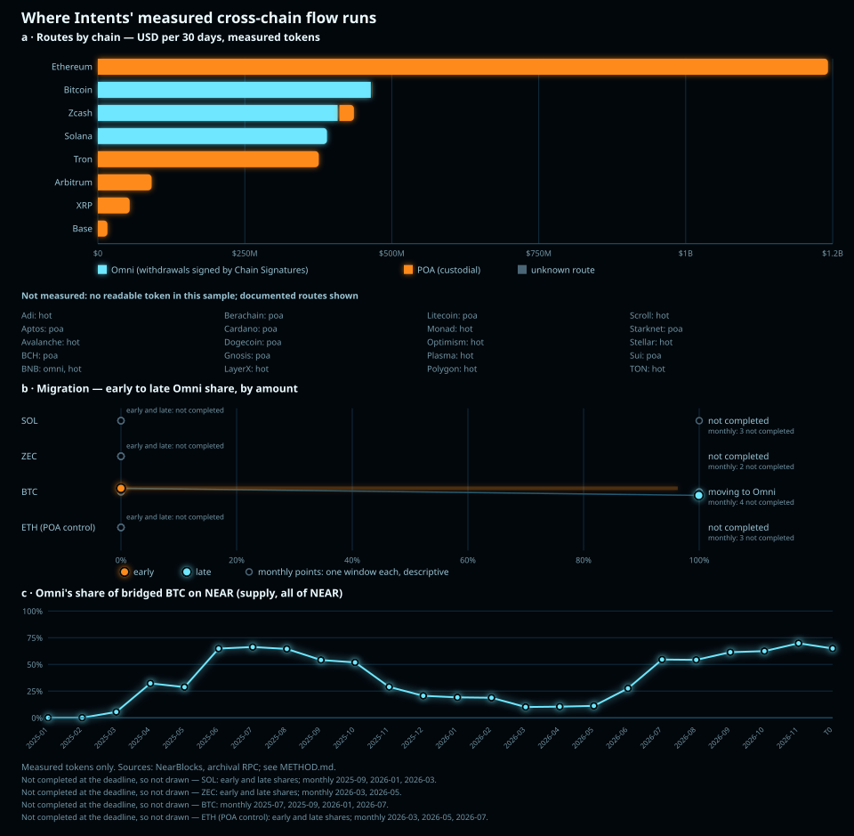
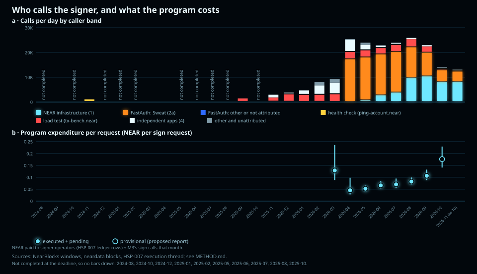

# Signed by NEAR?

*How much of NEAR's cross-chain flow needs NEAR's signer: five tests, fixed before any counted result was read.*

Bhargav Chowdary · version 1 · Data cutoff (T0): {{T0_utc::str}} · code, data and timestamps: https://github.com/bchowdar00/signed-by-near

<!-- THESIS.md is generated from THESIS.written.tmpl.md by `python3 -I publish/written.py data` and is not edited by hand. -->

## Summary

**Narrow today: the claim held on breadth. The next reads are dated.** Chain Signatures is NEAR's signer. It signs the withdrawals of Omni, NEAR's own bridge. NEAR Intents is NEAR's cross-chain swap product.

- **On Bitcoin the flow runs on the signer's bridge.** Nearly all of the bitcoin that moves through Intents moves on Omni: {{M10/BTC/readings/amount/late::iv1}} of it over the 90 days to T0. NEAR's own sentence about Bitcoin holds on chain.
- **Beyond Bitcoin it is not shown.** This sample can read {{mind/omni_dominant_widely/of_measured::int}} chains, and Omni is shown to be the main route on {{mind/omni_dominant_widely/dominant_yes::int}} of them. On Solana and Zcash Omni carried most of the sampled flow, but the intervals are too wide to call. On Arbitrum, Base, Ethereum, Tron and XRP every sampled dollar moved on a custodial bridge that does not use the signer. Found after the read: the Intents team's own SDK lists SOL and ZEC tokens among those it now sends through Omni, and no EVM, Tron or XRP token. That is a list in its code, not a measurement of flow (§5).
- **The call count overstates adoption.** The signer took {{by_month/M3/2026-10/raw/per_day::int}} calls a day in October. {{by_month/M4/2026-10/concentration/top1/point::pct1}} of them came from one app, Sweat Wallet, signing in through a login service, and that app ends in its present form on Dec 30, 2026. Apps beyond NEAR's own infrastructure, leaving Sweat out, made {{by_month/M4/2026-10/main_without_sweat/point::pct1}} [{{by_month/M4/2026-10/main_without_sweat/lo::pct1}}, {{by_month/M4/2026-10/main_without_sweat/hi::pct1}}].
- **It is a cost, and it is not falling.** The signer charges no fee. NEAR pays its operators from its treasury: {{by_month/M8/2026-09/per_request_executed_plus_pending/point::f4}} NEAR per request in September, and by the frozen test it did not fall from July. Written after the read: at October's proposed payout the programme runs at 922,374.24 NEAR a year, equal to 2.8% of the most NEAR the protocol can issue in a year (a comparison of size, not a share of issuance; §7.2).
- **What a holder watches next.** January 2027, the first full month without Sweat; October's payout, when it is executed; and the next complete reading of Solana and Zcash. Each has a threshold and an expectation, written after the read and timestamped before this page was published (§7.2).

**The claim under test:** "On the chains this sample can measure, Chain Signatures is a narrow route, not a broad one."

**Table 1. The five tests and how each came out.** Each test is a result that would have gone against this page's reading on one point. "Met if" gives the test in short; §7.1 gives it in full.

| | Test | Met if (in short) | Found | Result |
|---|---|---|---|---|
| T1 | Value mostly on Omni | the lower end of Omni's share of the measured value at 90% or more | {{mind/value_mostly_on_omni/p_L::pct1}}; the share is {{M9/p/point_unknown_not_omni::pct1}} {{M9/p::iv1}} over the 90 days | not met |
| T2 | Omni dominant widely | Omni the dominant route on at least 5 of the 8 chains this sample can read | {{mind/omni_dominant_widely/dominant_yes::int}} of {{mind/omni_dominant_widely/of_measured::int}}, Bitcoin | not met |
| T3 | Broad adoption | apps beyond NEAR's own infrastructure, leaving Sweat out, making at least 25% of `sign` calls in each of August, September and October | {{by_month/M4/2026-10/main_without_sweat/point::pct1}} [{{by_month/M4/2026-10/main_without_sweat/lo::pct1}}, {{by_month/M4/2026-10/main_without_sweat/hi::pct1}}] in October, and less before | not met |
| T4 | Falling spend per request | what NEAR pays per request falling from July to September while calls grow | it did not fall, and total calls did not grow | not met |
| T5 | No migration | no move to Omni for SOL, ZEC or BTC | Bitcoin moved, by the frozen test; for SOL and ZEC the comparison could not be made | not met |

T1 to T3 would have shown a broad moat; T4 and T5 would have changed the read on cost and on direction. All five frozen tests read not met; none was met and none is undecided.

The one sign of widening, Bitcoin's move to Omni, rests on two intervals that are only 3.4 points apart (96.3% against 99.7%), and Omni's share of all bridged BTC on NEAR, by token supply, is about where it was in July 2025 (66.3% then, 64.9% at T0). On value the sample cannot tell: Omni's share of the measured value is {{M9/p::iv1}}, wide enough that the truth may sit near its top.

The tests were written after an uncounted pilot that their author had seen (§3.5), and their hash was in a Bitcoin block before any counted result was read (§3.4). 490 of {{rule/windows_total::int}} windows read in full; readings that rest on the other {{rule/unfinished_windows::int}} are published as not completed, never estimated.

**Added after the read.** Intents' own records of 1Click swaps, read with a key after the counted read, put Omni's side of the bridged withdrawal value at 30.7% with the tokens the SDK lists as moved to Omni, and at 31.9% if the unclassified value is counted as Omni too (§4.8).

## How to read this page

- *[a, b]*: a 95% interval.
- *Reported*: stated by a source and not confirmed here.
- *Charts*: drawn by the timestamped code and shown in this entry's colours. Only the style block differs from the files that code wrote, `out/published/chart1-routes.svg` and `out/published/chart2-callers-cost.svg`.
- *Met, not met, undecided*: a test is met when the result that would have gone against this page's reading on that point occurred, not met when it did not, and undecided when a reading it needs was not completed.

## 1. The question

Part of NEAR's long-term case rests on one claim about its cross-chain stack: that Chain Signatures is a broad moat.

- **The partner.** SVRN is one of the partners in the hackathon's ecosystem list. Its report of March 2026 ("NEAR Protocol: The Bottom-Up Investment Case", SVRN Research, https://svrn.net/research/near-protocol, read Nov 9, 2026) rates "Competition" a MEDIUM risk, with "28-chain moat" first among its mitigants, and says solvers fulfil intents "across 28 blockchains via NEAR's chain signature architecture".
- **NEAR's blog.** A NEAR blog post by Near One's CTO, Anton Astafiev, and a NEAR writer (Oct 23, 2026; https://www.near.org/blog/chain-signatures-tee, read Nov 9, 2026) says Chain Signatures "powers all the network's cross-chain volume", and that "virtually all BTC and Solana cross-chain flow now moves through the NEAR MPC-powered Omnibridge".

Breadth is one input to two judgements a NEAR holder makes: how much of the partner's "Competition: MEDIUM" rests on the signer, and what the emissions that pay its operators buy. It does not settle either. A narrow moat can still be valuable, and emissions buy security as well as reach.

This entry tests those sentences against the chain. It does not re-check NEAR's headline totals (volume, users, fees); it asks which route carries the cross-chain flow behind them.

**What this adds.** Three measurements:
- the share of Intents' flow by bridge route, with intervals;
- which apps are behind the signer's calls, with the login service's calls attributed to the app behind each;
- what NEAR pays per signature.

## 2. Background

A swap on NEAR Intents can move an asset in over one bridge route and out over another. Three routes appear on this page (Table 2).

**Table 2.** The three bridge routes on this page.

| Route | Who holds the keys | Uses NEAR's signer | Readable in this sample |
|---|---|---|---|
| Omni, NEAR's own bridge | the signer's MPC network; for withdrawals to chains without smart contracts, Bitcoin and Zcash among them, with no single custodian | yes: it signs each withdrawal; deposits are verified by light clients or Wormhole | yes |
| POA, the Intents team's custodial bridge | the bridge itself | no | yes |
| HOT, a separate bridge | its own MPC network | no | no |

- *Chain Signatures*: NEAR's signer, the contract `v1.signer`; one signature is one `sign` call.
- *POA* ("Proof of Authority"): the Intents team's custodial bridge, which holds its own keys.
- *HOT*: a separate bridge that runs its own MPC network, not NEAR's signer; its flow cannot be read through these sources.
- *FastAuth*: a login service on NEAR that signs through the signer for the app behind each login.
- *Sweat*: Sweat Wallet, an app that reaches the signer through FastAuth logins and ends in its present form on Dec 30, 2026; "leaving Sweat out" drops its calls.
- *NEAR's own infrastructure*: contracts built by NEAR, Near One or the Intents team, such as the Omni bridge and its Bitcoin and Zcash connectors.
- *Window*: one randomly placed stretch of time, read completely.
- *Claim window*: the 28 days around NEAR's blog post of Oct 23, from Oct 9 to Nov 6, 2026.

## 3. Data and method

Every number here is recomputed by two offline commands from public chain data, NearStats' published swap volume and the payout thread of HSP-007 (the governance proposal that pays the signer's operators), and the sample can be re-pulled without an API key.

### 3.1 Sources

All sources of the five tests are keyless: NearBlocks' public API (FT events, `sign` receipts, the signature index), neardata.xyz blocks (call arguments and transaction signers), FastNEAR's archival RPC (token supplies and the signer's operator set), the HSP-007 execution thread on gov.near.org (payouts to operators; https://gov.near.org/t/42147, saved Nov 9, 2026), NearStats (nearstats.org: Intents' 30-day swap volume and its split by chain, a third party's figures, free to use with attribution, used as reported), and for the destination audit two public explorers, mempool.space for Bitcoin and Blockchair for Zcash. The track suggests BigQuery and the Intents Explorer API; both need a sign-up, so the five tests use sources anyone can query with no account, and §8 lists what that rules out. The Explorer API was read in one pull, after the counted read, with a key issued on Nov 13 (§4.8).

### 3.2 Sampling and intervals

The design is fixed in `METHOD.md`.
- Time windows are placed at random within strata (calendar months for the signer; for each of 15 Intents tokens on 8 chains, the 28-day window around the post and the rest of the 90 days to T0). Each window is read completely, page by page, and weighted by the inverse of its inclusion probability, so a total is unbiased where every window of its stratum is read. A share, the ratio of two totals, is not, and its interval is built as the next two points describe.
- A transfer's route comes from the counterparties of Intents' own legs: **Omni** (NEAR's bridge, whose withdrawals Chain Signatures signs), **POA** (the Intents team's custodial bridge) or **unknown**. Every share is computed twice, with unknowns counted against Omni and for it, and the interval read spans both.
- Intervals count windows, not transfers: transfers inside one window are not independent, so a stratum's bound uses Kish's effective number of windows. Three all-Omni windows give a lower bound of 29%, not 99%.
- Interval ends that come from the bootstrap are printed as computed at the frozen seed and carry Monte Carlo error: in an independent re-derivation (`rederive/mc-seeds/`), over 40 seeds the non-Omni lower end ran from $1.11B to $1.17B, and over 60 seeds Bitcoin's 90-day lower end ran from 99.68% to 99.77%. Ends set by the window-level or Garwood bound are exact. T1 to T4 are far from their thresholds: T1 reads the lower end of Omni's share, {{mind/value_mostly_on_omni/p_L::pct1}} against the 90% it needed. T5 is not: it rests on the gap between two interval ends (§4.5), though that gap is many times the seed-to-seed movement shown here.
- Every verdict was checked, before the draw, to be reachable both ways. Where it was not, the claim gets estimates and no verdict. That is why Solana has none: at this sample size the Solana half could not be confirmed even by an all-Omni sample, so the absence of a verdict is not evidence against the claim.

### 3.3 The five tests

The five tests, T1 to T5, are given in short in Table 1 and in full in §7.1, in the order in which they were stamped. The stamped read rests the page's first sentence, on breadth, on T1 and T2; T3, T4 and T5 qualify that reading and do not reverse it (`preread/HOLDER-READ.md`). T3 would also have shown breadth, of use by apps, which is why the Summary groups it with the first two.

### 3.4 What was fixed, and when

All times are 2026, UTC.
- **Nov 10.** The method, the list of windows and the collector were hashed and submitted to OpenTimestamps at 11:51Z, a minute before collection began. The analysis code, with the five tests in it, was hashed and submitted at 13:04Z, while collection ran and before any analysis read a collected row. Bitcoin holds both hashes in a block of 14:41Z that day. That block time is what anyone can verify; the two earlier times are this entry's own record.
- **Nov 10 to Nov 13, 00:00Z.** Collection.
- **Nov 13.** The claim's sentence, from a sketch dated Nov 10 that was not stamped then, and the read for a NEAR holder were stamped: submitted at 05:46Z, in a Bitcoin block at 07:25Z. That is after collection ended and before the first read of any counted result, on Nov 13 at 11:00:30Z (`preread/`).
- **Pre-registered.** Every reading in §4, and each threshold, is in those files or is listed in `POST-FREEZE.md`, and all were fixed before any counted row was read. `DEVIATIONS.md` lists every point the method left open and how the code settles it; it is hash-frozen with the analysis code, so it cannot be appended, and every change after the freeze is in `POST-FREEZE.md`, each with its own timestamp.
- **After the freeze.** The counted run stopped at its deadline, 2026-11-13T00:00Z, with {{rule/unfinished_windows::int}} of its {{rule/windows_total::int}} windows not completed. By the method, a reading that rests on a window not completed is "not completed" and is never estimated from the part done; the frozen code still computes a number for it, so a short script applies the method's rule to everything shown here, and the frozen output is published beside it unchanged (`POST-FREEZE.md`).

### 3.5 What was seen first, and what was added after the read

The claim and the tests were both written after an uncounted pilot that their author had seen. On Nov 9, with one window per token, SOL, ZEC and BTC transfers went through Omni, and ETH, USDC on Ethereum, Arbitrum and Base, Tron USDT and XRP went through POA; and 49 of 103 sampled `sign` calls were Sweat's (METHOD, sections 4 and 7). That pilot had already shown five of the eight readable chains on POA and Sweat with about half of the sampled calls, so T2 and T3 could hardly have been met; it did not measure value, cost or change over time, which the other three test. So the claim was not a blind guess. What the stamps show is that the tests, their thresholds and the claim were not changed after the counted results were read.

**Checked again after the read.** AI sessions wrote a second implementation from `METHOD.md`, told not to read the analysis code or any result, and it recomputes this page's numbers from the same saved rows. From a clone it compares 570 numbers: 553 agree (bootstrap ends within a stated tolerance), 9 need a source file this repository does not ship, 6 are not recomputed and 2 differ, both explained (`rederive/`). It was run after the read, so it shows that the numbers follow from the method and the rows, not that the method was fixed in advance.

Everything written or added after the counted results were read is listed in `AFTER-READ.md`. The additions that bear on a reading are marked where they appear: the Intents team's SDK list (§5), the size of the programme against issuance and the three dated next reads (§7.2, from `afterread/NEXT-READS.md`, timestamped before publication), the correction to one word of the stamped read (§6), the second implementation above, and the Explorer read (§4.8), whose plan was hashed and submitted to OpenTimestamps before its first counted request.

## 4. Results

### 4.1 T1. Is most of the measured value on Omni?

**T1, not met.** The lower end of Omni's share of the measured value is {{mind/value_mostly_on_omni/p_L::pct1}}; the test needed 90% or more.

<!-- if completed: M9 -->
- Omni's share of all measured value over the 90 days: {{M9/p::iv1}}. The part Chain Signatures signs, Omni's withdrawals: {{M9/p_CS::iv1}}.
- Measured value: {{M9/measured_usd_per_30d/point::usdm}} per 30 days, at fixed reference prices. Measured non-Omni value: {{M9/non_omni_usd_per_30d/lo::usdm}} to {{M9/non_omni_usd_per_30d/hi::usdm}} per 30 days. These dollar ranges are bootstrap intervals of totals. The share's interval is built differently and is wider: both its ends come from the window-level bound, which counts each window, not each transfer, as one trial (the bootstrap alone gives [{{M9/p/reading_L/boot/0::pct1}}, {{M9/p/reading_L/boot/1::pct1}}]). So the share's ends cannot be recomputed from the dollar ranges.
- How much of Intents this covers: not known from these sources. The method's coverage figure sets the measured value against twice NearStats' 30-day swap volume V (V = {{M9/V_usd::usdm}}; twice, because one cross-chain swap can move value in on one route and out on another). It reads {{M9/c_against_2V/point::pct1}} only because it is capped there: the measured value is {{M9/c_against_V/point::f2}} times V. The two are different populations. The measured value is bridge transfers into and out of Intents at prices fixed on Nov 9, per 30 days of the 90, while V counts each swap once over NearStats' 30 days (METHOD M9). So V is not a ceiling on bridge transfers, and this sample does not establish why the measured value is larger.
- Two labelled scenarios, not bounds: if every unmeasured dollar (HOT's included) were Omni, Omni's share would be {{M9/scenarios/S_U_favourable::pct1}}; if none were, {{M9/scenarios/S_L_unfavourable::pct1}}. These equal the interval's ends because coverage is capped at 100%, which leaves no dollar to count as unmeasured. The method's second scenario, by chain, is not capped: it weights each measured chain's share by NearStats' 30-day volume for that chain, the measured chains cover {{M9/by_chain_scenario/c::pct1}} of V, and the two scenarios read {{M9/by_chain_scenario/S_U_favourable::pct1}} and {{M9/by_chain_scenario/S_L_unfavourable::pct1}} (METHOD M9).
<!-- otherwise -->
- Omni's share of the measured value, the value itself and how much of Intents it covers are not completed at the deadline: a flow window they rest on did not finish (`POST-FREEZE.md`).
<!-- end if -->

Against "all the network's cross-chain volume": of the value this sample measured, Omni carried {{M9/p/point_unknown_not_omni::pct1}} {{M9/p::iv1}} over the 90 days, and the part Chain Signatures signs, Omni's withdrawals, {{M9/p_CS/point_unknown_not_omni::pct1}} {{M9/p_CS::iv1}}. Deposits on Omni are verified by light clients or Wormhole; the signer signs only what leaves. The measured value is {{M9/c_against_V/point::f2}} times NearStats' 30-day swap volume V [{{M9/c_against_V/lo::f2}}, {{M9/c_against_V/hi::f2}}], and the measured non-Omni value alone reaches {{M9/non_omni_usd_per_30d/share_of_2V/hi::f2}} times 2V at its upper end. For context only, against NEAR's headline 30-day total ({{M9/V_headline_usd::usdm}}: revenue.near.org's series, as carried in NearStats' summary feed of Nov 9, 2026; reported) the measured value is {{M9/c_against_headline/point::pct1}} [{{M9/c_against_headline/lo::pct1}}, {{M9/c_against_headline/hi::pct1}}]. Of the measured value, {{M9/non_omni_usd_per_30d/lo::usdm}} to {{M9/non_omni_usd_per_30d/hi::usdm}} per 30 days moved without NEAR's bridge.

### 4.2 T2. On how many chains is Omni the main route?

**T2, not met.** Omni is shown dominant on {{mind/omni_dominant_widely/dominant_yes::int}} of {{mind/omni_dominant_widely/of_measured::int}}, Bitcoin. On the other 7 it is not shown: on 2 (Solana and Zcash) the intervals are too wide, and on 5 (Arbitrum, Base, Ethereum, Tron and XRP) the sample holds no Omni value. Counting Solana and Zcash as dominant too would make 3 of {{mind/omni_dominant_widely/of_measured::int}}, still under the 5 needed.



**Figure 1.** Where Intents' measured cross-chain flow runs, in three panels: measured value by chain and route; Omni's share early and late for four series; Omni's share of bridged BTC on NEAR, by token supply, by month. Drawn by the timestamped code; the files and the dashboard call it chart 1.

<!-- if completed: M1/counts/dominant, M1/counts/observed -->
Of the 28 chains the partner names, this sample can read the flow on 8, and Omni is the dominant route on {{M1/counts/dominant/unfavourable_yes::int}} of those 8. Across all 28, counting the census of Intents' own legs, Omni is seen in use on {{M1/counts/observed/unfavourable_yes::int}}. NEAR's own Omni overview documents 10 of the 28, which is a statement of capability, not a ceiling. The other 20, HOT's included, cannot have their flow measured through these sources. Four of them (Aptos, BNB, Polygon, Starknet) appear in the census of Intents' own legs; the rest are shown by their documented route only. NearStats listed 39 supported chains for Intents on Nov 9, 2026 (its summary feed; reported), so the 28 is already a snapshot.
<!-- otherwise -->
Of the 28 chains the partner names, this sample can read 8. How many of them run on Omni is not completed at the deadline: a census or flow window it rests on did not finish (`POST-FREEZE.md`). NEAR's own Omni overview documents 10 of the 28, which is a statement of capability, not a ceiling. The other 20, HOT's included, cannot be read through these sources and are shown by their documented route only. NearStats listed 39 supported chains for Intents on Nov 9, 2026 (its summary feed; reported), so the 28 is already a snapshot.
<!-- end if -->

Bitcoin is the one measured chain where Omni is shown to be the dominant route (Figure 1), with {{M1/chains/8/amount_share_by_unit/BTC::iv1}} of its measured flow by amount. Bitcoin's interval is built by a different rule from the others, frozen with the method: the window-level bound applies where a token can take either route, but Bitcoin's Omni token can only be Omni or unknown and its POA token is read whole, so the interval comes only from a bootstrap of the Omni token's total (METHOD, sections 4 and 7).

A bootstrap over few windows holds the truth less often than its nominal 95%: for the claim window's six windows, the method's replays on synthetic data held it in 30 of 40, each miss within 0.005 points (`DEVIATIONS.md`). The 90-day interval printed here rests on twelve windows of the Omni token, six inside the claim window and six outside it; the replays were run at six only, so its coverage at twelve was not measured. That makes it the weakest interval on this page by coverage.

On Solana and Zcash Omni carried most of the measured flow, {{M1/chains/20/amount_share_by_unit/SOL/point_unknown_not_omni::pct1}} of SOL and {{M1/chains/27/amount_share_by_unit/ZEC/point_unknown_not_omni::pct1}} of ZEC, but over the 90 days their intervals reach down to {{M1/chains/20/amount_share_by_unit/SOL/L::pct1}} and {{M1/chains/27/amount_share_by_unit/ZEC/L::pct1}}, so the sample cannot call Omni dominant there. On the measured chains of EVM, Tron and XRP tokens (Arbitrum, Base, Ethereum, Tron and XRP), none of the measured value moved on Omni: in this sample the custodial POA bridge carried all of it. These five chains have six readings, one for each chain's dollar tokens or its own coin (Ethereum has both), and their upper ends, {{M1/chains/2/amount_share_by_unit/USD/U::pct1}} to {{M1/chains/26/amount_share_by_unit/XRP/U::pct1}}, reflect how few effective windows each reading had, between one and three, not any Omni flow: each reading rests on {{M1/chains/25/amount_share_by_unit/USD/windows::int}} to {{M1/chains/2/amount_share_by_unit/USD/windows::int}} windows, but most of its amount sat in a few of them.

Omni is seen in use on Bitcoin, Solana and Zcash among the measured chains, and on Aptos, BNB, Polygon and Starknet in the census of Intents' own legs. So "28 blockchains via NEAR's chain signature architecture" holds as documented capability on some chains and as measured use on a few.

### 4.3 T3. Who uses the signer?

**T3, not met.** Apps beyond NEAR's own infrastructure, leaving Sweat out, made {{by_month/M4/2026-10/main_without_sweat/point::pct1}} [{{by_month/M4/2026-10/main_without_sweat/lo::pct1}}, {{by_month/M4/2026-10/main_without_sweat/hi::pct1}}] of `sign` calls in October, and less before; the test needed at least 25% in each of August, September and October.



**Figure 2.** Who calls the signer, and what the programme costs, in two panels: `sign` calls per day by caller class, by month; NEAR paid per `sign` request, by month. Drawn by the timestamped code; the files and the dashboard call it chart 2.

<!-- if completed: by_month/M3/2026-10/raw, trend/raw, trend/excluding class 3 and 2a -->
- `sign` calls: {{by_month/M3/2026-10/raw/per_day::int}} a day in October 2026. The trend, the last three complete months over the three before: {{trend/raw/point::f2}} [{{trend/raw/lo::f2}}, {{trend/raw/hi::f2}}], **{{trend/raw/state::str}}**; without tests and Sweat, {{trend/excluding class 3 and 2a/point::f2}} [{{trend/excluding class 3 and 2a/lo::f2}}, {{trend/excluding class 3 and 2a/hi::f2}}]. The first is the headline and is inconclusive; the second leaves out test callers and Sweat, so it is the one that speaks to adoption, and its interval lies above 1.
<!-- otherwise -->
- `sign` calls in October 2026 and the trend are not completed at the deadline: a `sign` window they rest on did not finish (`POST-FREEZE.md`).
<!-- end if -->
<!-- if completed: by_month/M4/2026-10 -->
- Apps beyond NEAR's own infrastructure, leaving out Sweat Wallet (which ends in its present form on Dec 30, 2026): {{by_month/M4/2026-10/main_without_sweat/point::pct1}} of October's calls [{{by_month/M4/2026-10/main_without_sweat/lo::pct1}}, {{by_month/M4/2026-10/main_without_sweat/hi::pct1}}]. With Sweat: {{by_month/M4/2026-10/main/point::pct1}}.
- The largest single caller had {{by_month/M4/2026-10/concentration/top1/point::pct1}} of October's calls.
<!-- otherwise -->
- Who made October's calls (apps beyond NEAR's own infrastructure, with and without Sweat, and the largest single caller) is not completed at the deadline: a `sign` window of the month did not finish (`POST-FREEZE.md`).
<!-- end if -->

<!-- extension:callers -->

What the calls sign: a call's arguments can be read only from whole blocks, and the design reads {{M6/purpose/11/blocks::int}} random blocks a month for that; October's held {{M6/purpose/11/sign_calls_in_sample::int}} `sign` calls. (The deposits in §4.4 come from NearBlocks' receipt rows instead, which cover every sampled call of every month.) Of the {{M6/purpose/11/sign_calls_in_sample::int}}, {{M6/purpose/11/share/ed25519_fastauth_login/point::pct1}} [{{M6/purpose/11/share/ed25519_fastauth_login/lo::pct1}}, {{M6/purpose/11/share/ed25519_fastauth_login/hi::pct1}}] were Ed25519 signatures on FastAuth login paths, most likely NEAR account control rather than signing for another chain, and {{M6/purpose/11/share/secp256k1/point::pct1}} [{{M6/purpose/11/share/secp256k1/lo::pct1}}, {{M6/purpose/11/share/secp256k1/hi::pct1}}] were secp256k1, the key type for EVM, Bitcoin and Zcash, so cross-chain capable (METHOD M6). With so few calls both shares are wide.

October's three largest callers were Sweat through FastAuth ({{by_month/M4/2026-10/concentration/top3_callers/0/share::pct1}}), Omni's bridge contract ({{by_month/M4/2026-10/concentration/top3_callers/1/share::pct1}}) and Omni's BTC connector ({{by_month/M4/2026-10/concentration/top3_callers/2/share::pct1}}). Relay, an independent cross-chain intents protocol, appears to be among the users beyond NEAR's own infrastructure (reported): its docs place its Allocator, which generates MPC withdrawal payloads, on Aurora, and contracts there with verified Relay names call this signer (`registry/callers.json`; each contract's tie to Relay is reported).

Apps calling directly, the class Relay is in, made {{by_month/M4/2026-10/class_shares/4/point::pct1}} [{{by_month/M4/2026-10/class_shares/4/lo::pct1}}, {{by_month/M4/2026-10/class_shares/4/hi::pct1}}] of October's calls. That is the same point as the line above that leaves Sweat out, with a narrower interval: it leaves out apps other than Sweat that sign in through FastAuth, of which the sample of FastAuth's signers saw none, while the line above adds the bound on how many of FastAuth's calls that sample could have missed.

### 4.4 T4. What does NEAR pay, and is it falling?

**T4, not met.** What NEAR pays per request did not fall from July to September, and total calls did not grow. In September NEAR paid {{by_month/M8/2026-09/per_request_executed_plus_pending/point::f4}} NEAR [{{by_month/M8/2026-09/per_request_executed_plus_pending/lo::f4}}, {{by_month/M8/2026-09/per_request_executed_plus_pending/hi::f4}}] per request, from emissions held in NEAR's treasury (NEAR emitted earlier, which diluted holders then; the programme adds no new supply); the signer charges no fee.

<!-- if completed: by_month/M8/2026-09/per_request_executed_plus_pending -->
NEAR pays the signer's operators from emissions under HSP-007. The execution thread's ledger rows sum to {{M8/totals/executed_near::f2}} NEAR executed from {{M8/totals/executed_first_month::str}} to {{M8/totals/executed_last_month::str}}, plus {{M8/totals/pending_near::f2}} pending; {{M8/totals/proposed_near::f2}} NEAR for {{M8/totals/proposed_months/0::str}} is in a proposed report. Of these, 10,317.00 NEAR executed and 1,536.40 pending are testnet rows (June to August); the rest is mainnet. Per `sign` request, that was {{by_month/M8/2026-09/per_request_executed_plus_pending/point::f4}} NEAR in September [{{by_month/M8/2026-09/per_request_executed_plus_pending/lo::f4}}, {{by_month/M8/2026-09/per_request_executed_plus_pending/hi::f4}}]. A `sign` call must attach at least 1 yoctoNEAR (4,013 of 4,058 sampled calls attached exactly that), a spam guard, so the signer charges no fee for a signature. The minimum is in the signer contract's source (`SIGN_DEPOSIT_YOCTONEAR = 1`, github.com/near/mpc at commit `cfa4b83`, read Nov 8, 2026); the deployed contract was not compared with that source.
<!-- otherwise -->
NEAR pays the signer's operators from emissions under HSP-007. The execution thread's ledger rows sum to {{M8/totals/executed_near::f2}} NEAR executed from {{M8/totals/executed_first_month::str}} to {{M8/totals/executed_last_month::str}}, plus {{M8/totals/pending_near::f2}} pending; {{M8/totals/proposed_near::f2}} NEAR for {{M8/totals/proposed_months/0::str}} is in a proposed report. Of these, 10,317.00 NEAR executed and 1,536.40 pending are testnet rows (June to August); the rest is mainnet. The cost per `sign` request in September is not completed at the deadline: a `sign` window of the month did not finish (`POST-FREEZE.md`). A `sign` call must attach at least 1 yoctoNEAR (4,013 of 4,058 sampled calls attached exactly that), a spam guard, so the signer charges no fee for a signature. The minimum is in the signer contract's source (`SIGN_DEPOSIT_YOCTONEAR = 1`, github.com/near/mpc at commit `cfa4b83`, read Nov 8, 2026); the deployed contract was not compared with that source.
<!-- end if -->

On mainnet rows alone NEAR paid 0.0618 NEAR per `sign` request in July, 0.0782 in August and 0.1065 in September (executed plus pending). With the testnet rows of those months pooled in, as the frozen test computed it, the figures are {{by_month/M8/2026-07/per_request_executed_plus_pending/point::f4}}, {{by_month/M8/2026-08/per_request_executed_plus_pending/point::f4}} and {{by_month/M8/2026-09/per_request_executed_plus_pending/point::f4}}. The tables and Figure 2, made by the frozen command, show the pooled figures (`TABLE-NOTES.md`, note 1). Either way the points rose, but the intervals overlap, so the rise itself is not established.

Over the same months total calls fell, from {{by_month/M8/2026-07/calls_in_month/point::int}} to {{by_month/M8/2026-09/calls_in_month/point::int}} a month, and the paid operator set grew from 10 nodes to 17. October's total was lower again, {{by_month/M8/2026-10/calls_in_month/point::int}} calls [{{by_month/M8/2026-10/calls_in_month/lo::int}}, {{by_month/M8/2026-10/calls_in_month/hi::int}}]; its payout is only proposed, so October has no cost figure here (`TABLE-NOTES.md`, note 2). What the spend buys is a signer with no single custodian for withdrawals to chains without smart contracts, Bitcoin and Zcash among them.

### 4.5 T5. Is the route widening?

**T5, not met.** The test needed no move to Omni for SOL, ZEC or BTC. Bitcoin moved; for SOL and ZEC the comparison could not be made.

**Table 3.** Omni's share of Intents' bridged amount for four series, early 2025 against the 90 days to T0, with 95% intervals. The reading is the frozen test's word.

| series | early 2025 | the 90 days to T0 | reading |
|---|---|---|---|
| SOL | {{M10/SOL/readings/amount/early::iv1}} | {{M10/SOL/readings/amount/late::iv1}} | {{M10/SOL/verdict::str}} |
| ZEC | {{M10/ZEC/readings/amount/early::iv1}} | {{M10/ZEC/readings/amount/late::iv1}} | {{M10/ZEC/verdict::str}} |
| BTC | {{M10/BTC/readings/amount/early::iv1}} | {{M10/BTC/readings/amount/late::iv1}} | {{M10/BTC/verdict::str}} |
| ETH (a POA control) | {{M10/ETH (POA control)/readings/amount/early::iv1}} | {{M10/ETH (POA control)/readings/amount/late::iv1}} | {{M10/ETH (POA control)/verdict::str}} |

<!-- extension:migration -->

SOL's share over the 90 days is complete and is in the tables ({{C2b/SOL/readings/90d|amount|both::iv1}}); the comparison needs the early-2025 windows too, and 2 of SOL's 8 did not finish. ZEC is the same: its share over the 90 days is complete (its interval reaches down to {{M1/chains/27/amount_share_by_unit/ZEC/L::pct1}}, §4.2), and 3 of its 8 early-2025 windows did not finish.

Omni's share of bridged BTC on all of NEAR, by token supply, did not climb steadily: {{M10b/0/omni_share::pct1}} at the start of 2025, {{M10b/6/omni_share::pct1}} in July 2025, {{M10b/14/omni_share::pct1}} in March 2026, {{M10b/22/omni_share::pct1}} on Nov 1, 2026 and {{M10b/-1/omni_share::pct1}} at T0.

By the frozen test, Intents' Bitcoin flow moved to Omni: Omni's share of Intents' bridged BTC went from {{M10/BTC/readings/amount/early::iv1}} in early 2025 to {{M10/BTC/readings/amount/late::iv1}} in the 90 days to T0. The test reads "moving" (Table 3) because the two intervals do not overlap, and they are only 3.4 points apart (96.3% against 99.7%). The early interval is wide for a plain reason. The sample holds 45 early BTC transfers in 6 of the 16 early windows, none of them on Omni, but most of their amount sat in one window (an effective 1.1 windows), so the window-level bound cannot rule out a high Omni share.

So "moving" holds for Intents' flow by the frozen test, on a narrow gap, and does not show in the supply share since July 2025. For SOL, ZEC and the ETH control the before-and-after comparison could not be made: a window each rests on did not finish before the deadline, so this sample cannot say whether they moved. The thesis sketch of Nov 10 (`preread/THESIS-b-SKETCH.copy.md`, written before the counted sample) expected SOL and ZEC to have moved to Omni, and that stays unshown. A moat that is narrow today can still be widening; this sample shows that for Intents' Bitcoin flow only, and by that margin.

### 4.6 NEAR's own sentence on Bitcoin and Solana

**What holds for NEAR's side.** NEAR's blog post of Oct 23 says "virtually all" of BTC's cross-chain flow now moves through Omni. For Bitcoin that holds on chain. Tested as a threshold, at least 90% of Intents' bridged BTC on Omni, it passes (Table 4): Omni carried {{C2b/BTC/primary::iv1}} in the claim window, to one decimal. That is Intents' flow; of all bridged BTC on NEAR, Omni holds {{M10b/-1/omni_share::pct1}}. The post says the same of Solana. This sample's Solana intervals are too wide to confirm it; a source found after the read points the same way as the post: the Intents team's SDK lists SOL among the tokens it now sends through Omni, which is a list in its code and not a measurement of flow (`afterread/NEXT-READS.md`).

**Table 4.** Omni's share of Intents' bridged amount in the claim window (Oct 9 to Nov 6, 2026), deposits and withdrawals together:

| | Omni's share [interval] | reading |
|---|---|---|
| BTC (`nbtc.bridge.near` and `btc.omft.near`, in BTC) | {{C2b/BTC/primary::iv1}} | **{{C2b/BTC/verdict::str}}** at the 90% threshold |
| SOL (in SOL) | {{C2b/SOL/primary::iv1}} | estimate only |
| Solana USDC and USDT (in USD) | {{C2b/Solana stablecoins (USD)/primary::iv1}} | estimate only |

On Bitcoin the post's sentence holds on chain. Omni carried {{C2b/BTC/primary::iv1}} of Intents' bridged BTC in the claim window by amount, and every sensitivity reads the same: consistent at thresholds of 80% and 95%, by count as well as amount, in each direction, and over the whole 90 days ({{C2b/BTC/readings/90d|amount|both::iv1}}). Solana gets estimates only, for the reason given in §3.2: Omni carried {{C2b/SOL/primary::iv1}} of bridged SOL and {{C2b/Solana stablecoins (USD)/primary::iv1}} of Solana USDC and USDT, both consistent with "virtually all" and with much less. Each sensitivity is in `out/published/tables.md`; notes to read beside the tables and charts are in `TABLE-NOTES.md`.

### 4.7 Does the signer work?

In the contiguous run of {{M7/n_blocks::int}} blocks ending at T0, {{M7/matched::int}} of the {{M7/evaluated::int}} `sign` requests evaluated (98.8%) were paired with a successful response, and {{M7/censored::int}} had none by the end of the run, which counts as censored, not failed. Each of the {{M7/censored::int}} is the second of two identical requests (same payload, tweak and domain): two in the same block as the first, the third five blocks after it. For each, a node's later response for that payload failed with the contract's message "This sign request has timed out, was completed, or never existed"; whether the duplicate got its own signature was not checked. {{M7/matched_by_order::int}} of the pairs are between identical requests, paired in order, so they are not proven one by one. Over the matched pairs the median delay was 2.9 s and the longest 5.5 s.

- **Destination audit.** Withdrawals picked by seed from the signature index's completed months ({{completeness/index/completed::int}} of {{rule/windows_by_family/index::int}}; the others are named in `audit/dest-audit.md`), then looked up once each on a public explorer (mempool.space, Blockchair): Bitcoin, {{dest_audit/summary/BITCOIN/found::int}} of {{dest_audit/summary/BITCOIN/picked::int}} found, {{dest_audit/summary/BITCOIN/confirmed::int}} confirmed, {{dest_audit/summary/BITCOIN/from_signer_address::int}} spent from the address the signer's key controls; Zcash, {{dest_audit/summary/ZCASH/found::int}} of {{dest_audit/summary/ZCASH/picked::int}} found, {{dest_audit/summary/ZCASH/confirmed::int}} confirmed, {{dest_audit/summary/ZCASH/from_signer_address::int}} from that address.

  In 4 of the 10 Zcash picks most of the input value came from addresses outside the five signer addresses this audit knows (in one, the known address supplied 392,500 of 739,392,500 zatoshi), so for those "from that address" means the signer's address was among the inputs, not that it supplied most of the value; whether the other inputs are also the signer's is not established here (`audit/zec-zero-rows-check.md`). In the other 6 every input came from a known signer address. Each lookup and its link: `audit/dest-audit.md`.

  The Bitcoin picks are separate transactions but were confirmed at only 3 distinct times, 7 of them at one, so they are fewer independent checks than their number. On 4 of the Zcash withdrawals no value went to another transparent address: their payout is not visible on the transparent chain, which does not mean nothing was paid (most plausibly it went to a shielded address, which these lookups cannot see; not confirmed).

### 4.8 The same question on Intents' own records (added after the read)

**Added after the read; it changes no test.** The five tests could not use the Intents Explorer API, which needs a key (§3.1). A key was issued to the author on Nov 13, after the counted read. With it, all 90 of the 24-hour blocks were read: 1,934,126 completed swaps, worth $3,850.7M by the API's own USD figures, a count and not a sample. The plan was hashed and submitted to OpenTimestamps before the first request inside the 90 days. The rules that sort tokens into bridges, and the sentences that carry this read's figures, were submitted while the pull ran and before any pulled sum was read (`explorer/PLAN.md`, `explorer/STAGE2.md`, `explorer/sentences.py`). Those times, and their order, are this entry's own record (`AFTER-READ.md`). What the receipts show is that Bitcoin holds all three hashes in one block, number 975729, which is dated Nov 14, 00:54Z. By this entry's record the pull ended at 02:46Z.

This is a different measure from the tests'. It covers one channel, 1Click swaps. It sorts value by whose token was delivered, since a token's ID names its bridge, and not by the leg a transfer was seen to take on chain, which is how the tests label a route. The USD figures are the API's. Native BTC is the one token placed by a label and not by its ID: the operator's own token list calls it `BTC(OMNI)` (`explorer/STAGE2.md`). It is nearly all of the Omni-form value below, and no other way of counting it would raise Omni's side.

**Withdrawals.** These are the legs Chain Signatures signs when the token is Omni's. Of the $3,513.4M that left through a bridge, Omni-form tokens carried 14.0%, POA-form tokens that the SDK lists as moved to Omni 16.8%, other POA-form tokens 62.4%, HOT's tokens 5.7%, and 1.2% is unclassified. Omni's side of the withdrawals is 14.0% on Omni-form tokens alone, 30.7% with the SDK-listed tokens, and 31.9% if the unclassified value is counted as Omni too. A further $105.9M was delivered as tokens on NEAR, which cross no bridge. With that value in the denominator Omni's side is 29.8%, or 31.0% with the unclassified value, and POA-form tokens not on the SDK's list are 60.5%.

**Deposits.** Of the $3,263.3M that came in through a bridge, Omni-form tokens carried 14.6%, POA-form tokens that the SDK lists as moved to Omni 16.6%, other POA-form tokens 61.2%, HOT's tokens 7.4%, and 0.2% is unclassified.

**The chains the keyless sample could not read.** On the 29 chains here that the keyless sample could not read, $272.5M left through a bridge: Omni-form tokens 0.3%, SDK-listed 0.3%, other POA-form 16.3%, HOT's 73.7%, unclassified 9.4%. On the 8 here that it could read, $3,240.9M left through a bridge: Omni-form tokens 15.1%, SDK-listed 18.1%, other POA-form 66.2%, HOT's 0.0%, unclassified 0.5%. Each chain has its own line in `explorer/RESULTS.md`. The chains it could not read are the other 20 of §4.2 and chains the partner's page does not name.

**Against T1 and against the expectation.** On this channel Omni's side of the bridged withdrawals lies between 30.7% and 31.9%, counting the unclassified value against it and for it: under half, and so under T1's 90%. The expectation written before the pull (POA-form tokens over half of withdrawal value, Omni's side under half, HOT under 10%) held on all three counts, whether or not the tokens delivered on NEAR are in the denominator. Over the 30 days to T0 the completed swaps come to $1,054.7M. NearStats' figure for Intents' 30-day swap volume, V (§4.1), is {{M9/V_usd::usdm}}, from its summary feed of Nov 9. That is less than this one channel's figure, and this entry does not explain the gap. Of 3 blocks read a second time after the pull, 3 gave the same sums cell for cell. 0 of the swaps had no USD figure on the way out and count for nothing in these sums.

What this read cannot show: flows that do not pass through 1Click, and the route a given transfer took. A reader without a key cannot repeat the pull; the sums it rests on are published, and `python3 -I explorer/analyse.py explorer/data/blocks.jsonl explorer/data/assets.json explorer --check` recomputes every figure in this section from them.

## 5. Evidence against this reading

- **Bitcoin's flow does run through the signer.** Bitcoin and Zcash have no smart contracts, so a withdrawal needs keys that someone holds. On Omni the signer's MPC network holds them, with no single custodian, and every Bitcoin withdrawal the audit looked up was spent from the signer's address.
- **Intents' Bitcoin flow moved to Omni** by the frozen test, on the one series this sample can decide (§4.5). A narrow moat can widen.
- **Use leaving out tests and Sweat grew.** `sign` calls without test callers and Sweat ran at {{trend/excluding class 3 and 2a/point::f2}} [{{trend/excluding class 3 and 2a/lo::f2}}, {{trend/excluding class 3 and 2a/hi::f2}}] times their rate of the three months before, an interval wholly above 1 (§4.3). Total calls did not grow: the same ratio for all calls is {{trend/raw/point::f2}} [{{trend/raw/lo::f2}}, {{trend/raw/hi::f2}}].
- **Relay, an independent intents network, appears to use NEAR's signer** for its withdrawals (reported; §4.3). That is reach beyond Intents, small as it is in calls.
- **Counts are not value.** A login and a Bitcoin withdrawal each count as one call, and Omni's share of the measured value, {{M9/p::iv1}}, is wide enough that the truth may sit near its top.
- **Bitcoin's interval is the weakest here by coverage.** It is a bootstrap over few windows (§4.2), which holds the truth less often than 95%. The replays' misses were far smaller than the gap the migration test rests on.
- **Two things here are not explained.** Omni's share of all bridged BTC on NEAR fell to {{M10b/14/omni_share::pct1}} in March 2026 and recovered (§4.5), and the measured value is {{M9/c_against_V/point::f2}} times NearStats' swap volume (§4.1). Either could point to something this reading has wrong.
- **The Intents team's own code routes more through Omni than this sample could show.** Found after the read: its SDK lists 17 tokens it now sends through Omni, 12 of them on Solana and one of them Zcash's; no Ethereum, Arbitrum, Base, Tron or XRP token is on it. It is a list in the SDK's code of which tokens the SDK treats as Omni, not a measurement of flow, and its last two changes (Aug 14 and Sep 1, 2026) fall inside the 90 days sampled. If flow followed the code, Solana and Zcash run on Omni and the route is wider than the 1 of 8 shown here. No frozen test result changes and nothing was re-run (`afterread/NEXT-READS.md`).
- **Sweat's exit** on Dec 30, 2026 is one app's decision, not a verdict on the signer.
- **What this sample cannot see** could move every share: HOT's flow, the 20 chains without a readable token here, and flows outside Intents. The Explorer read covers HOT and those chains for one channel, by token and not by route (§4.8).

## 6. What this means for a NEAR holder

**Where the moat sits.** NEAR's cross-chain case has three layers: Intents' own contract and solver network on NEAR; the bridge that moves an asset in and out; and, on NEAR's own Omni bridge, the signer that signs each withdrawal. This entry measures the second and third. On Omni the signer signs the withdrawal side of Bitcoin's flow, and Omni carried {{C2b/BTC/primary::iv1}} of Intents' bridged BTC in the claim window, deposits and withdrawals together. On the measured EVM, Tron and XRP tokens the sampled flow moved on a custodial bridge that holds its own keys, and no sampled transfer there was on Omni, so what keeps that flow on NEAR is Intents' own network, not Chain Signatures.

**Narrow and widening.** On the read written before any counted result was read, T1 and T2 not met with a series moving to Omni is "a moat under construction", and the holder watches the monthly Omni share of SOL, ZEC and BTC. The weak point: the series is Bitcoin, its move rests on a 3.4-point gap between two intervals, and Omni's share of all bridged BTC on NEAR is about where it was in July 2025; for SOL and ZEC the comparison could not be made here.

**What it costs.** The signer charges no fee for a signature (§4.4), and its operators are paid from emissions: {{by_month/M8/2026-09/per_request_executed_plus_pending/point::f4}} NEAR per request in September. The read written before any counted result was read says "Today the signer is a cost that holders carry through dilution", and that low breadth "makes it a cost that buys little flow". One word of that read needs a correction made after it: HSP-007 funds the programme from "protocol emissions held in `treasury.near`", NEAR already minted. By that description holders were diluted when that NEAR was emitted to the treasury; the programme is one use of it and adds no further supply. The cost is treasury NEAR spent on the signer, not new issuance.

What is measured: Omni is shown dominant on {{mind/omni_dominant_widely/dominant_yes::int}} of the {{mind/omni_dominant_widely/of_measured::int}} readable chains, and the part of the measured value that the signer signs is {{M9/p_CS/point_unknown_not_omni::pct1}} {{M9/p_CS::iv1}}. The same read: "Falling cost per request while calls grow would show scale; anything else means the subsidy grows with the operator set." From July to September the cost did not fall and total calls did not grow; calls leaving out tests and Sweat did grow (§4.3).

The read quoted in this section is `preread/HOLDER-READ.md`, checked by `preread/MANIFEST-preread.txt` and its receipt; §3.4 gives when it was stamped.

**What this page does not give.** No price target and no valuation of NEAR: the signer charges no fee for a signature, so any value reaches the token through Intents' fees and gas, which this sample does not measure. Nothing on this page is investment advice.

**What would make the other 20 chains readable.** If NEAR or the Intents team published, with no sign-up, each bridge leg's chain, route and amount, HOT's legs included, the same five tests could run on all 28.

## 7. What would change my mind

### 7.1 The five tests in full

These tests were written before the counted sample was collected and frozen in the analysis code before any counted row was read; §3.4 gives the times and what each proves. Table 5 shows each with whether it was met.

**Table 5.** The five tests as frozen, the reading each rests on, and the result. V is NearStats' 30-day swap volume (§4.1).

| Test, as frozen | Reading | Result |
|---|---|---|
| **Value mostly on Omni.** The lower end of Omni's share of the measured value over the 90 days is at least 90%, and the measured non-Omni value's upper end is under 10% of 2V | lower end {{mind/value_mostly_on_omni/p_L::pct1}}; non-Omni upper end {{mind/value_mostly_on_omni/non_omni_hi_share_of_2V::f2}} times 2V | not met |
| **Omni dominant widely.** Omni is the dominant route on at least 5 of the 8 measurable chains | shown dominant on {{mind/omni_dominant_widely/dominant_yes::int}} of {{mind/omni_dominant_widely/of_measured::int}}; not shown on 7 (2 with intervals too wide, 5 with no Omni value in the sample); {{mind/omni_dominant_widely/undecided::int}} undecided | not met |
| **Broad adoption.** In each of August, September and October 2026, apps beyond NEAR's own infrastructure, without Sweat, make at least 25% of `sign` calls, with a lower end of at least 15% | {{by_month/M4/2026-08/main_without_sweat/point::pct1}}, {{by_month/M4/2026-09/main_without_sweat/point::pct1}}, {{by_month/M4/2026-10/main_without_sweat/point::pct1}}; lower ends {{by_month/M4/2026-08/main_without_sweat/lo::pct1}}, {{by_month/M4/2026-09/main_without_sweat/lo::pct1}}, {{by_month/M4/2026-10/main_without_sweat/lo::pct1}} | not met |
| **Falling spend per request.** NEAR paid per request falls month on month over July to September 2026, each interval wholly below the one before, while calls grow | {{by_month/M8/2026-07/per_request_executed_plus_pending/point::f4}}, {{by_month/M8/2026-08/per_request_executed_plus_pending/point::f4}}, {{by_month/M8/2026-09/per_request_executed_plus_pending/point::f4}} NEAR (mainnet rows alone: 0.0618, 0.0782, 0.1065; same result) | not met |
| **No migration.** No clear move to Omni for SOL, ZEC or BTC | BTC {{mind/no_migration/states/BTC::str}}; SOL and ZEC: no comparison could be made | not met |

The first three, if met, would have shown a broad moat; the last two would have changed the read on cost and on direction. "Met" is the frozen word for the result that would have gone against this page's reading, and undecided would mean a reading the test needs was not completed. All five are one-sided: a sample too small to decide reads "not met" by default, so "not met" means not shown, never disproved. What would change the reading from here is listed in §7.2.

### 7.2 The next reads

**What to watch, and when.** Written after the read and timestamped before this page was published (`afterread/NEXT-READS.md`, with its manifest and receipt). Each read uses a series and a threshold frozen before the read; the expectation is this entry's own.
- **January 2027, the first full month without Sweat.** Readable from February 2027. Threshold: apps beyond NEAR's own infrastructure make at least 25% of `sign` calls, with a lower end of at least 15%. Expectation: not met. If Sweat's calls stop and nothing else changes, those apps would make 5.2% of the calls that remain, and the signer would take about 9,270 calls a day; more than that means the other callers grew.
- **October's payout, when it is executed, and each monthly report after it.** Threshold: NEAR per request falling month on month, each interval wholly below the one before, while calls grow. Expectation: not met, and higher than September's {{by_month/M8/2026-09/per_request_executed_plus_pending/point::f4}}. Paid as proposed, October comes to {{by_month/M8/2026-10/per_request_proposed/point::f4}} NEAR per request [{{by_month/M8/2026-10/per_request_proposed/lo::f4}}, {{by_month/M8/2026-10/per_request_proposed/hi::f4}}].
- **The next complete reading of Solana and Zcash,** at a cutoff after Dec 30, in which every SOL and ZEC window is completed. Threshold: the lower end of Omni's share above 50%, by count and by amount. Expectation: both read dominant, which would make 3 of the 8 readable chains and still fall short of the 5 the test needs.

If all three read as expected, the signer is a route that widens by chain while its use by apps outside NEAR's own stack stays small and its cost per signature rises. What keeps flow on NEAR on the other measured chains is then still Intents' own network, not Chain Signatures.

The same stamped file sets the cost against issuance: at October's proposed payout the programme runs at 922,374.24 NEAR a year, equal to 2.8% of the most NEAR the protocol can issue in a year. It is a comparison of size, not a share of issuance (`afterread/NEXT-READS.md`).

**Reading it again.** The five tests are thresholds on public data, and one command re-pulls the sample without an API key, so anyone can read them again. The dates that matter: January 2027 for broad adoption (the first full month after 2026-12-30), and each month's HSP-007 report for falling spend per request. Beyond those three reads, what would move a reading:
- Two Bitcoin series, kept apart: Omni's share of Intents' bridged BTC, the frozen test's series ({{M10/BTC/readings/amount/late::iv1}} over the 90 days), and Omni's share of all bridged BTC on NEAR by token supply ({{M10b/-1/omni_share::pct1}} at T0). A rise in the second would show the move beyond Intents.
- The SOL and ZEC monthly points: a clear move to Omni in either would widen the route beyond Bitcoin.
- Chains added to Omni's overview: capability only, until a readable token shows flow on them.

## 8. Limitations

Each limit is stated beside the result it limits, and §5 gathers those that cut against this reading. By kind: what the sample cannot see (the list below); how the intervals can mislead (the bootstrap over few windows and the seed-to-seed movement, §3.2 and §4.2; the gap the migration test rests on, §4.5); and what the design could not rule out (the pilot seen before the tests were written, §3.5; coverage against swap volume, §4.1).

This page does not cover:
- HOT's flow and the 20 chains without a readable token here; flows outside Intents.
- Daily active accounts and contract usage across NEAR (BigQuery), which needs a sign-up. Intents' own swap records (Explorer API) need one too: they were read in one pull, after the counted read, for one channel (§4.8).
- The destination-chain leg of Omni's Solana and EVM withdrawals.
- Chain Signatures' security or cryptography.

## 9. Reproduce it

The repository is https://github.com/bchowdar00/signed-by-near. It needs Python 3 and nothing outside the standard library (numpy only for the second implementation in `rederive/`). `data/` holds the saved rows: the NearBlocks pages, the neardata blocks and the RPC answers collected for this entry (`data/README.md` says what each file is and credits its sources). The two commands below and the manifest check run offline; the receipt check needs the network.

```bash
python3 -I rebuild.py data --draft
python3 -I publish/written.py data
```
recompute every number, table and chart here from the saved rows, offline, in a few seconds each.
- The first runs the frozen command (`analysis/recompute.py`, whose output in `out/` is published unchanged), applies the rule for readings not completed (`out/published/`) and combines those results with the saved destination-audit lookups (`audit/`). It runs with `--draft` because `THESIS.tmpl.md` is kept as it was timestamped, with its sentences still to write. When it worked, it ends by printing the sha256 of each file it wrote: `out/published/tables.md` should read `cd05cf5f0eec33295f6a5272e049d324ee715182cd9ee1e0d66ed44795afdd76`.
- The second fills this page from `THESIS.written.tmpl.md`, the same template with its sentences written after the counted read (`AFTER-READ.md` lists each change), checks the counts stated in words against the results and the saved rows, and writes the dashboard, `docs/index.html` (each chart, the query behind it and one sentence on what it shows). When it worked, its last line starts with `ok:` and gives this page's sha256, the same as `shasum -a 256 THESIS.md` prints. If a check fails it stops and leaves this page as it was.

```bash
shasum -a 256 -c postfreeze/MANIFEST-postfreeze.txt
python3 -I collector/ots.py verify frozen/MANIFEST-stage1.txt.ots frozen/MANIFEST-stage1.txt
```
check the freeze. The first, offline and at once, prints 16 lines that each end in `OK`: the files stamped before the first read are the ones here. That manifest lists `deadline/MANIFEST-deadline.txt`, which lists `frozen/MANIFEST-stage2.txt`, which lists `frozen/MANIFEST-stage1.txt`. Each checks the same way, and `preread/MANIFEST-preread.txt` checks the claim's sentence and the holder's read; `README.md` says what each prints. The second needs the network: it looks up each Bitcoin block the receipt names and prints its height, its time and `"merkle_root_matches": true`. Every `.ots` file here checks the same way against the file it is named after.

`README.md` gives the other commands with what each prints or writes: the destination audit and the keyless re-pull of the sample, which need the network; the second implementation; the tests; and the Explorer read, whose pull needs a key and whose arithmetic does not.

## Disclosure

HSP-007's authors are SVRN's CEO and the founder of Proximity Labs, and SVRN runs one of the paid nodes, onboarded on June 22, 2026 by the thread's own report (SVRN's release says July). SVRN's report that makes the 28-chain claim predates the node. These are stated as facts; nothing is inferred from them.

Data: "Powered by Nearblocks.io APIs". NearStats' figures are free to use with attribution (nearstats.org).

## References

Each source is named where it is used; this list gathers them, with the date it was read where the page gives one.

- SVRN Research, "NEAR Protocol: The Bottom-Up Investment Case", March 2026. https://svrn.net/research/near-protocol (read Nov 9, 2026).
- NEAR blog, Oct 23, 2026. https://www.near.org/blog/chain-signatures-tee (read Nov 9, 2026).
- HSP-007 execution thread, gov.near.org. https://gov.near.org/t/42147 (saved Nov 9, 2026).
- NearStats, summary feed of Nov 9, 2026. nearstats.org.
- revenue.near.org's 30-day series, as carried in NearStats' summary feed of Nov 9, 2026 (reported).
- Relay's documentation and its contracts on Aurora, as recorded in `registry/callers.json` (reported).
- The signer contract's source. github.com/near/mpc at commit `cfa4b83` (read Nov 8, 2026).
- The Intents SDK's list of tokens moved to Omni. github.com/defuse-protocol/sdk-monorepo; the file and commit are in `afterread/NEXT-READS.md` (found after the read).
- NEAR's Omni overview and the Intents bridging overview, as listed in `METHOD.md`.
- NearBlocks' public API, neardata.xyz and FastNEAR's archival RPC: the counted sample, collected Nov 10 to Nov 13, 2026 (`data/README.md`).
- mempool.space and Blockchair: the destination audit's lookups (`audit/dest-audit.md`).
- OpenTimestamps: the receipts (`.ots` files) and the Bitcoin blocks they name.
- The NEAR Intents Explorer API, its specification. https://explorer.near-intents.org/api/v0/openapi.yaml (read Nov 13, 2026).
- 1Click's public token list, https://1click.chaindefuser.com/v0/tokens, and its terms of service, docs.near-intents.org (read Nov 13, 2026).
- The Omni Bridge repository's README, github.com/Near-One/omni-bridge, and HOT's documentation, docs.hotdao.ai/omni-tokens (read Nov 13, 2026): the sources of the family rules in `explorer/STAGE2.md`.
